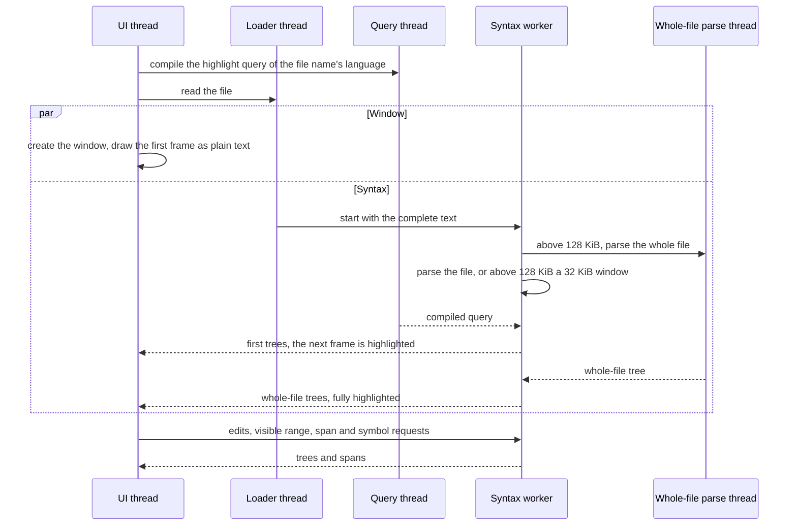

# Syntax Performance

Status: implemented in the working tree, awaiting review. Follows the
M6 Astra review fixes recorded in
[Done/SyntaxHighlighting.md](../Done/SyntaxHighlighting.md).

## Task

Make syntax highlighting instant for the files people edit, without
complicating the architecture:

- Code files up to about 4 MiB (typically 10-10,000 lines) must be instant:
  typing, scrolling and highlighting within a frame, and the whole file
  highlighted and ready for work (code-aware commands on final trees) under
  50 ms after process start where the language allows it.
- Large data files (JSON, CSV, minified code reformatted to about 8 MiB)
  must not fail; speed there is secondary.
- Measure before optimizing: the benchmark gets representative code files
  and highlight metrics.

## Scope

Included:

- Benchmarks: 50,000-line and 10,000-line code fixtures, load and
  interaction tests, `--bench-full`, highlight metrics.
- Fixes found while measuring: rows over the UI budget never highlighted
  after a window was replaced; Go to Symbol re-collected unchanged text.
- A smaller first window (32 KiB above 128 KiB, was 128 KiB above 512 KiB).
- Ideas 1-3 and 5 of the 50 ms analysis: an early syntax start from the
  loader, the highlight query compiled on its own thread, the whole-file
  parse on its own thread, and mimalloc for tree-sitter allocations.

Excluded:

- Idea 4 (a parallel parse in segments): needed for C#, Julia, PowerShell,
  long-line JSON and dense C to get under 50 ms; a separate task if wanted.
- A per-row span cache and span invalidation by changed ranges: the UI stays
  within a few milliseconds without them.
- mimalloc for Rust allocations (measured: no gain, double the memory).

Compatibility: no configuration, command or public API change. The
benchmark stays at v1 (new fixtures and tests only; L17 keeps its published
procedure, the highlighted single-line JSON is the new L22).

## Design

### Threads and data flow



- **Allocator.** `rte_syntax::install_allocator` is the first call in
  `main`: tree-sitter allocates through mimalloc (`libmimalloc-sys` 0.1.49,
  `extended` for `mi_calloc`, MIT). Rust code keeps the system heap. It is
  the one `unsafe` exception to the workspace lint.
- **Query warm-up.** `main` detects the language from the file name (or
  `--syntax`) and calls `rte_syntax::warm`, which compiles the highlight
  query on a short-lived thread unless it is compiled. `Session::new` no
  longer compiles it; `Session::view` waits for it (a `OnceLock`).
- **Early start.** The configuration is read before the loader starts. The
  loader calls a hook (`loader::OnDone`) with the complete text just before
  its `Done` event. The hook (`syntax::early_start`) detects the language
  like the editor (`syntax::detect`: file name and first 64 KiB, or the
  `--syntax` language), checks `syntax.maxFileMiB` and starts `Syntax` into
  a shared slot (`syntax::EarlySyntax`, `Settings::early_syntax`). The
  editor's first `restart_syntax` takes the slot once and adopts the thread
  only when the language is the same and `Syntax::is_for` the loaded
  snapshot (same tree, no edits sent); otherwise it drops it and starts its
  own.
- **Window.** Above `WINDOW_THRESHOLD` (128 KiB) the worker first parses a
  `WINDOW` (32 KiB) around the view; a window covering half the file or more
  is one full parse.
- **Whole-file parse thread.** With a window, `Session::start_full_parse`
  spawns a thread with its own parser and a snapshot clone; it sends the
  tree over a channel and calls the session's notifier
  (`Session::set_notify`), which posts `Msg::Parsed` to the worker. Edits
  meanwhile are recorded and applied to the tree when it arrives
  (`Session::take_full_tree`). While only that parse runs, `work` returns
  `Work::Waiting` and the worker blocks on its channel like `Idle`.
- **Stopping.** `FullParse` sets a stop flag when dropped (the parse thread
  checks it in its progress callback). `Syntax` sends `Msg::Stop` when
  dropped, because the worker now holds a sender to itself (the notifier)
  and would not see its channel close.

### Failure behavior

- Query compile error: the first view is not posted; the worker replies
  `Failed` and highlighting turns off with a notice (as before).
- Whole-file parse thread cannot start or exits without a tree: the channel
  disconnects, `take_full_tree` sets `no_window` and the worker parses the
  whole file itself (cancellable).
- Early start does not match (different language, `--syntax` unknown id,
  file over the limit, edits before adoption): the editor starts its own
  thread; the dropped one stops on `Msg::Stop`.
- A reply sent before the window exists wakes nothing; the editor drains
  replies on its first events.

### Persistence

Not applicable: nothing is stored.

## Alternatives

| Alternative                                    | Result                                                                                        |
| ---------------------------------------------- | --------------------------------------------------------------------------------------------- |
| Parallel segment parse (idea 4)                | Would bring all 24 languages under 50 ms; adds a split heuristic and segment trees. Deferred. |
| mimalloc for all allocations                   | No gain for Rust code, peak memory about doubled (empty file 5.1 to 9.4 MiB). Rejected.       |
| Bump allocator                                 | Upper bound only (0-28% faster parses), never frees. Used for measurement.                    |
| `-march=x86-64-v3` for the grammar C code      | Crashed (`0xC0000005`) under MinGW GCC (AVX stack alignment). Rejected.                       |
| Precompiled queries                            | tree-sitter has no query serialization. Not possible.                                         |
| Span cache on disk                             | Does not help a first open, adds I/O. Rejected.                                               |
| Per-row span cache, changed-range invalidation | UI already within a few ms; more state. Dropped.                                              |
| Resumable full parse on the worker (before)    | Paused for every UI message and ran after the window. Replaced by its own thread.             |
| Start syntax in `Editor::new` (before)         | Started after the window and font (about 10.5 ms). Replaced by the loader hook (about 7 ms).  |

## Runtime Effects

- **Startup:** unchanged first paint (21.6-21.8 ms) and empty-file memory
  (5.1 MiB). The query thread starts only with highlighting on and a known
  language; the loader hook adds a `Syntax::start` (a thread spawn) before
  `Done`.
- **Threads:** per opened code file, one short-lived query thread (once per
  grammar per process) and, above 128 KiB, one whole-file parse thread per
  full parse. Both end when done or stopped.
- **CPU:** the same parse work, now overlapped; window plus full parse of
  a file above 128 KiB run at once on two cores.
- **Memory (design choice):** more memory is accepted for performance:
  2-3 MiB more peak for small and 10,000-line files (threads, mimalloc
  pages); editing an 8 MiB file while it is still parsed peaks 13-20 MiB
  higher (C05, M05), because the whole-file parse no longer pauses for the
  edits. 8 MiB files peak about 24 MiB lower. Executable +286 KiB.
- **Cancellation:** UI messages still cancel worker parses; the whole-file
  thread stops on drop of its `FullParse`; the worker stops on `Msg::Stop`.
- **Disabled path:** `--syntax none/off` or the toggle off: no early slot,
  no warm-up thread, no syntax threads. Plain text: the hook detects no
  language and starts nothing. The allocator is installed regardless (it
  only affects tree-sitter). `--syntax none` restores the memory footprint
  of 0.3.0: a 64 KiB JSON file (L06) peaks at 5.7 MiB instead of 10.7 MiB
  (0.3.0: 5.6 MiB; medians of 8 launches).

## Tests

Unit and integration (all passing):

| Test                                                                      | Covers                                             |
| ------------------------------------------------------------------------- | -------------------------------------------------- |
| `rte_app` `long_rows_are_fully_highlighted_after_the_window`              | Rows over the budget re-requested after a new view |
| `rte_app` `change_language_mode_and_code_commands`                        | Go to Symbol reuses the list of unchanged text     |
| `rte_app` `paced_runs_wait_for_the_last_highlighted_frame`                | Benchmark driver waits for the last highlight      |
| `rte_app` `the_done_hook_sees_the_complete_text_before_the_event`         | Loader hook order and text                         |
| `rte_app` `the_loader_hook_starts_syntax_for_code_within_the_limit`       | Early start: code, plain text, size limit          |
| `rte_app` `an_early_syntax_thread_is_adopted_when_it_matches`             | Adoption on match, own thread otherwise            |
| `rte_syntax` `the_whole_file_parses_on_its_own_thread`                    | Background parse, edit meanwhile, notification     |
| `rte_syntax` `windows_are_bounded_and_whole_file_windows_are_full_parses` | Input resized for the 32 KiB window                |

Benchmarks (`cargo xtask bench-perf`, v1): L20-L25 and K01-K10 below, plus
the existing L01, L04, L09, E01, C05, M05-M08, S02 as regression checks.
The allocator has no unit test: it is process-wide and must be installed
before any tree-sitter use, which the shared test process cannot guarantee;
every benchmark run exercises it.

Manual: not run (no UI behavior change beyond timing).

## Implementation Steps

1. Benchmarks: `--bench-full`, highlight metrics, fixtures and tests
   (L20-L25, K01-K10), paced last-step wait.
2. Fix the stuck highlight after a window is replaced (`requested` reset on
   a new view); reuse Go to Symbol lists of unchanged text.
3. `WINDOW` 32 KiB, `WINDOW_THRESHOLD` 128 KiB.
4. Query warm-up thread; `Session` without a compiled query.
5. Whole-file parse thread, `Work::Waiting`, `Msg::Parsed`, `Msg::Stop`,
   fallback.
6. Loader hook, `syntax::early_start`, `syntax::detect`, adoption in the
   editor; configuration read before the loader.
7. `rte_syntax::install_allocator` with `libmimalloc-sys`.
8. Documentation: Developer Guide (diagram, memory allocation),
   `Performance.md`, `Plan/Architecture.md`, changelog.

## Acceptance Criteria

- Python and TypeScript 10,000-line files fully highlighted under 50 ms
  from process start (L23, L25). Met: 42.6 and 35.7 ms.
- No regression of first paint, empty-file memory, typing (E01), scrolling
  (S02) or multi-cursor editing (M05-M08) beyond noise. Met; memory
  increases are recorded above as a design choice.
- Single-line 8 MiB JSON reaches the full highlight (L22). Met: 689 ms.
- All benchmark caps pass; focused tests, clippy and formatting clean. Met.
- Not met (out of scope, idea 4): C# 10,000 lines (projected 69 ms), Julia
  (60), PowerShell (148), long-line JSON (91), dense C (70.3 measured).

## Measurements

All in release builds on the reference machine (AMD64 Family 26, 32
threads, Windows 11), ms from process start unless stated.

### Fixtures added to benchmark v1

| File      | Bytes     | XXH3-64              | Content                                    |
| --------- | --------- | -------------------- | ------------------------------------------ |
| `code.py` | 1,693,627 | `0x5ebabdd1ff1a5b60` | Python block, repeated to 50,000 lines     |
| `code.c`  | 2,353,242 | `0xc89d830565836307` | C block, repeated to 50,000 lines          |
| `10k.py`  | 337,182   | `0x8e415b15e8bd4e98` | Python block, repeated to 10,000 lines     |
| `10k.c`   | 464,767   | `0x057e008afce340c3` | C block, repeated to 10,000 lines          |
| `10k.ts`  | 283,728   | `0xa69187b2ee0c321f` | TypeScript block, repeated to 10,000 lines |

### 50,000-line files (before ideas 1-3 and 5)

| Case                                 | Result                                          |
| ------------------------------------ | ----------------------------------------------- |
| Open 50,000 lines (Python, C)        | First paint 23 ms; full highlight 226 / 370 ms  |
| Typing, key to frame (K01, K03)      | p95 5.2 / 2.4 ms                                |
| Typing, key to highlighted (K01)     | p95 6.4 ms                                      |
| Scroll and jump (K04)                | p95 2.6 ms, no missed refresh                   |
| Single-line JSON, 8 MiB (L22)        | Full highlight 830 ms, peak 439 MiB             |
| Go to Symbol, 50,000 lines (K05)     | 86 ms (collection on the syntax thread: 77 ms)  |

Tree-sitter's incremental reparse after an edit (plain tree-sitter, same
numbers outside the editor):

| File   | 2,000 lines | 10,000 lines | 50,000 lines |
| ------ | ----------- | ------------ | ------------ |
| Python | 0.1-3 ms    | 0.3-15 ms    | 1.5-92 ms    |
| C      | 1.2 ms      | 6-9 ms       | 41-51 ms     |

Python is fast except edits that reshape the tree (an unclosed quote, some
`Enter`/`Backspace` pairs); C costs about 1 µs per top-level item on every
edit. Symbol collection walks the whole tree (about 70 ns per node).

### First window (step 3)

Load, 10 processes each (medians):

| Test                     | First frame | Highlighted, before | Highlighted, after | Fully highlighted |
| ------------------------ | ----------- | ------------------- | ------------------ | ----------------- |
| Python, 10,000 lines     | 32.9        | 61.1                | 34.5               | 55.4              |
| C, 10,000 lines          | 32.7        | 88.8                | 35.5               | 82.5              |
| TypeScript, 10,000 lines | 28.1        | 48.5                | 29.1               | 51.4              |

Editing a fully highlighted 10,000-line file (paced, p95 in ms):

| Test                          | Key to frame | Key to highlighted |
| ----------------------------- | ------------ | ------------------ |
| Type, Python (K06)            | 4.8          | 6.3                |
| Type, C (K07)                 | 4.5          | 10.1               |
| Type, TypeScript (K08)        | 4.9          | 6.2                |
| Enter, Backspace, TS (K09)    | 5.3          | 6.3                |
| Go to Symbol, Python (K10)    | 18.1 median  | -                  |

### Where the time went (before ideas 1-3 and 5)

Timeline from temporary trace marks:

| Stage                         | `10k.py` (337 KiB) | `10k.c` (454 KiB) | `10k.ts` (277 KiB) |
| ----------------------------- | ------------------ | ----------------- | ------------------ |
| `main` entered                | 6.1                | 6.2               | 6.2                |
| File read (loader thread)     | 6.6                | 7.0               | 6.8                |
| Syntax thread starts          | 10.0               | 10.2              | 10.6               |
| Highlight query compiled      | 13.6               | 12.6              | 22.4               |
| View window parsed            | 17.4               | 17.4              | 25.4               |
| Whole file parsed             | 55.0               | 84.2              | 53.2               |
| Fully highlighted frame       | 56.7               | 85.5              | 54.9               |

### Per language (synthetic 10,000-line files)

Query: cold compile of the highlight query. Parse: a fresh full parse, the
file split at block boundaries into 1, 4 or 8 parts parsed on that many
threads. Now: `10.5 + query + 4 + parse + 1.5`. A (ideas 1-3):
`7 + max(query, parse) + 1.5`. B: A with a 4-thread parse (idea 4). Bold:
50 ms or more.

| Language   | KiB | Query | Parse, 1 thread | Parse, 4 threads | Parse, 8 threads | Now     | A       | B  |
| ---------- | --- | ----- | --------------- | ---------------- | ---------------- | ------- | ------- | -- |
| Bash       | 184 | 3.6   | 26.8            | 7.8              | 5.3              | 46      | 35      | 16 |
| C          | 267 | 2.3   | 37.5            | 10.9             | 6.7              | **56**  | 46      | 19 |
| C++        | 194 | 16.4  | 32.0            | 9.0              | 5.4              | **64**  | 40      | 25 |
| C#         | 290 | 20.4  | 60.1            | 17.6             | 11.0             | **96**  | **69**  | 29 |
| CSS        | 264 | 0.3   | 29.1            | 8.3              | 5.2              | 45      | 38      | 17 |
| Go         | 169 | 1.1   | 15.8            | 5.0              | 3.4              | 33      | 24      | 14 |
| HTML       | 277 | 0.1   | 23.5            | 6.9              | 4.6              | 40      | 32      | 15 |
| Java       | 208 | 3.2   | 13.2            | 4.2              | 3.0              | 32      | 22      | 13 |
| JavaScript | 289 | 5.3   | 28.5            | 9.1              | 6.4              | **50**  | 37      | 18 |
| JSON       | 754 | 0.1   | 82.4            | 21.9             | 13.9             | **98**  | **91**  | 30 |
| Julia      | 218 | 40.8  | 51.5            | 13.3             | 8.8              | **108** | **60**  | 49 |
| Lua        | 211 | 1.0   | 18.1            | 4.9              | 3.5              | 35      | 27      | 13 |
| Markdown   | 128 | 0.7   | 22.2            | 5.9              | 3.7              | 39      | 31      | 14 |
| MATLAB     | 178 | 26.3  | 25.1            | 7.0              | 5.0              | **67**  | 35      | 35 |
| Octave     | 188 | 26.3  | 19.4            | 5.4              | 3.6              | **62**  | 35      | 35 |
| PowerShell | 326 | 1.8   | 139.9           | 35.5             | 17.7             | **158** | **148** | 44 |
| Python     | 244 | 3.4   | 20.3            | 5.8              | 3.3              | 40      | 29      | 14 |
| Rust       | 181 | 9.9   | 14.7            | 4.2              | 2.5              | 41      | 23      | 18 |
| SQL        | 286 | 9.8   | 30.9            | 8.2              | 4.2              | **57**  | 39      | 18 |
| TOML       | 154 | 0.1   | 9.4             | 2.9              | 1.9              | 26      | 18      | 11 |
| TSX        | 272 | 12.2  | 21.6            | 6.1              | 3.5              | **50**  | 30      | 21 |
| TypeScript | 266 | 10.9  | 20.5            | 6.3              | 3.2              | 47      | 29      | 19 |
| XML        | 250 | 0.3   | 24.7            | 7.7              | 4.0              | 41      | 33      | 16 |
| YAML       | 134 | 2.8   | 10.4            | 2.9              | 1.7              | 29      | 19      | 11 |

Parse time follows bytes more than lines (about 3-12 MB/s; PowerShell 2.3
MB/s). 10,000 lines of one-value-per-line JSON are about 250 KiB (about
27 ms). A bump allocator (upper bound) made parses 0-28% faster (JSON 82
to 59 ms, C# 60 to 47 ms, PowerShell 140 to 129 ms, most others 5-10%).

### Allocator variants (before ideas 1-3)

Means of two runs (system heap, "all"), one run ("tree-sitter"). Bold:
worse.

| Test                         | Measure                     | System heap | mimalloc, all | mimalloc, tree-sitter |
| ---------------------------- | --------------------------- | ----------- | ------------- | --------------------- |
| L01 Empty file               | First paint [ms]            | 21.7        | 21.9          | 21.9                  |
| L01 Empty file               | Peak private [MiB]          | 5.1         | **9.4**       | 5.1                   |
| L09 Python, 8 MiB            | Fully highlighted [ms]      | 911.6       | 789.7         | 803.0                 |
| L09 Python, 8 MiB            | Peak private [MiB]          | 417.5       | 407.9         | 390.6                 |
| L20 Python, 50,000 lines     | Fully highlighted [ms]      | 209.0       | 176.9         | 185.3                 |
| L21 C, 50,000 lines          | Fully highlighted [ms]      | 344.2       | 318.6         | 316.2                 |
| L22 1-line JSON, 8 MiB       | Fully highlighted [ms]      | 834.5       | 701.1         | 700.5                 |
| L22 1-line JSON, 8 MiB       | Peak private [MiB]          | 439.3       | 453.0         | 413.9                 |
| L23 Python, 10,000 lines     | Fully highlighted [ms]      | 56.7        | 50.7          | 51.1                  |
| L23 Python, 10,000 lines     | Peak private [MiB]          | 24.1        | **45.4**      | 24.8                  |
| L24 C, 10,000 lines          | Fully highlighted [ms]      | 84.4        | 79.9          | 79.4                  |
| L24 C, 10,000 lines          | Peak private [MiB]          | 21.8        | **39.8**      | 22.5                  |
| L25 TypeScript, 10,000 lines | Fully highlighted [ms]      | 53.0        | 48.3          | 47.8                  |
| L25 TypeScript, 10,000 lines | Peak private [MiB]          | 19.1        | **40.9**      | 19.6                  |
| K03 Type, C 50k lines        | Key to highlighted p95 [ms] | 48.0        | 42.1          | 40.3                  |
| K07 Type, C 10k lines        | Key to highlighted p95 [ms] | 10.0        | 8.7           | 8.5                   |
| K05 Go to Symbol, 50k lines  | Key to frame [ms]           | 85.6        | 64.0          | 66.2                  |
| K10 Go to Symbol, 10k lines  | Key to frame [ms]           | 18.1        | 13.9          | 14.4                  |
| C05 Paste 1 MiB              | Key to frame [ms]           | 2.35        | 3.01          | 2.33                  |
| C05 Paste 1 MiB              | Peak private [MiB]          | 38.0        | **65.7**      | 35.9                  |
| M05 Type at 10,000 carets    | Key to frame [ms]           | 4.00        | 4.39          | 4.47                  |
| M05 Type at 10,000 carets    | Peak private [MiB]          | 119.9       | **168.4**     | 118.9                 |
| M06 Backspace, 10,000 carets | Key to frame [ms]           | 4.32        | 4.86          | 4.73                  |
| M07 Paste 10,000 pieces      | Key to frame [ms]           | 5.41        | 5.25          | 5.21                  |
| M07 Paste 10,000 pieces      | Peak private [MiB]          | 69.1        | **127.2**     | 76.2                  |
| M08 Undo and redo, 10,000    | Key to frame [ms]           | 0.72        | 0.70          | 0.73                  |
| M08 Undo and redo, 10,000    | Peak private [MiB]          | 45.1        | **102.0**     | 48.7                  |

`MIMALLOC_ARENA_EAGER_COMMIT=0` and `MIMALLOC_PURGE_DELAY=0` did not lower
the "all" variant's memory.

### Ideas 1-3, then ideas 1-3 and 5

Means of two runs each. Bold: under 50 ms.

| Test                         | Measure                     | Before | Ideas 1-3 | Ideas 1-3 and 5 |
| ---------------------------- | --------------------------- | ------ | --------- | --------------- |
| L01 Empty file               | First paint [ms]            | 21.7   | 21.6      | 21.8            |
| L01 Empty file               | Peak private [MiB]          | 5.1    | 5.1       | 5.1             |
| L23 Python, 10,000 lines     | Fully highlighted [ms]      | 56.7   | **47.0**  | **42.6**        |
| L24 C, 10,000 lines          | Fully highlighted [ms]      | 84.4   | 74.5      | 70.3            |
| L25 TypeScript, 10,000 lines | Fully highlighted [ms]      | 53.0   | **35.3**  | **35.7**        |
| L20 Python, 50,000 lines     | Fully highlighted [ms]      | 209.0  | 198.0     | 176.4           |
| L21 C, 50,000 lines          | Fully highlighted [ms]      | 344.2  | 337.7     | 312.9           |
| L09 Python, 8 MiB            | Fully highlighted [ms]      | 911.6  | 925.1     | 817.3           |
| L22 1-line JSON, 8 MiB       | Fully highlighted [ms]      | 834.5  | 825.9     | 688.7           |
| L04 Python, 64 KiB           | Peak private [MiB]          | 9.1    | 9.2       | 11.5            |
| L23 Python, 10,000 lines     | Peak private [MiB]          | 24.1   | 24.7      | 26.7            |
| L25 TypeScript, 10,000 lines | Peak private [MiB]          | 19.1   | 19.5      | 22.1            |
| L09 Python, 8 MiB            | Peak private [MiB]          | 417.5  | 417.9     | 393.2           |
| L22 1-line JSON, 8 MiB       | Peak private [MiB]          | 439.3  | 439.6     | 415.9           |
| C05 Paste 1 MiB              | Peak private [MiB]          | 38.0   | 51.3      | 52.6            |
| M05 Type at 10,000 carets    | Peak private [MiB]          | 119.9  | 139.8     | 144.8           |
| M08 Undo and redo, 10,000    | Peak private [MiB]          | 45.1   | 48.8      | 52.0            |
| E01 Type, Python 8 MiB       | Key to frame [ms]           | 0.45   | 0.44      | 0.45            |
| M05 Type at 10,000 carets    | Key to frame [ms]           | 4.00   | 4.29      | 4.30            |
| K03 Type, C 50k lines        | Key to highlighted p95 [ms] | 48.0   | 49.8      | 41.3            |
| K07 Type, C 10k lines        | Key to highlighted p95 [ms] | 10.0   | 9.9       | 8.9             |
| K05 Go to Symbol, 50k lines  | Key to frame [ms]           | 85.6   | 87.3      | 65.8            |
| K10 Go to Symbol, 10k lines  | Key to frame [ms]           | 18.1   | 18.2      | 13.6            |
| S02 Scroll, MD 8 MiB         | p95 [ms]                    | 0.89   | 0.94      | 1.36            |

Findings:

- Ideas 1-3 remove fixed startup latency (10-18 ms on 10,000-line files);
  the allocator speeds the parse itself (10-17% on 8 MiB files, Go to
  Symbol 25%). The model `7 + max(query, parse) + 1.5` predicted the ideas
  1-3 results within 1-2 ms.
- TypeScript is bound by the first frame (about 34 ms), not by parsing.
- Dense C (454 KiB) stays at 70.3 ms, bound by its parse.
- Executable 32,116,224 to 32,409,088 bytes.

## Review Notes

Points worth a reviewer's attention:

- `syntax::early_start` runs on the loader thread before `Done`;
  `Syntax::start` there is a thread spawn. Adoption is decided once, in the
  editor's first `restart_syntax`.
- `Syntax` holds a `Sender` to its own worker through the notifier, so
  `Drop` sends `Msg::Stop`; a worker that never receives it would leak.
- `Session::view` blocks on the query `OnceLock` while the warm-up thread
  compiles (by design: the first view needs the query).
- `take_full_tree` falls back to a worker-side full parse when the parse
  thread's channel disconnects without a tree.
- The memory increases in C05 and M05 are attributed to the overlap of the
  whole-file parse with the edits, not verified with a heap profile.
- The S02 p95 of the last column (1.36 ms) comes from one noisy run
  (0.91-1.68 ms across runs); still far within a frame.

## Reviewers

### 2026_10_24 - Claude Opus 5.5

- Role: Reviewer
- Activity: Design
- Agent: GitHub Copilot
- Model: Claude Opus 5.5
- Effort: High
- Context Window: 872K
- Outcome: Design drafted with the user from measurements: target code files
  up to about 4 MiB instant, large files must not fail, no added
  architecture. Ideas 1-3 and 5 approved by the user; idea 4 deferred; a
  per-row span cache dropped; mimalloc for Rust rejected on memory.

## Implementer

### 2026_10_24 - Claude Opus 5.5

- Role: Implementer
- Activity: Implementation
- Agent: GitHub Copilot
- Model: Claude Opus 5.5
- Effort: High
- Context Window: 872K
- Outcome: Implemented steps 1-8. Python and TypeScript 10,000-line files
  are fully highlighted in 42.6 and 35.7 ms; 8 MiB files 10-17% faster; the
  single-line JSON reaches its full highlight. Ready for review.

## Validation Results

| Check                                                                                       | Result                                                                                           |
| ------------------------------------------------------------------------------------------- | ------------------------------------------------------------------------------------------------ |
| `cargo test -p rte_app`                                                                     | 122 passed, 1 ignored (after the final refactor)                                                 |
| `cargo test -p rte_syntax -p rte_edit -p rte_text -p rte_view -p xtask`                     | 20, 28, 20 + 2, 28, 9 passed                                                                     |
| `cargo clippy --workspace --all-targets -- -D warnings`                                     | Clean                                                                                            |
| `cargo fmt --all`                                                                           | Applied                                                                                          |
| `bench-perf --only` L01, L04, L09, L20-L25, E01, C05, M05, M08, K01, K03, K05-K08, K10, S02 | Two runs with ideas 1-3 and 5, all caps passed                                                   |
| Developer Guide page                                                                        | Served page renders both diagrams                                                                |
| `tools/Build-Docs.ps1`                                                                      | Stopped: refuses to overwrite `docs/src/assets/editor-screenshot.png` (existing file, unrelated) |

Not run: the full test suite and the full benchmark (not requested); the
benchmarks were not repeated after the final refactor (shared language
detection and `syntax::early_start` moved out of `main`, covered by tests).

## Implementation Review

### 2026_10_24 - GPT-6 Astra

- Role: Reviewer
- Activity: Review
- Agent: GitHub Copilot
- Model: GPT-6 Astra
- Effort: Extra High
- Context Window: 1M
- Outcome: The startup and allocator gains reproduce after the final refactor.
  Changes requested for SP1-SP3; SP4-SP6 are measured optimization opportunities,
  not additional correctness failures. No application fixes authored. This task
  remains in Plan pending the correctness and safety findings.

### SP1 [P1] Missing injection coverage authorizes the wrong edit

Location: [Editor::lang_at](../crates/rte_app/src/editor/code.rs#L100).
The edit path uses `Syntax::view` without checking whether its injected layers
cover the command positions or match the current text. A fully parsed Markdown
host with interest `0..100` returns Markdown at an offscreen Python fence.
Invoking Toggle Line Comment there writes `<!-- def hidden(): -->` instead of
`# def hidden():`, reproduced through the real editor command. Scrolling or
selecting offscreen text need not wait for layers to arrive before a command.
Resolve command languages from verified host fence/script metadata on demand,
or defer/refuse until that region is known. Do not treat a missing layer as
proof that the host language applies. Test offscreen and stale layers, edits
to fence language names, and selections crossing multiple languages.
Probe: `review_offscreen_fence_comment_uses_python`.

### SP2 [P1] The allocator wrapper does not enforce its safety contract

Location: [install_allocator](../crates/rte_syntax/src/lib.rs#L25).
The [tree-sitter 0.27.1 contract](https://docs.rs/tree-sitter/0.27.1/tree_sitter/fn.set_allocator.html#safety)
requires non-null results for non-zero allocations and initialization before
any tree-sitter use, without concurrent/repeated installation over live objects.
[mimalloc documents null on allocation failure](https://microsoft.github.io/mimalloc/group__malloc.html)
for the supplied `mi_malloc`, `mi_calloc` and `mi_realloc`; "never null on
success" in the safety comment does not satisfy that requirement. The safe
public wrapper also lets safe Rust callers reinstall after objects exist.
The current first call in `main` has correct ordering; this is not evidence of
an observed startup crash. Add allocation wrappers with the required failure
behavior, never unwinding across C, and either enforce initialization before
all exposed constructors or make the caller's safety obligation explicit.
A once guard alone does not make a late first installation safe. Validate
failure handling in a controlled child with injected null callbacks; no real
out-of-memory or undefined-behavior experiment was run in this review.

### SP3 [P2] Cancellation depends on matches being emitted

Locations: [symbols](../crates/rte_syntax/src/aware.rs#L201),
[captures](../crates/rte_syntax/src/highlight.rs#L153), and
[paint_ranges](../crates/rte_syntax/src/session.rs#L831).
Symbols checks `stop` only every 256 emitted matches, with no query progress
callback. An already-canceled query over 100,000 Python `pass` lines runs for
24.6 ms, polls zero times and returns success. A small JSON paint likewise
returns `complete=true` despite `stop` already being true. Check before work,
between ranges/layers and before returning completion; give symbol queries a
progress callback so a no-match scan can stop. Keep cancellation separate from
an exact empty result. Tests: `review_symbols_cancel_without_waiting_for_matches`
and `review_canceled_small_paint_does_not_report_complete`. The first exploratory
fixture used assignments and did poll; the no-match fixture distinguishes the bug.

### SP4 Optimization: Adopt a ready full tree before another window parse

Location: [Session::work](../crates/rte_syntax/src/session.rs#L226).
`work` prioritizes `parse_host` when scrolling invalidates the window, before
checking whether the full tree is already waiting. With a completed C tree
queued, moving interest to the middle spends another 6.46 ms parsing a window
and still reports incomplete; the full tree is adopted later. Poll the ready
full result first and preserve the existing edit reconciliation. A ready tree
also avoids generating a short-lived window/view. Probe:
`review_completed_full_tree_preempts_new_window` fails an optimization assertion,
not a search or editing correctness assertion.

### SP5 Optimization: Control which thread releases the last tree owner

Locations: [Syntax::poll](../crates/rte_app/src/syntax.rs#L303) and
[restart_syntax](../crates/rte_app/src/editor.rs#L427).
Replacing/dropping a UI view can release the final reference to an old tree.
With the adopted tree-sitter-only mimalloc, isolated last-view destruction takes
4.80 / 28.96 / 56.97 ms for 10,000 / 50,000 / 100,000 Python lines
(0.22 / 1.1 / 2.2 MB). Parsing, fixture allocation and dropping the session are
outside these timings. This does not establish that every edit pays that cost:
shared unchanged subtrees reduce it, and final ownership depends on scheduling.
Retire old views through the existing worker where possible, with a bounded
queue and shutdown draining; include destruction in frame-latency and memory
tests. Do not merely defer frees indefinitely. Probe:
`review_profile_last_view_drop` is a timing control, not a failed correctness test.

### SP6 Optimization: Make language lookup allocation-free

Location: [View::layers_at / lang_at](../crates/rte_syntax/src/session.rs#L758).
Even with no injections, every lookup creates a vector containing the host
layer. Exactly 10,000 Rust-only lookups make 10,000 allocation/reallocation
calls. Code-aware typing and multi-cursor commands call this path repeatedly.
Return the host directly when there are no injected layers; otherwise find the
smallest covering layer without collecting/sorting a vector. Reuse the same
non-allocating traversal for bracket/enclosing queries when practical. Probe:
`review_profile_language_lookup_allocations`. This establishes allocation churn,
not peak memory growth or a measured end-to-end speedup from the proposed fix.

### Other Low-Complexity Candidates

- Consume matching worker spans before repeating the UI query. `Syntax::spans`
  currently spends its UI budget before checking an available fallback result.
  Retain tree identity and range validation. This is an inspection-derived idea,
  not a measured saving.
- Reserve query warm-up once while compilation is in progress. `warm` checks
  only whether the `OnceLock` is completed, so `main` and `Session::new` can
  both spawn threads for the same pending grammar. Only one compiles; the other
  waits. Avoid the redundant spawn without adding a persistent worker.
- Keep dense C's remaining parse cost separate from UI overhead. The updated
  10k-line fixture remains at 70 ms; this review provides no evidence that
  another allocator change alone reaches 50 ms. The deferred segment parser
  and per-row cache remain outside this task.

### Fresh Measurements

After the final startup refactor, release build on the same machine:

- L23 Python 10k: first frame 32.6 ms, full highlight 42.2 ms, peak private
  26.7 MiB. L24 C 10k: 34.3 / 70.0 ms, 25.2 MiB. L25 TypeScript 10k:
  34.0 / 35.5 ms, 22.1 MiB.
- L22 single-line JSON: full highlight 695.8 ms, peak private 415.7 MiB.
- K07 C typing: frame p95 4.06 ms, highlighted p95 8.60 ms, zero keys not
  highlighted and zero reported missed refreshes.
- K10 Go to Symbol: median 13.60 ms, p95 19.92 ms.

The gains reproduce. These are local samples, not comparative-editor rankings;
the benchmark's successful caps do not cover the SP1-SP3 correctness contracts.

### Review Validation

- 170 existing focused tests passed: syntax 20, edit 28, app 122. One existing
  search profiling test skipped. Focused clippy passed.
- Three behavioral assertions fail (SP1 and both SP3 paths). Two optimization
  assertions fail (SP4, SP6). Injection-coverage and last-view-release controls
  pass their setup/result checks. SP2 is supported by source/API contracts,
  not a deliberately triggered allocator failure.
- Probes live only in ignored `target/`; no application source was edited.
  Core probes install the production allocator once before any tree-sitter use.
  Timing fixtures are prepared before measurement; allocator counters cover
  Rust allocation calls only, not native heap size. Last-tree release uses the
  production tree-sitter allocator.
- The application probe uses an in-memory console build of current source,
  changing module/include paths and test access to `editor_on` and `Syntax.view`.
  A real session supplies the incomplete injection view; the real edit command
  runs with fake file operations. No user settings or system clipboard access
  is needed by the headless probes.

Commands:

```powershell
cargo build -p rte_app --release --locked --message-format=json
cargo test -p rte_syntax -p rte_edit --locked
./target/syntax-followup-app.exe --skip syntax_followup_review --test-threads=1
./target/syntax-followup-app.exe syntax_followup_review --nocapture --test-threads=1
./target/syntax-followup-review.exe review_ --nocapture --test-threads=1
cargo clippy -p rte_syntax -p rte_app --all-targets --locked -- -D warnings
cargo xtask bench-perf --only L22,L23,L24,L25,K07,K10
```

The review-probe invocations exit 101 for the assertions described above; they
are not passing regression coverage. PowerShell verifies the original task byte
prefix, source/query fingerprints, finding IDs and local links; a no-index Git
check validates task whitespace. No full suites, package rebuild, hosted CI,
native memory-exhaustion test, forced thread-spawn failure or comparative editor
benchmark was run. Previous task history and the Pending index entry are retained.

## Review Response

### 2026_10_24 - Claude Opus 5.5

- **SP1.** `View` records `covered`, the bytes whose layers are complete
  for its text (none after an edit). Outside it, `View::lang_at` reads the
  region from the host tree (fence info string, `<script>`) at that
  position. Tests: `offscreen_fences_comment_in_their_language` (app:
  offscreen fence, selection crossing into it) and
  `the_language_outside_parsed_layers_comes_from_the_host_tree` (offscreen
  fence, then its info string renamed).
- **SP2.** `alloc.rs` wraps the mimalloc functions; a null result for a
  non-empty request aborts the process (no unwind into C).
  `install_allocator` is `unsafe` with a `# Safety` contract; `main` calls
  it first. Test: `a_failed_allocation_aborts` (child process, injected
  null).
- **SP3.** `captures` and `paint_ranges` check `stop` before work.
  `symbols` checks before work and polls through the query progress
  callback, so a scan without matches stops; a stop returns `None`, never
  an empty result. Test: `cancellation_does_not_wait_for_matches`.
- **SP4.** `Session::work` adopts a finished whole-file tree first, with
  the same edit reconciliation and disconnect fallback. Test:
  `a_finished_whole_file_tree_comes_before_a_new_window`.
- **SP5.** `Syntax::poll` and `Drop` send replaced views to the worker
  (`Msg::Retire`) without interrupting its work; the worker drops them in
  order, before `Stop`. A closed channel drops them on the sender. Test:
  `replaced_trees_are_released_by_the_syntax_thread` (no tree is kept; the
  thread placement is by construction, not asserted).
- **SP6.** `layers_at` returns an iterator (smallest covering layer, then
  the host), no vector. Covered by the existing bracket and injection tests.
- **Candidates.** `Syntax::spans` uses matching worker spans before a UI
  query; `warm` spawns at most one compile thread per grammar. The dense C
  parse is unchanged.

Measurements after the fixes (one run of
`bench-perf --only L01,L09,L20-L25,E01,C05,M05,K03,K05,K07,K10,S02`; S02
and K07 three more runs):

| Test                         | Measure                     | Ideas 1-3 and 5 | Review | After fixes |
| ---------------------------- | --------------------------- | --------------- | ------ | ----------- |
| L01 Empty file               | First paint [ms]            | 21.8            | -      | 21.8        |
| L23 Python, 10,000 lines     | Fully highlighted [ms]      | 42.6            | 42.2   | 41.3        |
| L24 C, 10,000 lines          | Fully highlighted [ms]      | 70.3            | 70.0   | 69.9        |
| L25 TypeScript, 10,000 lines | Fully highlighted [ms]      | 35.7            | 35.5   | 34.0        |
| L20 Python, 50,000 lines     | Fully highlighted [ms]      | 176.4           | -      | 169.4       |
| L21 C, 50,000 lines          | Fully highlighted [ms]      | 312.9           | -      | 312.1       |
| L09 Python, 8 MiB            | Fully highlighted [ms]      | 817.3           | -      | 814.3       |
| L22 1-line JSON, 8 MiB       | Fully highlighted [ms]      | 688.7           | 695.8  | 685.9       |
| L22 1-line JSON, 8 MiB       | Peak private [MiB]          | 415.9           | 415.7  | 415.3       |
| L23 Python, 10,000 lines     | Peak private [MiB]          | 26.7            | 26.7   | 26.6        |
| E01 Type, Python 8 MiB       | Key to frame [ms]           | 0.45            | -      | 0.46        |
| M05 Type at 10,000 carets    | Key to frame [ms]           | 4.30            | -      | 4.24        |
| K03 Type, C 50k lines        | Key to highlighted p95 [ms] | 41.3            | -      | 38.4        |
| K07 Type, C 10k lines        | Key to highlighted p95 [ms] | 8.9             | 8.6    | 8.0-9.1     |
| K05 Go to Symbol, 50k lines  | Key to frame [ms]           | 65.8            | -      | 68.0        |
| K10 Go to Symbol, 10k lines  | Key to frame [ms]           | 13.6            | 13.6   | 13.8        |
| S02 Scroll, MD 8 MiB         | p95 [ms]                    | 1.36            | -      | 1.9-4.7     |

Findings:

- The fixes change no result beyond run-to-run noise except S02. Retiring
  views moves up to 57 ms of frees per 100,000-line view off the UI thread
  (Astra's timing); the benchmarks do not exercise that case.
- S02 frame p95 is 1.9-4.7 ms (max 4.3-6.0 ms, no missed refresh) against
  0.89-1.68 ms earlier. An A/B against a build with the fixes reverted
  (below) gives the same spread, so the fixes do not cause it; the earlier
  numbers came from the build before the final refactor and other machine
  load.

A/B: a copy of the tree with SP1-SP6 and the candidates reverted (except
the symbols progress callback, which S02 and K07 do not run), built
separately; six alternating rounds of `bench-perf --only S02,K07`.
Medians, ranges in parentheses:

| Test                  | Measure                     | Fixes reverted     | Fixes             |
| --------------------- | --------------------------- | ------------------ | ----------------- |
| S02 Scroll, MD 8 MiB  | p95 [ms]                    | 4.23 (2.17-5.04)   | 4.39 (1.87-4.90)  |
| S02 Scroll, MD 8 MiB  | Max [ms]                    | 5.17 (4.89-5.31)   | 5.17 (4.70-5.51)  |
| S02 Scroll, MD 8 MiB  | Jump to highlighted [ms]    | 5.17 (5.03-5.47)   | 4.59 (4.07-4.90)  |
| K07 Type, C 10k lines | p95 [ms]                    | 4.91 (4.62-5.17)   | 4.87 (4.71-4.99)  |
| K07 Type, C 10k lines | Key to highlighted p95 [ms] | 8.71 (8.21-8.97)   | 8.30 (8.03-9.50)  |

Frame times are equal. Every run with the fixes jumps to a highlighted
frame faster than every run without them (about 0.6 ms).

### Reviewers

#### 2026_10_24 - Claude Opus 5.5

- Role: Reviewer
- Activity: Review
- Agent: GitHub Copilot
- Model: Claude Opus 5.5
- Effort: High
- Context Window: 872K
- Outcome: Accepted SP1-SP6 and the first two candidates; the dense C
  parse stays out of scope.

### Implementer

#### 2026_10_24 - Claude Opus 5.5

- Role: Implementer
- Activity: Implementation
- Agent: GitHub Copilot
- Model: Claude Opus 5.5
- Effort: High
- Context Window: 872K
- Outcome: Implemented SP1-SP6 and two candidates with seven regression
  tests; focused tests, clippy and the focused benchmark pass. An A/B
  against the reverted fixes shows equal frame times and a faster jump to
  a highlighted frame. Ready for re-review.

### Validation Results

| Check                                                      | Result                                     |
| ---------------------------------------------------------- | ------------------------------------------ |
| `cargo test -p rte_app -p rte_syntax -p rte_edit -p xtask` | 124 passed and 1 ignored, 24, 28, 9 passed |
| `cargo clippy --workspace --all-targets -- -D warnings`    | Clean                                      |
| `cargo fmt --all --check`                                  | Clean                                      |
| `bench-perf --only`, the 16 tests above                    | Exit 0, all caps passed                    |
| `bench-perf --only S02,K07`, 3 runs                        | Exit 0, S02 p95 1.9-4.7 ms                 |
| `bench-perf --only S02`, 9 runs, one change disabled each  | Exit 0, S02 p95 1.9-4.6 ms                 |
| A/B `bench-perf --only S02,K07`, 6 alternating rounds      | Exit 0, table above                        |

Not run: the full test suite, the full benchmark, a frozen or packaged
build, and a real out-of-memory test (the abort path is tested with an
injected null).

## Sol Implementation Review

### 2026_10_24 - GPT-6.1 Sol

- Role: Reviewer
- Activity: Review
- Agent: GitHub Copilot
- Model: GPT-6.1 Sol
- Effort: High
- Context Window: 1M
- Outcome: Changes requested for M6S1-M6S4 after reviewing the current M6
  implementation and SP1-SP6 responses. Existing focused tests and clippy
  pass; four isolated behavioral assertions fail across three correctness
  issues. Timing and memory controls establish the costs below. No
  application fixes authored; this task remains Pending.

### M6S1 [P1] Disabling syntax during loading retains an early worker

[restart_syntax](../crates/rte_app/src/editor.rs#L427) returns for disabled
highlighting or Plain Text before taking `settings.early_syntax`. The
[loader hook](../crates/rte_app/src/syntax.rs#L46) still starts and stores its
worker using startup settings. Replaying Progress, Toggle Syntax, the hook
and Done leaves `editor.syntax` empty but the editor still owns a populated
early slot. The worker parses and retains its trees until that slot is
eventually adopted or dropped. This violates the disabled/no-background-work
contract, not just a peak-memory preference.

In a separate controlled 1,048,572-byte Python fixture, that hidden worker
finishes a full parse while highlighting is off. Process-private memory rises
by 69.7-70.7 MiB after completion. This is a current process-memory delta,
including query/thread state, not peak heap or a general bytes-to-tree ratio.
Detach/cancel unused early state before disabled/plain-text returns and make
late loader publication respect that cancellation. Test toggling off and
choosing Plain Text both before and after the hook publishes.

### M6S2 [P1] Approximate host coordinates choose the wrong comment tokens

[Syntax::sync](../crates/rte_app/src/syntax.rs#L267) deliberately applies only
near-visible edits to the UI trees, but
[Editor::lang_at](../crates/rte_app/src/editor/code.rs#L100) consults them at
every command position. SP1's host-region fallback fixes missing layers only
when host coordinates are valid there. After a two-caret insertion of 100
spaces into distant JavaScript blocks, the offscreen host tree has omitted
the second insertion. The real Toggle Line Comment command writes
`<!-- let z = 1; -->` instead of `// let z = 1;`.

Track the view's position authority, reconcile the requested region against
all intervening edits and valid structure, or defer the command until its
language is known. An edited view must not silently authorize commands beyond
its exact range. Add regression coverage for immediate mixed/offscreen
multi-cursor commands before the worker posts a current tree; the existing
offscreen test starts with an exact host and does not cover this case.

### M6S3 [P2] Line comments still scan trailing spaces byte by byte

[trimmed_end](../crates/rte_edit/src/code.rs#L150) performs an unbounded
`chunk_at` lookup per trailing byte on the UI. Toggle Line Comment in HTML
over `x` followed by 4 MiB of spaces takes release medians of 28.4-36.6 ms
across two runs for command construction alone, despite returning only two
tiny insertions. 4 KiB and 256 KiB controls take 0.003-0.004 and 0.92-0.95 ms.
Snapshot construction, application, parsing and rendering are outside these
timings.

Walk borrowed chunks backwards, as the block-comment edge path already does,
rather than looking up every byte in the piece tree. Preserve delimiter
placement; bound, cancel or defer truly large scans rather than silently
changing the trim result. Cover block-only comment languages, long trailing
whitespace, and wrapping/unwrapping. This is a measured runtime finding, not
a flaky wall-clock regression assertion.

### M6S4 [P2] Truncated predicate text is treated as the whole token

[captures](../crates/rte_syntax/src/highlight.rs#L184) supplies only the first
1,024 bytes to all text predicates. In C, an identifier of 1,024 uppercase
`A`s followed by lowercase `a` incorrectly satisfies
`^[A-Z][A-Z\d_]*$` and is painted as a constant, including in a two-byte
viewport range. Short `AA` and `AAa` controls behave correctly. The painter
reports completion, so this is not merely provisional coloring.

Keep the bounded UI materialization, but do not assert whole-token predicate
results from a prefix. Suppress/defer predicates that require the missing
suffix or evaluate them exactly through a bounded worker path. Cover anchored
matches and equality/negative predicates around the cutoff.

### Controls and Priorities

- Fix early-worker ownership and command-language authority first; both affect
  observable behavior, and the first wastes substantial memory while off.
- UI `View::edit` medians are below 0.001 ms for 1,000/10,000/50,000 C items
  in the tested one-character edit. This probe does not support treating
  reduced tree-edit bookkeeping as the current bottleneck.
- Building the symbol palette's labels, hints and rows takes 0.15-0.18 ms
  at 1,000 symbols, 1.6-2.2 ms at 10,000, and 3.3-4.3 ms at the 20,000 cap.
  These exclude symbol querying and rendering, and are not end-to-end Go to
  Symbol timings. Do not attribute the existing 68 ms K05 result entirely
  to palette materialization.
- No new segmented parser, per-row cache or allocator replacement is proposed.
  This review does not rerun or independently certify the startup tables.

### Review Validation

- 52 core tests passed: syntax 24, editing 28. The selected app filters cover
  14 distinct passing tests (18 executions, with overlaps). Focused clippy
  passed, and editor diagnostics report no errors in the reviewed modules.
- Core probes: two assertions fail (M6S2 lower-level reproduction and M6S4);
  two scaling controls pass. App probes: two assertions fail (M6S1 and the
  real M6S2 command); memory and palette-materialization controls pass.
  Exit 101 is expected for those review reproductions, not passing coverage.
- Disposable probes are under ignored `target/`. Release probes use opt-level
  3, fat LTO, one codegen unit, x86-64-v3 and self-contained GNU linking,
  with exact dependency artifacts selected from Cargo JSON. The core and
  app harnesses install the production tree-sitter allocator before use.
- The headless app compiles current sources in memory, changing only module
  and include paths, the Windows subsystem attribute, and test visibility
  for `editor_on` and `Syntax.view`. Real command/load paths run against fake
  files; no user settings, clipboard or installed-app inspection is needed.

Commands run:

```powershell
cargo test -p rte_syntax -p rte_edit --locked
foreach ($filter in @('syntax', 'code_', 'offscreen_fences', 'early_', 'replaced_trees')) {
    cargo test -p rte_app $filter --locked | Out-String
}
cargo build -p rte_syntax --release --locked --message-format=json
cargo build -p rte_app --release --locked --message-format=json
./target/sol-m6-review.exe review_ --nocapture --test-threads=1
./target/sol-m6-app-review.ps1
cargo clippy -p rte_syntax -p rte_edit -p rte_app --all-targets --locked -- -D warnings
```

Task-history byte prefixes, application/query fingerprints and appended local
links are checked after the review append. No full test or performance suite,
native startup benchmark, package build, hosted CI, memory-exhaustion test or
production fix was performed. Previous reviewer records, task locations and
the Pending index entry are preserved.

## Sol Review Response

### 2026_10_24 - Claude Opus 5.5

- **M6S1.** The early slot (`syntax::Early`) has a `closed` flag.
  `restart_syntax` closes it first, before the disabled and Plain Text
  returns, and drops a started thread (its `Drop` stops it). The loader
  hook starts and stores a thread only into an open slot, under the lock.
  Test: `an_early_syntax_thread_does_not_outlive_highlighting_off`
  (highlighting off and Plain Text, each before and after the hook).
- **M6S2.** Simple variant, chosen by the user: `Syntax` records the last
  text whose edits reached the UI trees only near the visible rows
  (`rte_syntax::changes_near`); `Syntax::exact` is false until a parse of
  that text arrives. In Markdown and HTML, while not exact, Toggle Line and
  Block Comment show "Embedded languages are still being parsed; try
  again" and change nothing; auto-close, delete pair and Enter indentation
  act as in plain text. No waiting. Single-caret edits stay exact. Test:
  `far_edits_defer_comments_until_the_next_parse` (two carets 2,000
  paragraphs apart; fails without the check, writing the wrong tokens).
- **M6S3.** `trimmed_end` walks borrowed chunks backwards (as the block
  comment edge path does); same result, spaces and tabs only. Test:
  `line_comments_close_before_long_trailing_whitespace` (600,000 bytes of
  spaces and tabs, block-only tokens, wrap and unwrap).
- **M6S4.** `predicate_text` (highlights and tags) ends a token longer than
  1,024 bytes with a NUL after the prefix, so whole-token predicates (`$`,
  `#eq?`, `#any-of?`) fail and the token keeps its plain style. The queries
  have no `#not-match?` and no capture-to-capture `#eq?`; the one `#not-eq?`
  (`"constructor"` in the JavaScript/TypeScript tags) stays true for long
  names, which is correct. Test:
  `predicates_do_not_judge_a_long_token_by_its_prefix` (C constants at and
  past the cut, JavaScript methods named `constructor…`).

Measurements after the fixes, one run of
`bench-perf --only L23,L24,L25,E01,M05,K07,S02`: L23/L24/L25 fully
highlighted 41.2/70.5/34.4 ms, E01 0.45 ms, M05 4.13 ms, K07 highlighted
p95 8.87 ms, S02 p95 1.03 ms. All within the earlier ranges.

### Reviewers

#### 2026_10_24 - Claude Opus 5.5

- Role: Reviewer
- Activity: Review
- Agent: GitHub Copilot
- Model: Claude Opus 5.5
- Effort: High
- Context Window: 872K
- Outcome: Accepted M6S1-M6S4; M6S2 with the simple variant (notice, no
  wait) chosen by the user.

### Implementer

#### 2026_10_24 - Claude Opus 5.5

- Role: Implementer
- Activity: Implementation
- Agent: GitHub Copilot
- Model: Claude Opus 5.5
- Effort: High
- Context Window: 872K
- Outcome: Fixed M6S1-M6S4 with four regression tests; focused tests,
  clippy and the focused benchmark pass. Ready for re-review.

### Validation Results

| Check                                                      | Result                                     |
| ---------------------------------------------------------- | ------------------------------------------ |
| `cargo test -p rte_app -p rte_syntax -p rte_edit -p xtask` | 126 passed and 1 ignored, 25, 29, 9 passed |
| `cargo clippy --workspace --all-targets -- -D warnings`    | Clean                                      |
| `cargo fmt --all`                                          | Applied                                    |
| M6S2 test with the check disabled                          | Fails: the wrong tokens are written        |
| `bench-perf --only L23,L24,L25,E01,M05,K07,S02`            | Exit 0, all caps passed                    |

Not run: the full test suite, the full benchmark, a packaged build. The
M6S3 release timing at 4 MiB was not repeated; the test covers the result.

## Completion

Marked done by the user on 2026_10_24 after the Astra and Sol review
fixes.

| Check                    | Result                                                                    |
| ------------------------ | ------------------------------------------------------------------------- |
| `cargo test --workspace` | 282 passed, 3 ignored                                                     |
| `cargo xtask bench-perf` | Exit 0, 54.9 s (cap 60 s); results in [Performance.md](../Performance.md) |
| `cargo xtask bench-perf` | Earlier run: M03 2.14 s over its 1 s cap after a build (spurious)         |

Passed per crate: app 126, edit 29, platform 4, render 8, search 31,
syntax 25, text 20 + 2, view 28, xtask 9. Not run: a packaged build; the
4 MiB M6S3 timing.
