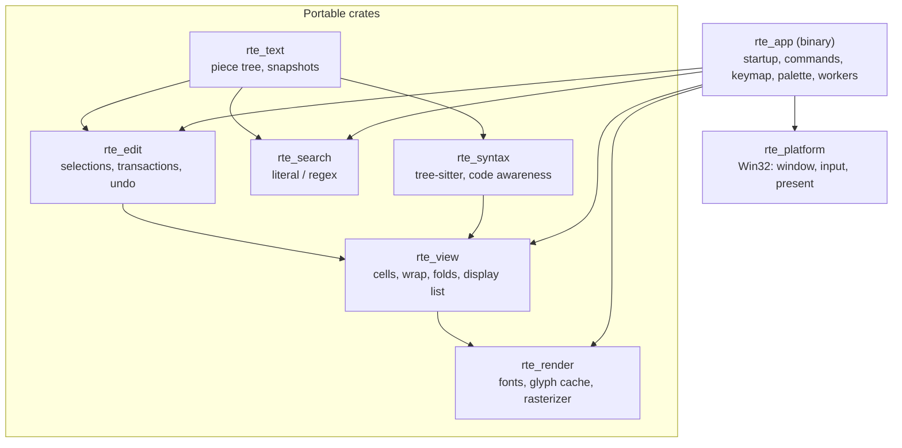

# Architecture

## Task

Define the architecture of `RoyiTextEditor`: a single-file, keyboard-driven,
frameless code editor for Windows, written in Rust.

Priorities, in order:

1. **Speed.** First frame of a small file in < 100 ms from process creation
   (goal ≤ 50 ms warm). Keystroke to screen within the next vsync. Scrolling at
   display refresh rate. Responsive with 1 GiB files.
2. **Correctness.** Byte-exact preservation of everything the user did not edit.
3. **Aesthetic, keyboard-first UX.** No menus, frameless, crisp monospaced text.

Inputs: the preliminary design in [TextEditorDesign.json](../TextEditorDesign.json)
and the requirements and competition list in [DEVELOPMENT.md](../DEVELOPMENT.md).

## Scope

### Included

- One file per process. No tabs, projects, plug-ins or LSP.
- Main use: launched by a file manager, in edit or read-only mode. No history
  or sessions.
- No menu. Every action is a command: Command Palette or keyboard shortcut.
- Frameless window with native snap, shadow, resize and DPI behavior.
- Line numbers.
- Read-only mode through the CLI (`--read-only`) and a command.
- Single-file search with VS Code parity, including lookaround and
  backreferences (see [Search](#search-rte_search)).
- Bundled monospaced fonts only, chosen from a predefined list. LTR only.
- Syntax highlighting and code awareness without LSP (tree-sitter).
- VS Code Windows shortcuts from `KeyboardShortcutsWindows.pdf` sections:
  General, Basic Editing, Navigation, Search and Replace, Multi-cursor and
  Selection. LSP-dependent commands are dropped. See [Command Coverage](#command-coverage).
- Large files (1 GiB) stay responsive.
- Windows 11 x64 is the supported and tested platform. Windows 10 is not
  supported but not blocked (no version check). Portable core crates.

### Excluded

- CSV/TSV Table Mode. Deferred; the design keeps a hook (see [Future Hooks](#future-hooks)).
- LSP features: completion, diagnostics, definitions, workspace symbols, rename, formatting.
- RTL / bidirectional text, proportional fonts, system font selection, ligatures.
- Split views, terminal, Git, Markdown preview, session restore.
- UI Automation accessibility in v1 (boundary reserved in `rte_platform`).
- IME composition (CJK input) in v1. Dead keys and AltGr work through `WM_CHAR`.
- Encodings other than UTF-8 and UTF-16 (BOM) in v1.

### Compatibility Constraints

- Never normalize line endings, BOM, or invalid UTF-8 silently.
- Never lose user data: no save path deletes the only copy of any version.
- Configuration is one YAML file next to the executable, never written by the
  application. Application-written state (recovery files only) lives under
  `UserSettings/`. No Registry writes.
- macOS / Linux are not targets, but no crate except `rte_platform` may use OS APIs.

## Design

### Principles

1. Interactive work is proportional to what is **visible** or what **changed**,
   never to file size.
2. The UI thread never waits on disk, parsing or whole-document scans.
3. Workers read immutable snapshots. Results carry a revision; stale results are
   dropped or mapped forward.
4. Startup does only what the first frame needs. Everything else is parallel or lazy.
5. Few dependencies. Each one must justify its startup, size and build cost.
6. Pure, testable core crates. Win32 code only in `rte_platform`.
7. **Speed over memory.** When they conflict, fast rendering and
   highlighting win over a small memory footprint (the owner's design
   choice, 2026_10_24): syntax trees stay in memory, the whole file parses
   beside the first window, tree-sitter allocates through mimalloc. Memory
   stays bounded by explicit limits (`syntax.maxFileMiB`, the Replace All
   cap, the cursor limit), and startup memory is not traded. Highlighting
   off (`--syntax none`) restores the memory footprint of 0.3.0.

### Overview



### Crates

| Crate          | Owns                                                                  | Main dependencies        |
| -------------- | --------------------------------------------------------------------- | ------------------------ |
| `rte_text`     | Piece tree, snapshots, line index, encodings, change sets             | `memchr`                 |
| `rte_edit`     | Selections, transactions, undo, movement, edit commands               | `unicode-width`          |
| `rte_search`   | Literal and regex search over snapshots (two regex engines)           | `memchr`, regex crates   |
| `rte_syntax`   | Languages, parsing, highlights, folds, symbols, brackets              | `tree-sitter`, grammars  |
| `rte_view`     | Cell layout, wrap, folding, viewport, hit testing, display list       | `unicode-width`          |
| `rte_render`   | Bundled fonts, glyph cache, CPU rasterizer, damage tracking           | `swash`                  |
| `rte_assets`   | Downloads missing assets at build time; embeds the default face       | None (PowerShell script) |
| `rte_platform` | Win32 window, frameless chrome, input, clipboard, present, files      | `windows-sys`            |
| `rte_app`      | Binary: startup, commands, keymap, palette, settings, workers         | All of the above         |

Workspace layout: `crates/<name>/`, `assets/fonts/`, `benches/`, `xtask/`
(startup and frame-time harness). Release profile: `lto = "fat"`,
`codegen-units = 1`, `opt-level = 3`, `strip = true`.

### Threading

- **UI thread.** Win32 message loop. Owns the `Editor` (current snapshot,
  selections, view state, overlays). The only thread that mutates editor state.
- **Startup threads.** Loader and glyph threads spawned at entry (see [Startup](#startup)).
- **Worker.** A single persistent thread, created after the first frame,
  runs resumable jobs from a priority queue: syntax parse (highest), syntax
  highlight fallback, long-line indexing. A new job of the same kind cancels
  the queued or running stale one.
- **Search thread.** Regex engines cannot suspend mid-scan, so all search
  work (pattern compilation, viewport regex matches, counts, next-match beyond
  the UI budget, Replace All construction) runs on its own thread, created on
  first use. A slow scan never delays parsing. Cancellation is checked between
  chunks, lines and matches; a cursor that stops early reports cancelled, and
  the result is discarded by its ticket.
- **One-off threads.** File load runs on the loader thread. Saves run on one
  save thread at a time (see [Saving](#saving)), so a long save never delays
  highlighting or search.
- **Smoothness rules.** The UI never waits for the worker or the search thread,
  except the bounded startup highlight deadline. Worker jobs yield at every
  chunk (~1 ms), so a newly queued parse starts within ~1 ms. A parse aborts
  through its progress callback when a newer revision is queued.
- **Tickets.** Every request carries `JobTicket { kind, generation, rev }`.
  The UI keeps one `generation` per job kind and increments it whenever a
  non-document input changes: search query or options, language, injection
  setting, load cancellation. A result is accepted only when its `generation`
  equals the current one. Then `rev` decides: equal → use; older → map
  through `ChangeSet`s for **display only** (syntax spans, search highlights)
  or drop (counts). Mapped results never authorize an edit (see
  [Search](#search-rte_search)). The ticket's `CancelToken` is cancelled when
  its generation is superseded.
- **Messages.** Results go to a queue and wake the UI with
  `PostMessageW(WM_APP)`. The UI drains each queue once after installing its
  waker, so results sent before the window exists are not lost. A worker that
  ends without a final result is reported as a failure.
- No lock is held on the UI path except the result-queue pop.

### Text Engine (`rte_text`)

A **persistent hybrid piece tree** (B-tree rope whose leaves may reference the
loaded file instead of copying it).

```rust
struct Snapshot { root: Arc<Node>, rev: Rev }          // Clone = refcount bump
struct Node { height: u8, summary: Summary, kind: Kind }
enum Kind { Leaf(Chunk), Internal(Vec<Arc<Node>>) }
// One shape for loaded blocks and inserted text: a slice of a shared immutable buffer.
struct Chunk { buf: Arc<[u8]>, start: u32, len: u32 }
struct Summary { bytes: u64, newlines: u64 }
```

- **Load.** The file is read in immutable blocks: first block 1 MiB, then
  16 MiB. Each block becomes one `Arc<[u8]>`, split into 8 KiB leaves with
  newline counts (`memchr`), appended to the tree. No text is copied.
- **Progressive publication.** Files up to one block load in a single read
  (the startup path). Larger files publish a read-only prefix snapshot after
  the first block, then at most every 50 ms, as
  `LoadProgress { snapshot, bytes_loaded, total }`. The final snapshot makes
  the document editable. Prefix snapshots are complete trees over the bytes
  read so far; leaves never reference unread bytes.
- **Load cancellation.** The loader checks its `CancelToken` between blocks.
  Closing the window or a read error cancels it; a read error keeps the
  loaded prefix read-only and reports the error. Nothing is ever written.
- **Edit.** An edit inside one leaf copies only the root-to-leaf path. Other
  edits use persistent B-tree split and concatenate (O(log² n)). Everything
  else is shared with older snapshots. Adjacent small pieces (≤ 4 KiB total)
  are coalesced into one new buffer, so typing does not fragment the tree.
- **Batch apply.** A `Transaction` holds sorted, non-overlapping edits. Edits
  inside leaves are applied in one traversal (each touched node rebuilt once,
  overflowing nodes regrouped); otherwise edits apply one by one, last first.
- **Queries.** Offset ↔ line in O(log n), then `memchr` inside one chunk.
  Forward/backward chunk iterators. Never flatten the document.
- **Line endings.** `\n` ends a line; `\r\n` displays as one break; a lone `\r`
  displays as a control glyph. New breaks use the file's dominant style.
- **Bytes.** Invalid UTF-8 is displayed per byte and never rewritten.
- **Encodings.** UTF-8, UTF-8 BOM, UTF-16 LE/BE BOM. The BOM and encoding are
  preserved. Files without a BOM load as UTF-8 bytes (lossless).
- **UTF-16.** Valid UTF-16 is transcoded to UTF-8 on load (per block, carrying
  a split code unit or surrogate) and back on save. Malformed UTF-16 (unpaired
  surrogate, odd byte count) opens **read-only**: shown with U+FFFD, save
  disabled, status-line notice. The original bytes are never
  rewritten. Lossless editing (WTF-8 style storage) is a possible later step.
- **ChangeSet.** Each applied transaction yields `(old_range, new_len)` pairs.
  It maps positions (with left/right bias) for selections, search hits, folds,
  syntax spans and future views.

### Editing (`rte_edit`)

- **Selections.** `Selection { anchor, head, goal_col }` in byte offsets.
  `Selections` is sorted, merged and non-empty; one caret is a set of one.
  Box selection is a set of per-line selections plus a box anchor.
- **Commands** are pure: `(snapshot, selections, options) -> Transaction + Selections`.
  Golden-testable without a window.
- **Undo.** Linear history of `{ root_before, root_after, sels_before, sels_after, changes }`.
  Undo restores a root; no inverse replay. Typing coalesces into word groups;
  paste, cut and multi-line edits are separate steps. Retention: at most
  10,000 steps and 256 MiB of inserted bytes held only by history; the oldest
  steps drop first.
- **Cursor undo** (`Ctrl+U`): a separate bounded stack of selection states.
- **Bounded movement.** One movement (character with its marks, word,
  double-click word) scans at most 64 KiB through a borrowed chunk cursor;
  longer runs are crossed by repeating it. Positions estimated from columns
  past the scanned prefix snap to a character boundary.
- **Clean state:** `Arc::ptr_eq(saved_root, current_root)`, where `saved_root`
  is the root of the snapshot actually committed by the last successful save
  (see [Saving](#saving)). Undo back to it clears the dirty marker.
- **Clipboard.** Empty selection copies/cuts the whole line. With N carets and N
  clipboard lines, paste distributes one line per caret (VS Code behavior).
  A private clipboard format stores per-selection metadata.
- **Navigation history** (`Alt+Left`/`Alt+Right`): caret positions recorded on
  jumps (go to line, symbol, search, bracket, large moves), mapped through edits.

### Search (`rte_search`)

Goal: VS Code single-file search parity (find widget options, regex dialect,
replacement syntax), with bounded memory and preemptible work.

- **Options.** Match case (`Alt+C`), whole word (`Alt+W`), regex (`Alt+R`),
  preserve case (`Alt+P`), find in selection (`Alt+L`). Multiline patterns
  (containing `\n`) are supported.
- **Glob** (`Alt+G`, not in VS Code; exclusive with regex): `?`, `*` (within
  a line), `[abc]`, `[!abc]`; translated to the automata engine.
- **Literal:** `memchr::memmem` over chunks, carrying a pattern-length overlap
  across chunk boundaries.
- **Regex, two engines.** The pattern is parsed once:
  - **Automata path** (`regex-cursor`, regex-automata over chunked bytes):
    patterns without lookaround or backreferences. Linear time, multiline,
    invalid UTF-8 safe.
  - **Backtracking path** (`fancy-regex`): patterns with lookaround or
    backreferences (`foo(?=bar)`, `(\w+)\s+\1`). Runs per line on `&str`;
    multiline patterns use a bounded window (1 MiB). Bounded by
    `backtrack_limit`; a limit hit reports "pattern too complex" instead of
    hanging. Lines with invalid UTF-8 or longer than 16 MiB are skipped and
    the skip count is shown.
  - JS-only syntax differences are mapped where possible; unsupported
    constructs are reported in the find widget, never silently ignored.
- **Replacement syntax** (VS Code): `$1`, `$<name>`, `$&`, `$$`, `\n`, `\t`,
  `\u` `\l` `\U` `\L` case modifiers, preserve case.
- **Compilation** runs on the search thread with regex size limits. The UI
  never compiles or runs a regex.
- **No match lists.** Matches are never stored for the whole document:
  - **Display:** viewport matches only (literal on the UI with a byte bound per
    row; regex from the search thread), cached per `(generation, rev)` and
    mapped through `ChangeSet`s as provisional display spans.
  - **Count and "N of M":** streaming counters on the search thread.
  - **Navigation** (`F3`, `Ctrl+D`, `Ctrl+K Ctrl+D`): search from the caret on
    the current snapshot; a short literal search runs on the UI within
    0.5 ms, otherwise on the search thread.
- **Edit authority.** Commands never use mapped results.
  - **Replace:** if the current selection is exactly a match on the current
    snapshot (re-matched in place), replace it, then find the next; otherwise
    only find the next (VS Code behavior).
  - **Replace All** and **select all occurrences** (`Ctrl+Shift+L`, `Ctrl+F2`,
    `Alt+Enter`) are built on the search thread against snapshot `R` with
    ticket `G`. The UI commits only if the current `rev == R` and the
    generation is still `G`; otherwise the job re-runs once, then aborts with
    a message. No partial edits.
- **Bounded construction.**
  - Replace All builds the new tree directly: unchanged spans reuse existing
    leaves; replacements pack into 4 KiB owned leaves. Memory ≈ new bytes +
    tree overhead, capped by `search.replaceAllMaxMiB` (default 512); over the
    cap → abort, no edit. Commit is one undo step (`root_before`, `root_after`)
    with a coarse `ChangeSet` (selections clamp, syntax reparses).
  - Select all occurrences stops at `editor.multiCursorLimit` (default 10,000,
    as VS Code) and refuses with a message instead of a partial selection.
  - Zero-width matches advance by one character.

### Syntax and Code Awareness (`rte_syntax`)

- **Language registry** (static): id, names, extensions, file names, shebang,
  grammar, queries, comment tokens, bracket pairs, auto-closing pairs, word pattern.
- **Initial languages:** Rust, C, C++, C#, Python, JavaScript, TypeScript,
  JSON, TOML, YAML, Markdown, HTML, CSS, XML, Bash, PowerShell, Lua, SQL, Go,
  Java, MATLAB, Octave, Julia.
- **Unregistered extensions** open as plain text. `.ipynb` is not registered
  as JSON; a notebook is highlighted as JSON only when chosen (below).
- **Language override.** Change Language Mode (`Ctrl+K M`,
  `workbench.action.editor.changeLanguageMode`) lists Plain Text and the
  registered languages and re-parses with the choice. `--syntax <id>` (registry
  id, for example `json`) sets it at startup; an unknown id keeps detection and
  shows a status-line notice. `--syntax none` / `--syntax off` (any case) and
  `View: Toggle Syntax Highlighting` select plain text (status line:
  `Syntax off`). The choice lasts for the process.
- **MATLAB and Octave** share `tree-sitter-matlab` (MIT; no Octave dialect).
  Octave adds its own configuration (`%` and `#` comments, `end*` keywords).
  `.m` opens as MATLAB unless content shows Octave markers (`#` comments,
  `endfunction`, `endif`, `!=`); the palette can override. Octave-only syntax
  may highlight as error nodes; highlighting degrades, never blocks.
- **Parsing** runs on the worker: incremental `Tree::edit` from each `ChangeSet`,
  input read through a chunk callback (no flattening), cancellable via the
  progress callback. At startup the loader thread starts the worker as soon
  as the text is read (before the window exists; the editor adopts it when
  the language and text match), and the highlight query compiles on its own
  short-lived thread while the text parses. Tree-sitter allocates through
  mimalloc (6-16% faster parses than the system heap; Rust code keeps the
  system heap, which measured no gain and double the memory with mimalloc).
  Trees the UI replaces are sent back to the worker to be freed (freeing a
  100,000-line tree takes up to about 57 ms).
- **Highlighting** runs on the UI thread over the visible byte range (cached
  per tree generation, text and range). The trees received from the worker
  are edited forward with each transaction (exact edits near the visible rows,
  one point edit for changes before them), so positions match the current
  text until the next parse arrives. The visible rows are queried with a
  **1 ms work budget** enforced by the query progress callback. When the
  budget runs out, the worker highlights the range and posts spans for the
  next frame.
- **Trimmed queries.** Our own `highlights.scm` per language under
  `crates/rte_syntax/queries/<lang>/`, generated from upstream (licenses kept;
  `cargo xtask syntax-queries`). Only patterns producing the theme's captures
  remain: `keyword`, `string`, `comment`, `number`, `type`, `function`,
  `constant`, `operator`, `punctuation`, `property`, `tag`, `attribute`
  (`@none` is kept: plain text over outer captures). Patterns with predicates
  tree-sitter does not evaluate (`#lua-match?`, `#has-ancestor?`) are
  dropped; regex predicates stay (the regex engine is linked anyway). Patterns
  are ordered by specificity (nodes and predicates), then by upstream
  precedence; the first pattern matching a node wins. `tags.scm` is trimmed
  to definitions; grammars without one get a small written query.
- **First frame:** never waits for highlighting; a code file shows plain text
  first and repaints when the trees arrive.
- **Off switch:** unknown language, Plain Text chosen, or a file above
  `syntax.maxFileMiB` (default 32) → plain text, no parser work.
  `--syntax none` restores the memory footprint of 0.3.0 (64 KiB JSON:
  5.7 MiB peak instead of 10.7 MiB).
- **Size limit.** Measured with tree-sitter 0.25 on the reference machine
  (`tools/SyntaxProbe`; one thread, the benchmark fixture blocks;
  memory and time grow linearly with size), at the 32 MiB limit:

  | Language                      | Parse [MiB/s] | Tree [B/B] | 32 MiB: tree | 32 MiB: parse |
  | ----------------------------- | ------------- | ---------- | ------------ | ------------- |
  | JSON                          | 11.1          | 44         | 1.4 GiB      | 2.9 s         |
  | JSON, minified                | 9.9           | 51         | 1.6 GiB      | 3.2 s         |
  | Python                        | 8.3           | 48         | 1.5 GiB      | 3.9 s         |
  | C                             | 6.7           | 30         | 0.9 GiB      | 4.8 s         |
  | Markdown, block grammar       | 4.0           | 80         | 2.5 GiB      | 8.9 s         |
  | Markdown, inline and fences ¹ | 1.6           | 132        | 4.1 GiB      | 20.4 s        |

  Tree [B/B]: syntax tree bytes per file byte. ¹ All injection layers.
  JSON and Markdown were measured at 32 MiB; Python, C and minified JSON at
  128 MiB, scaled to 32 MiB (128 MiB: 3.8–6.4 GiB, 12–19 s; Markdown with all
  layers about 16.5 GiB, 82 s).
- **Viewport first.** Above 128 KiB (an estimated full parse over one frame),
  the worker first parses a 32 KiB window around the viewport (a few
  milliseconds, so the second frame is highlighted), starting at a line
  start when one is near (otherwise at a character boundary, so minified
  lines stay bounded), with `set_included_ranges` (positions stay those of
  the document) and posts it. A window covering half the file or more is
  replaced by one full parse. Meanwhile a second parser parses the whole file
  on its own thread; edits made meanwhile are applied to its tree when it
  finishes. A jump
  outside the window (`Ctrl+End`, scroll bar, Go to Line) parses a new window.
  Window spans can be wrong for constructs opened before the window (block
  comments, strings, code fences), so a window not starting at the file start
  is provisional: it is drawn, but not reported as highlighted nor used by
  code-aware commands until the full tree arrives. A finished full tree is
  adopted before another window parses. Edits re-parse
  incrementally: the full tree when present, otherwise the window.
- **Injections** (embedded languages) are in v1, on by default, setting
  `syntax.injections`:
  - **HTML:** `<script>` → JavaScript, `<style>` → CSS.
  - **Markdown:** inline elements (second `tree-sitter-markdown` grammar, always
    on), fenced code blocks by info string (any registered language), YAML
    front matter, HTML blocks.
  - **Layers.** One parser per injected language; each region (an inline
    node, a code fence, a `<script>` element) gets its own tree, parsed with
    `set_included_ranges` over that region and re-parsed only when an edit
    touches it. One combined tree over all regions is quadratic in the region
    count in tree-sitter 0.25 (13,152 inline ranges: 1.3 s; 26,200: 5.1 s;
    separate trees: 0.6 s). Layers are rebuilt on the worker after the host
    parse. Highlighting merges the visible captures of all layers; the
    innermost layer wins. Commands outside the parsed layers (or with
    layers older than the text) take the language from the host tree's
    regions (fence info string, `<script>`), not from the host language.
    After edits far from the view (positions there are approximate until
    the next parse), comments report "still being parsed" and typing aids
    act as in plain text.
  - **Depth.** One level below the host. HTML inside Markdown gets no further
    injections. Markdown inline counts as part of Markdown.
  - **Lazy grammars.** An injected language's queries compile on the worker
    the first time it appears. Until then its region draws plain text.
- **Theme:** capture name (`@keyword`, `@string`, ...) → style. Built-in dark
  theme (v1); a light theme later. No theme files.

| Feature                       | Source                                        |
| ----------------------------- | --------------------------------------------- |
| Syntax highlighting           | Trimmed `highlights.scm` queries              |
| Bracket match and jump        | Bounded scan, skips string and comment nodes  |
| Auto-closing pairs and quotes | Language configuration                        |
| Auto-indent on Enter          | Indent rules; `indents.scm` later             |
| Line and block comments       | Language comment tokens                       |
| Folding (after v1)            | `folds.scm`; indentation fallback             |
| Expand and shrink selection   | Syntax tree ancestors; word and line fallback |
| Go to symbol                  | `tags.scm` definitions                        |
| Word occurrence highlight     | Visible-range literal search                  |

Grammar packaging gate: grammars link statically in v1. If the executable size
measurably hurts cold start, move each grammar to a lazily loaded DLL.

### View and Layout (`rte_view`)

- **Cell grid.** Integer cell width and height derived from the font advance and
  line-height setting (terminal style). All x/y math is integer.
- **Cell widths.** ASCII = 1 (runs of printable ASCII need no lookup).
  Others via `unicode-width` (0, 1 or 2). Tab → next tab stop. Control and
  invalid bytes → visible 1-cell symbol.
- **No layout cache.** Visible rows are laid out every frame (~100 rows × ~200
  cells). Caches exist only for glyphs, syntax spans and long-line checkpoints.
- **Long lines** (above 64 KiB):
  - **Checkpoints** (byte → display column every 4 KiB, relative to the line
    start) are built on the worker, never synchronously on the UI.
  - **Invalidation.** An edit inside the line drops checkpoints after the edit
    offset; edits elsewhere only shift the line start through the `ChangeSet`.
  - **UI work bound.** Each visible row scans at most 64 KiB of bytes per frame,
    whatever their cell widths (long zero-width runs included). The rest of
    the row draws a continuation marker.
  - **Pending view.** Without a checkpoint near the target column (e.g. `End`
    on an unindexed line), the horizontal anchor becomes a byte offset: the row
    renders from the nearest known checkpoint or the anchor byte, with columns
    counted from there and marked approximate in the status line. Exact
    columns replace them when the index arrives. Caret positions are byte
    offsets and stay exact.
- **Anchor scrolling.** Viewport = `(anchor_line, sub_row, pixel_offset, first_col)`.
  No global visual-row count; the scrollbar is proportional to logical lines.
- **Horizontal scrolling.** `Shift`+wheel, horizontal touchpad, caret follow,
  thin horizontal scrollbar. In v1 every line is exactly one screen row.
- **Scroll mode.** `editor.smoothScrolling` (default off). v1 implements only
  the immediate mode: wheel and keys move whole lines, touchpads move by pixels.
  The animated mode comes later.
- **After v1: word wrap** (`Alt+Z`) **and folding.** The viewport walks screen
  rows through one row iterator from the start (identity mapping in v1), so
  wrap and folds plug in later without changing callers.
- **Hit testing** uses the same layout as drawing.
- **Gutter.** Line numbers (on by default), width from the line count digits.
  The dirty and read-only markers live in the title strip and status line.
- **Output:** a `DisplayList` of rows (background spans, glyph cells, decorations),
  carets, selections and overlays (palette, find widget, title strip, status line).
  Each glyph carries the clip rectangle of its region, so a partial last row
  never draws into the status line.

### Rendering (`rte_render`)

- **Fonts.** Five bundled OFL families: JetBrains Mono (default), Cascadia
  Mono, Fira Mono, Iosevka, Lilex. The default Regular face is embedded in the
  executable, so startup reads no font file. All faces also ship as files in
  `Fonts/` next to the executable (Iosevka faces are several MB each, too
  large to embed); a selected non-default family is memory-mapped and parsed
  zero-copy by `swash`; bold and italic faces load on first use. A missing or
  corrupt font file falls back to the default family with a status-line message.
- **Assets are not in Git.** `assets/` is ignored. The `rte_assets` crate's
  build script runs `tools/Get-Fonts.ps1` (pinned release URLs, SHA-256
  verified, archives cached in `target/font-cache`), so any build that embeds
  or packages fonts first restores missing files. CI caches the archives.
- **Glyph cache.** `(face, glyph, px size) → coverage mask` in an atlas. ASCII is
  rasterized at startup on the glyph thread; the rest on first use.
- **Quality.** Grayscale AA with gamma/contrast LUTs, hinting on. Syntax colors
  are unaffected: each coverage mask is blended with its token color. Subpixel
  (LCD) AA is a possible later setting.
- **No shaping in v1.** One glyph per character, in one or two cells.
  Combining marks draw over the previous cell, at most 4 per cell (further
  marks are not drawn; the text is unchanged). A later `editor.textShaping`
  mode can shape non-ASCII clusters with `swash`; the glyph-run boundary keeps
  room for it. ASCII never shapes.
- **CPU rasterizer** writes BGRA rows into a framebuffer owned by `rte_platform`.
- **Damage tracking** (planned, not yet needed). Per-row hash versus the
  previous frame; only changed rows redrawn; scrolling shifts framebuffer rows.
  M2 measured full redraws (layout + draw) at 0.36 ms for 1080p and 1.16 ms
  for 4K, so frames are fully redrawn until a profile shows otherwise.
- **Pixels** are written opaque (`0xFFRRGGBB`): DWM honors alpha in the 1 px
  frame extension that keeps the window shadow.
- **Missing glyph** → visible box. Optional lazy system fallback later.
- **Caret.** Steady (no blink) in v1. Blinking is a later setting.
- **GPU fallback.** A Direct3D 11 presenter can replace the GDI presenter behind
  the same boundary if the scroll gate fails at 4K.

### Platform (`rte_platform`, Win32)

- **Frameless.** Standard overlapped styles kept (snap, animations, `Alt+Space`),
  caption removed via `WM_NCCALCSIZE`, edges and caption strip via `WM_NCHITTEST`,
  shadow via `DwmExtendFrameIntoClientArea`, Windows 11 rounded corners, inset
  correction when maximized. Window stays hidden until the first frame is ready.
- **Chrome.** Thin title strip (drag, double-click maximize, file name, dirty
  marker) and a status line. No minimize/maximize/close buttons. Every edge and
  corner resizes (hit-test band scaled by DPI). `Alt+F4`, `Win+Arrow` and
  `Alt+Space` work as usual. The strip and status line can be hidden by setting.
- **DPI.** Per-monitor v2. `WM_DPICHANGED` rescales cells and re-rasterizes glyphs.
- **Windows 11 features** through `DwmSetWindowAttribute`: rounded corners
  and a border color matching the theme (build 22000), optional Mica backdrop
  for the title strip (build 22621). Failures are ignored, so no version check
  is needed and older systems keep working with the plain look.
- **Application manifest** (M3): supported-OS entry, per-monitor v2 DPI
  (replacing the runtime call), UTF-8 active code page, long paths. The
  segment heap is enabled only if measured memory and startup improve (M3:
  no gain measured, not enabled). Embedded with MinGW `windres` from
  `rte_app/build.rs`.
- **Keyboard.** Virtual key + modifiers (layout independent, as VS Code on
  Windows); `WM_CHAR` for text including surrogate pairs.
- **Mouse.** Click counts, `Alt+Click`, `Shift+Alt+Drag`, high-resolution wheel.
- **IME.** Deferred. The IMM32 boundary is reserved; composition is not drawn in v1.
- **Clipboard.** `CF_UNICODETEXT` plus the private multi-selection format.
- **Present.** `BitBlt` from a DIB section.
- **Files.** Read via `CreateFileW`. Saving: see [Saving](#saving).
- **Lazy DLLs.** Startup imports only `kernel32`, `user32`, `gdi32`, `imm32`,
  `dwmapi`. File dialogs (COM) and other rare APIs load via `LoadLibraryW` on first use.

### App (`rte_app`)

- **Commands.** Static registry: `{ id, label, keys, mutates, action }`, sorted
  by label. Labels use VS Code style families (`Application:`, `File:`, `Edit:`,
  `Selection:`, `Go:`, `View:`). IDs follow VS Code (`editor.action.copyLinesDownAction`)
  so bindings are familiar. Keymap and palette both dispatch through one
  `Editor::perform(Action)`. Bindings match modifiers exactly; keys that are
  not commands (movement, typing) stay in the editor, and unbound `Alt` keys
  keep their system behavior. `Application: Quit` (`Alt+F4`) and `File: Close`
  (`Ctrl+W`) both close the instance: one document per process. `Ctrl+Q` is
  not bound (VS Code quits every window with it).
- **Keymap.** Two-key chords (`Ctrl+K Ctrl+C`) with a pending-chord hint.
  `when` uses a fixed set of contexts (editor, palette, find widget, multi-cursor).
- **Palette.** `Ctrl+Shift+P` / `F1`: all commands. `Ctrl+P`: the last
  `palette.recentCount` commands run from the palette, then the favorites (by
  label). Own fuzzy matcher: in-order subsequence, case-insensitive, bonuses
  for word starts and consecutive characters; matched characters highlighted.
  A star per row (click or `Ctrl+Space`) toggles a favorite. The search field
  has a caret and selection (arrows, `Ctrl` word moves, `Shift` extends,
  `Home`/`End`, `Backspace`/`Delete`, `Ctrl+A`, `Ctrl+V` first line), at most
  256 characters, scrolled to keep the caret visible. Planned modes:
  `:` go to line (`Ctrl+G`), `@` symbols (`Ctrl+Shift+O`); Quick Open moves to
  another key.
- **Palette state.** `UserSettings/Palette.json` (favorites, recent IDs). The
  UI applies every change at once; a worker thread, started when the palette
  first opens, reads the file and then persists the changes in order: re-read
  (keeping other instances' changes), apply, replace atomically (temporary
  file + rename). Replies older than the last change are ignored. Limits:
  64 KiB file, 256 favorites, 128-byte IDs; duplicates and recent entries past
  20 are dropped. An unreadable, oversized or invalid file is reported and
  left unchanged; changes then last for the session. Unknown IDs are kept and
  ignored; favorites are indexed by registry position for painting.
- **Popups.** The palette and panels (About, Keyboard Shortcuts) are a
  `DisplayList` layer drawn last (fills, images, stars, glyphs). They do not
  zoom: a second renderer at the zoom-0 size exists only while the editor is
  zoomed. They fit the client, moving over the title strip and dropping the
  About icon when the window is too low. A fingerprint of the visible popup
  state decides repaints. The About icon is a premultiplied image rendered by
  the build script and scaled when the panel opens. Links open through
  `ShellExecuteW`; `shell32` and `ole32` load on first use.
- **Edit permission.** `Editor::apply(Transaction)` is the only mutation entry
  (typing, paste, undo, redo, replace, commands). It requires all independent
  locks to be clear; each lock has one owner:

  | Lock         | Owner                         | Set                         | Cleared                  |
  | ------------ | ----------------------------- | --------------------------- | ------------------------ |
  | `user`       | `--read-only`, toggle command | CLI or command              | Toggle command only      |
  | `loading`    | Loader                        | Load start                  | Final snapshot published |
  | `encoding`   | Decoder                       | Malformed UTF-16            | Never (process lifetime) |
  | `load_error` | Loader                        | Read error                  | Never (process lifetime) |

  Commands with `mutates = true` are refused (status-line notice) and shown
  disabled in the palette while any lock is set. Save is refused
  under `encoding` and `load_error`. Read-only command:
  `workbench.action.files.toggleActiveEditorReadonlyInSession` (VS Code ID),
  status line shows `RO` and the reason.
- **CLI.** `RoyiTextEditor.exe [--read-only] [--syntax <id>] [--trace-startup] [<path>]`.
- **Configuration.** One file, `RoyiTextEditor.yaml`, next to the executable:
  settings plus a `keybindings:` section (VS Code semantics, including
  `-command` removals). Read once at startup; changes apply to new instances.
  **The application never writes it**, so multiple instances cannot conflict.
  Errors are reported on the status line and never block startup.
- **Window placement** comes from the configuration (`window:` size, position,
  maximized or centered). No automatic placement memory.
- **YAML parser.** `saphyr-parser` (pure Rust, YAML 1.2, event API; small
  dependency set). `serde_yaml` is archived; `yaml-rust2` pulls more crates.
  YAML 1.2 keeps `no`/`off` as strings. Only plain maps, lists and scalars are
  accepted; anchors, aliases, tags and multiple documents are rejected.
  Unknown keys are reported.
- **Process model.** One document per process lifetime; no in-place reload of
  another file. Open / New / Quick Open spawn a new process. When the current
  document is untitled and unmodified, it exits after the spawn.
  `Ctrl+,` opens `RoyiTextEditor.yaml` in a new instance.
- **Dirty close.** In-window prompt strip: Save / Don't Save / Cancel; for an
  untitled document: Discard / Cancel.
- **Crash recovery** (best effort):
  - After each transaction the UI publishes the current `Snapshot` (an `Arc`
    clone) into a recovery slot.
  - The panic hook takes the slot with `try_lock` and writes it to
    `UserSettings/Recovery/<name>.<pid>.<timestamp>.recovery` plus a `.meta`
    file (original path, encoding). Unique names; no shared files.
  - When a file is opened, recovery entries for its path are checked after the
    first frame; an in-window strip offers Open (new instance, untitled) or
    Discard.
  - Limits: no coverage for process kill, power loss or allocation-failure
    aborts. Save failures keep their own recovery copies (see [Saving](#saving)).
- **Large files.** Shown read-only from the first published prefix; editable
  when fully loaded; progress on the status line. Syntax off above
  `syntax.maxFileMiB` (see [Syntax](#syntax-and-code-awareness-rte_syntax)).
  Large-file mode
  above `largeFileThresholdMiB` (default 256): no wrap, search counts only
  asynchronously; the default is set by measurement when wrap ships.

### Saving

Guarantee: no failure path deletes the only copy of the edited text or of the
previous file. Every Win32 file operation goes through a `FileOps` trait so
tests can inject each outcome.

- **One save at a time.** A single save slot. A save request while another
  runs is queued; further requests replace the queued one. The queued request
  resolves its snapshot, path and baseline **when it starts**, so it always
  targets the current document path. Saves are never cancelled mid-write.
- **Baseline.** Recorded at load and after each successful save: volume serial
  + 128-bit file ID (`FILE_ID_INFO`), size, last-write time, and for files
  ≤ 64 MiB a 64-bit content hash (XXH3).
- **Sequence** for snapshot `S` to path `P`:
  1. Write `S` to a temporary sibling `P.~rte-<pid>.tmp`, flush
     (`FlushFileBuffers`). Only the layer that created it removes it after
     a write failure; a name taken by another file is never deleted.
  2. **Pre-check:** open `P`, compare with the baseline (identity, size,
     time; hash when ≤ 64 MiB). Mismatch → conflict prompt (Overwrite / Cancel);
     the temporary file is kept until the prompt resolves.
  3. `ReplaceFileW(P, tmp, backup = P.~rte-<pid>.bak)`.
  4. **Post-check:** the backup is the file actually replaced. Compare it with
     the baseline (identity, size, time; hash when ≤ 64 MiB). Match → delete
     the backup. Mismatch → another writer raced the commit: keep the backup,
     report its path.
  5. `saved_root = S.root`, dirty marker recomputed. Edits made during the
     save keep the document dirty; undo coalescing is sealed when the save
     starts. The new baseline is adopted only if `P` still holds `S` (size,
     and hash ≤ 64 MiB or file identity above); otherwise the committed
     version's stamp is kept, so the next save reports a conflict.
- **Absent target** (new file named on the command line, target deleted):
  `MoveFileExW(tmp, P, MOVEFILE_WRITE_THROUGH)` without
  `MOVEFILE_REPLACE_EXISTING`, so a file that appears meanwhile fails the move
  instead of being overwritten. No other `MoveFileExW` fallback.
- **`ReplaceFileW` failures** (documented states, backup name always passed):

  | Error                               | Disk state                                   | Action                                         |
  | ----------------------------------- | -------------------------------------------- | ---------------------------------------------- |
  | 1175 `UNABLE_TO_REMOVE_REPLACED`    | `P` and temporary keep their names           | Delete temporary; report                       |
  | 1176 `UNABLE_TO_MOVE_REPLACEMENT`   | With backup: both keep their names           | Verify `P` against baseline, then as 1175      |
  | 1177 `UNABLE_TO_MOVE_REPLACEMENT_2` | Old file at backup name; new at temporary    | Keep both; report both paths; no deletion      |
  | Other                               | Unknown                                      | Keep all artifacts; report paths               |

  Any artifact is deleted only after verifying that `P` holds a complete
  version (old by baseline, or new by size and hash of `S`). On every failure
  `saved_root` is unchanged, the queued request is dropped, the document stays
  dirty, and an in-window message lists surviving paths.
- **Conflict guarantee.** Changes made before the pre-check are detected.
  A change racing the commit is detected afterwards and its version survives
  as the backup. Limit: files above 64 MiB rewritten in place with the same
  size and timestamp are not detected.
- **New files** are created only from the command line: a path that does not
  exist opens an empty document, and its first save creates the file. There
  is no Save As. A document started without a path is an untitled scratch
  document: editable, never saved (Save shows a notice), marked as at risk.
- **Close during a save:** input is disabled and "Saving…" is shown until the
  save finishes. Clean afterwards → exit. Failed or dirty → the dirty-close
  prompt.
- **External changes** are also checked on `WM_ACTIVATE` (identity, size and
  time; no hashing on activation).

### Startup

```text
t0 main ─ parse CLI ─ read RoyiTextEditor.yaml (tiny, sync) ─ spawn threads
 ├─ loader: read first block → encoding → tree → language → syntax prep → remaining blocks
 ├─ glyphs: map font file → parse face → cell metrics → rasterize ASCII
 └─ UI:     DPI awareness → register class → CreateWindowExW (hidden, configured placement)
            → join first snapshot + glyphs → layout → wait syntax ≤ deadline
            → render → ShowWindow + present → message loop (input ready)
```

`--trace-startup` logs each stage relative to the process creation time
(`GetProcessTimes`). `cargo xtask bench-startup` launches fresh processes and
waits for the first-frame event.

**Benchmark protocol.**
- Reference machine: recorded in the M2 task (CPU, RAM, disk, GPU, display
  resolution and refresh rate) and frozen for comparisons.
- Displays: 1080p at 60 Hz and 4K at 144 Hz.
- Warm start: 5 discarded launches, then 50 measured; **the gate is p95**.
  Cold start (after reboot) is reported, not gated.
- First-frame event: `BitBlt` completed **and** `DwmFlush` returned (frame
  composed by DWM). `BitBlt` completion alone is reported separately.

### Performance Budgets

Targets to verify on reference hardware, not measurements.

| Stage                               | Budget                          |
| ----------------------------------- | ------------------------------- |
| Process creation to `main`          | ≤ 8 ms                          |
| Hidden frameless window created     | ≤ 10 ms                         |
| Config, file read, tree (≤ 1 MiB)   | ≤ 5 ms, parallel                |
| Font face, ASCII glyphs rasterized  | ≤ 5 ms, parallel                |
| Grammar, queries, first parse       | ≤ 30 ms, parallel, deadline     |
| Layout, render, present first frame | ≤ 5 ms                          |
| First frame, small file, warm start | < 100 ms required, ≤ 50 ms goal |
| Keystroke to presented frame        | Next vsync, render ≤ 2 ms       |
| Command palette shown after key     | Next vsync, render ≤ 2 ms       |
| UI highlight query per frame        | ≤ 1 ms, then fallback           |
| Scroll frame at 1080p / 4K          | ≤ 4 ms / ≤ 8 ms                 |
| Idle CPU, unfocused                 | 0 wakeups                       |
| Private memory excl. framebuffer    | ≤ 15 MiB, empty document        |
| Framebuffer (one BGRA buffer)       | W × H × 4 (4K: 31.6 MiB)        |
| Glyph atlas                         | ≤ 16 MiB, LRU                   |
| 1 GiB file: first content           | ≤ 200 ms                        |
| 1 GiB file: fully editable          | ≤ 1.5 s, warm cache             |

The 100 ms gate is measured on single-language files (C as reference). HTML
and Markdown files with injections are measured and reported, not gated.

Memory metric: `PrivateUsage` from `GetProcessMemoryInfo`, sampled idle after
the first frame. Memory-mapped font files and the executable image are
file-backed and excluded. Empty-document memory is reported at 1080p and 4K.

### Command Coverage

Status: **Kept**, **Adapted** (behavior changed for a single-file editor),
**Later** (after v1), or **Dropped** (needs LSP or multiple files).

General:

| Keys                 | Command                | Status                                    |
| -------------------- | ---------------------- | ----------------------------------------- |
| `Ctrl+Shift+P`, `F1` | Show Command Palette   | Kept                                      |
| `Ctrl+P`             | Quick Open, Go to File | Adapted: recent and favorite commands     |
| `Ctrl+Shift+N`       | New window/instance    | Adapted: new process                      |
| `Ctrl+Shift+W`       | Close window/instance  | Kept                                      |
| `Ctrl+,`             | User Settings          | Adapted: opens config file                |
| `Ctrl+K Ctrl+S`      | Keyboard Shortcuts     | Adapted: opens config file                |
| `Ctrl+K M`           | Change Language Mode   | Kept; also `--syntax <id>`                |

Basic Editing:

| Keys                              | Command                     | Status |
| --------------------------------- | --------------------------- | ------ |
| `Ctrl+X`                          | Cut line (empty selection)  | Kept   |
| `Ctrl+C`                          | Copy line (empty selection) | Kept   |
| `Alt+Up` / `Alt+Down`             | Move line up/down           | Kept   |
| `Shift+Alt+Down` / `Shift+Alt+Up` | Copy line down/up           | Kept   |
| `Ctrl+Shift+K`                    | Delete line                 | Kept   |
| `Ctrl+Enter`                      | Insert line below           | Kept   |
| `Ctrl+Shift+Enter`                | Insert line above           | Kept   |
| `Ctrl+Shift+\`                    | Jump to matching bracket    | Kept   |
| `Ctrl+]` / `Ctrl+[`               | Indent/outdent line         | Kept   |
| `Home` / `End`                    | Go to beginning/end of line | Kept   |
| `Ctrl+Home` / `Ctrl+End`          | Go to beginning/end of file | Kept   |
| `Ctrl+Up` / `Ctrl+Down`           | Scroll line up/down         | Kept   |
| `Alt+PgUp` / `Alt+PgDn`           | Scroll page up/down         | Kept   |
| `Ctrl+Shift+[` / `Ctrl+Shift+]`   | Fold/unfold region          | Later  |
| `Ctrl+K Ctrl+[` / `Ctrl+K Ctrl+]` | Fold/unfold all subregions  | Later  |
| `Ctrl+K Ctrl+0` / `Ctrl+K Ctrl+J` | Fold/unfold all regions     | Later  |
| `Ctrl+K Ctrl+C` / `Ctrl+K Ctrl+U` | Add/remove line comment     | Kept   |
| `Ctrl+/`                          | Toggle line comment         | Kept   |
| `Shift+Alt+A`                     | Toggle block comment        | Kept   |
| `Alt+Z`                           | Toggle word wrap            | Later  |

Navigation:

| Keys                     | Command                   | Status                       |
| ------------------------ | ------------------------- | ---------------------------- |
| `Ctrl+T`                 | Show all symbols          | Dropped: LSP/workspace       |
| `Ctrl+G`                 | Go to line                | Kept                         |
| `Ctrl+P`                 | Go to file                | Adapted: see General         |
| `Ctrl+Shift+O`           | Go to symbol              | Kept: tree-sitter `tags.scm` |
| `Ctrl+Shift+M`           | Show Problems panel       | Dropped: LSP                 |
| `F8` / `Shift+F8`        | Go to next/previous error | Dropped: LSP                 |
| `Ctrl+Shift+Tab`         | Editor group history      | Dropped: single file         |
| `Alt+Left` / `Alt+Right` | Go back/forward           | Kept: caret history          |
| `Ctrl+M`                 | Toggle Tab moves focus    | Kept                         |

Search and Replace:

| Keys                        | Command                           | Status |
| --------------------------- | --------------------------------- | ------ |
| `Ctrl+F`                    | Find                              | Kept   |
| `Ctrl+H`                    | Replace                           | Kept   |
| `F3` / `Shift+F3`           | Find next/previous                | Kept   |
| `Alt+Enter`                 | Select all occurrences of match   | Kept   |
| `Ctrl+D`                    | Add selection to next match       | Kept   |
| `Ctrl+K Ctrl+D`             | Move last selection to next match | Kept   |
| `Alt+C` / `Alt+R` / `Alt+W` | Toggle case / regex / whole word  | Kept   |
| `Alt+G`                     | Toggle glob                       | Added  |
| `Alt+P` / `Alt+L`           | Preserve case / find in selection | Kept   |

Multi-cursor and Selection:

| Keys                                          | Command                             | Status            |
| --------------------------------------------- | ----------------------------------- | ----------------- |
| `Alt+Click`                                   | Insert cursor                       | Kept              |
| `Ctrl+Alt+Up` / `Ctrl+Alt+Down`               | Insert cursor above/below           | Kept              |
| `Ctrl+U`                                      | Undo last cursor operation          | Kept              |
| `Shift+Alt+I`                                 | Cursor at end of each selected line | Kept              |
| `Ctrl+L`                                      | Select current line                 | Kept              |
| `Ctrl+Shift+L`                                | Select all occurrences of selection | Kept              |
| `Ctrl+F2`                                     | Select all occurrences of word      | Kept              |
| `Shift+Alt+Right` / `Shift+Alt+Left`          | Expand/shrink selection             | Kept: syntax tree |
| `Shift+Alt+Drag`                              | Column (box) selection              | Kept              |
| `Ctrl+Shift+Alt+Arrow`                        | Column (box) selection              | Kept              |
| `Ctrl+Shift+Alt+PgUp` / `Ctrl+Shift+Alt+PgDn` | Column selection page up/down       | Kept              |

Implicit essentials (not in the sheet): typing, `Backspace`/`Delete` and their
`Ctrl` word variants, arrows / `Ctrl+Arrows` / `PgUp` / `PgDn` with `Shift`,
`Ctrl+A`, `Ctrl+Z`, `Ctrl+Y` / `Ctrl+Shift+Z`, `Ctrl+V`, `Ctrl+S`,
`Ctrl+O`, `Ctrl+N` (untitled scratch instance), `Ctrl+W` / `Ctrl+F4`, `Tab` / `Shift+Tab`,
`Esc` (collapse carets, close overlay), `Insert`, `F11`, `Ctrl+=` / `Ctrl+-` (zoom),
Toggle Read-Only (palette; no default key, as VS Code).

### Future Hooks

- **CSV/TSV Table Mode:** a second view over the same snapshot; a background
  record index fed by `ChangeSet`s; cell commits become transactions.
- **GPU presenter**, **UI Automation**, **legacy encodings**, **system glyph
  fallback**: each fits behind an existing boundary without touching core crates.

### Decisions

| Topic     | Decision                                                            |
| --------- | ------------------------------------------------------------------- |
| Toolchain | `x86_64-pc-windows-gnu`; MinGW `gcc` builds grammars (local and CI) |
| Codegen   | `-C target-cpu=x86-64-v3` (AVX2, BMI2, FMA); no older CPUs          |
| Fonts     | JetBrains Mono (default), Cascadia Mono, Fira Mono, Iosevka, Lilex  |
| Config    | One `RoyiTextEditor.yaml` next to the executable; never written     |
| Process   | One document per process lifetime; Open spawns a new process        |
| Caret     | Steady in v1; blinking later                                        |
| Scrolling | Mode setting; v1 ships the immediate mode only                      |
| Syntax    | Injections in v1, on: HTML script/style, Markdown inline/fences     |
| Queries   | Own trimmed `highlights.scm` per language, 12 captures              |
| Shaping   | None in v1; `editor.textShaping` mode later                         |
| AA        | Grayscale with gamma LUTs; LCD subpixel possibly later              |
| Wrap/Fold | After v1; horizontal scrolling in v1                                |
| Workers   | One worker (syntax, indexing); search thread; load/save threads     |
| Themes    | Two built-in (dark, light); no theme files                          |
| Chrome    | Drag strip only; no caption buttons; all edges and corners resize   |
| Placement | From configuration; no automatic memory (no history)                |
| Input     | LTR only; IME deferred                                              |
| Platform  | Windows 11 x64, tested only there; Windows 11 DWM calls optional    |
| Settings  | Read once at startup; the application never writes it               |
| Read-only | `--read-only` and toggle command; central edit-permission locks     |
| Regex     | Automata engine; `fancy-regex` for lookaround and backreferences    |
| Saving    | `ReplaceFileW` with backup; verified cleanup; no blind fallback     |
| New files | Only from a command-line path; no Save As; untitled is never saved  |
| Recovery  | Best-effort panic snapshots under `UserSettings/Recovery/`          |
| Languages | Initial list above, including MATLAB, Octave and Julia              |
| Trade-off | Faster rendering and highlighting over a smaller memory footprint   |

Toolchain check: the release binary must not import MinGW runtime DLLs
(`libgcc_s_seh-1.dll`, `libwinpthread-1.dll`, `libstdc++-6.dll`).
`cargo xtask check-imports` verifies the import table; packaging runs it.
The toolchain file names the GNU host explicitly, so MSVC-default machines
also build with GNU. Linking uses Rust's bundled MinGW runtime
(`-C link-self-contained=yes`).

## Alternatives

- **UI stack.** Selected: raw Win32 via `windows-sys`. Rejected: GPUI, iced,
  egui, Slint, Floem, `winit`. Reason: full control of startup and DLL
  imports; proper frameless behavior (snap, shadow, resize) needs native
  messages anyway; the UI is only a viewport plus overlays. FastPad shows ~60 ms
  to first keystroke on Win32.
- **Rendering.** Selected: own CPU rasterizer + GDI `BitBlt` with damage
  tracking. Rejected for v1: Direct2D/DirectWrite (COM and device setup),
  Direct3D 11 (device and swap chain setup). Reason: no device initialization
  at startup, deterministic output. D3D11 remains the fallback presenter.
- **Text storage.** Selected: persistent hybrid piece tree. Rejected: Ropey
  (copies and validates all text on load), gap buffer (distant edits move
  memory). Reason: zero-copy load, free snapshots, undo by root. Ropey stays as
  the benchmark baseline.
- **Syntax.** Selected: tree-sitter. Rejected: syntect (regex engine, slower
  highlighting, syntax-set load cost), hand-written lexers (no structure for
  folding, symbols, expand selection). Reason: incremental, fast, structural.
- **Syntax size limit.** Selected: a fixed `syntax.maxFileMiB` (default 32),
  with viewport-first window parses below it. At 32 MiB the tree takes up to
  4.1 GiB and a full parse up to 20 s. Rejected: no fixed limit while the tree
  fits in half of the available memory (Markdown up to about 350 MiB on the
  reference machine, minutes of full parsing).
- **Font rasterization.** Selected: `swash` (parse, hint, rasterize, shape).
  Rejected: `fontdue` (no hinting, no shaping), DirectWrite (COM, system font
  machinery). Reason: pure Rust, zero-copy memory-mapped fonts.
- **Glyph positioning.** Selected: integer cell grid. Rejected: fractional
  advances. Reason: integer math everywhere, one cache entry per glyph, trivial
  hit testing. Cost: up to ±0.5 px letter spacing change at some sizes.
- **Layout caching.** Selected: re-layout visible rows each frame. Rejected:
  per-line layout cache. Reason: cheap for a monospaced grid; removes cache
  invalidation bugs.

## Runtime Effects

- **Startup:** two short-lived helper threads, one small configuration read,
  one file read, ASCII glyph rasterization, grammar/query preparation with a
  deadline. No COM, no GPU, no font enumeration.
- **Steady-state CPU:** zero when idle. No timers (steady caret, no scroll
  animation). Typing re-lays out visible rows and redraws damaged rows only.
- **Memory:** private memory ≤ 15 MiB for an empty document, excluding the
  single framebuffer (W × H × 4: 7.9 MiB at 1080p, 31.6 MiB at 4K). Separate
  caps: glyph atlas 16 MiB, span cache around the viewport, undo history
  (10,000 steps, 256 MiB), Replace All construction (512 MiB). Search never
  stores whole-document match lists. Large files ≈ file size + tree overhead
  (~1 KiB per 64 KiB of text). No per-line objects. Syntax trees take 30–132
  bytes per file byte (see the size limit); `syntax.maxFileMiB` (default 32)
  bounds them to about 1–4 GiB.
- **I/O:** configuration read once at startup and never written. File read
  once; save streams to a temporary sibling file with a backup during replace.
  Recovery files are written only on panic. No file watchers; external changes
  checked on activation.
- **Threads:** UI thread, two startup threads, one worker, one search thread
  (on first search), one save thread at a time. Syntax adds short-lived
  threads: the query compile at startup and the whole-file parse of a file
  above 128 KiB.
- **Cancellation:** every job has a `CancelToken`; parsing and search check it
  per chunk; superseded revisions are rejected on arrival.
- **Disabled paths:** syntax off → no parser, no queries. Large-file mode → no
  wrap, async-only search counts. Idle → no timers.

## Tests

- **Unit:** each crate, including the edge cases of chunk boundaries, CRLF
  split across chunks, invalid UTF-8, wide and zero-width characters, tabs.
- **Property (`proptest`):** piece tree versus a `Vec<u8>` model under random
  edit sequences; selection invariants; undo-to-start and redo-to-end identity;
  `ChangeSet` mapping consistency.
- **Golden command tests:** one fixture per command in the coverage tables,
  using caret markers (`a|bc`, `[sel]`) for before and after states.
- **Round trip:** load → save without edits is byte identical for LF, CRLF,
  mixed, lone CR, BOM, UTF-16 LE/BE, invalid UTF-8, no trailing newline.
- **Malformed UTF-16:** LE and BE files with an unpaired surrogate or an odd
  byte count open read-only; save is refused; file bytes are
  unchanged afterwards.
- **Progressive load:** a throttled reader source publishes the first prefix
  snapshot before the remaining bytes are read; cancellation between blocks;
  a read error keeps the prefix read-only; `\r\n` and UTF-16 code units split
  across block boundaries.
- **Saving:** overlapping save requests (latest wins, commit order kept), edits
  during a save (document stays dirty, `saved_root` equals the committed
  snapshot), close during a save. Injected `FileOps` outcomes 1175, 1176 and
  1177 and an unknown error: assert which files survive (target, temporary,
  backup), that no surviving version is deleted, and the reported paths.
  Absent target (new file from the command line, deleted target) with a
  file appearing before the move. Save of an untitled document is refused.
- **Conflicts:** two writers with a barrier between pre-check and commit;
  same-size replacement with the old timestamp (detected ≤ 64 MiB by hash;
  backup kept and reported when racing the commit).
- **Tickets:** an old search or syntax result delivered after a query or
  language change, with the same document revision, is rejected.
- **Search authority:** `cat` → `dog` while a `cat` result is in flight; edits
  inside a match and at a whole-word boundary; an edit during Replace All
  construction. Stale work never changes newer text.
- **Search bounds:** a 1 GiB file of `a` searched for `a` and for a zero-width
  regex: memory stays flat, the count streams, cancellation works, select all
  refuses above the cursor limit, Replace All above its cap makes no edit, a
  successful Replace All is one undo step.
- **Search preemption:** parse-job latency stays ≤ ~1 ms during a long no-match
  scan and during `.*[^A-Z]|[A-Z]` over a long run of `A`; cancellation
  latency is reported.
- **Regex parity:** `foo(?=bar)`, `(?<!x)y`, `(\w+)\s+\1`, multiline patterns,
  `$1`, `$<name>`, `$&`, case modifiers and preserve case; catastrophic
  patterns hit `backtrack_limit` and report instead of hanging.
- **Long lines:** `End`, horizontal scrolling and prefix edits on an unindexed
  1 GiB line, and a long combining-mark run, while another worker job runs:
  UI frames stay within budget, approximate columns are marked, exact columns
  arrive later.
- **Read-only:** typing, paste, undo/redo, replace and save through both the
  keymap and the palette under each lock; completing a load never clears the
  `user` lock; toggling never clears `encoding` or `load_error`.
- **Recovery:** panic during editing writes one uniquely named recovery file;
  reopening the path offers it; Discard removes it.
- **Render:** headless `DisplayList` snapshots; small framebuffer pixel tests.
- **Syntax:** capture goldens per language; injection goldens for HTML
  (`<script>`, `<style>`) and Markdown (inline, fenced code, front matter, HTML
  blocks); edits inside and across injected regions keep layers consistent.
- **Highlight budget:** adversarial inputs (10,000-level nesting, a 1 MiB
  string literal, a 1 MiB single-line JSON) keep UI highlight work within
  1 ms per frame, falling back to cached or plain spans.
- **Platform smoke:** frameless window creation, synthetic input via posted
  messages, clipboard round trip, save replacement.
- **Performance:** `divan` benches (edits in 1 GiB, 10k-caret typing, line
  lookups, search throughput, highlight of a viewport); `xtask bench-startup`
  (median and p95, three file sizes, C plus HTML and Markdown); scroll
  frame-time at 1080p and 4K; idle `PrivateUsage` of an empty document at
  1080p and 4K.
- **Manual:** dead keys and AltGr input, multi-monitor DPI moves, snap layouts,
  edge and corner resizing, 4K scrolling, cold start after reboot.
- **Commands:** `cargo test -p <crate>` per changed crate; `cargo bench -p <crate>`
  for performance work; `cargo xtask bench-startup` for startup gates.

## Implementation Steps

Each milestone gets its own task document.

1. **M0 Workspace** (done): Cargo workspace, toolchain file, lints, release
   profile, CI workflow on `windows-latest` (fmt, clippy, test).
2. **M1 Text engine** (done): `rte_text` with property tests and benches
   against Ropey.
3. **M2 Window and render spike** (done): first binary, frameless window, bundled
   font, read-only file view, scrolling, startup trace, `xtask` startup bench.
   Replace the inherited Python/conda workflows (`release.yml`, `pages.yml`)
   with Rust release steps; keep or port the stdlib-only release-notes helper.
   Record the reference machine.
   **Gate:** first frame p95 < 100 ms; scroll budgets at 1080p and 4K.
   Failure triggers the D3D11 presenter decision.
4. **M3 Editing** (done): carets, selections, undo, clipboard, edit-permission locks,
   `--read-only`, saving with `FileOps` fault injection, application manifest
   (segment heap measured before adoption).
5. **M4 Commands:** registry, keymap and chords, palette, configuration file.
6. **M5 Search and multi-cursor:** search thread, both regex engines, find
   widget, replace, occurrence commands, box selection.
7. **M6 Syntax:** tree-sitter, trimmed queries, highlighting, HTML and
   Markdown injections, comments, brackets, indent, expand selection, symbols.
   **Gate:** grammar packaging versus startup.
8. **M7 Polish:** navigation history, large-file mode, external change
   detection, crash recovery, themes.

After v1: word wrap, folding, smooth scrolling mode, caret blinking, shaping
mode, IME, CSV/TSV Table Mode.

## Acceptance Criteria

- This document is reviewed and approved by the user.
- Every requested feature maps to an owning crate and a command entry.
- Performance budgets, the measurement method and both gates (M2 render, M6
  grammar packaging) are defined.
- Decisions are recorded before M0 starts.

## Reviewers

### 2026_10_23 - Claude Opus 5.5

- Role: Reviewer
- Activity: Design
- Agent: GitHub Copilot
- Model: Claude Opus 5.5
- Effort: High
- Context Window: 872K
- Outcome: Initial architecture design. Raw Win32 + CPU rasterizer, persistent
  piece tree, tree-sitter code awareness. Four open decisions pending user review.

### 2026_10_23 - Claude Opus 5.5

- Role: Reviewer
- Activity: Review
- Agent: GitHub Copilot
- Model: Claude Opus 5.5
- Effort: High
- Context Window: 872K
- Outcome: Recorded user decisions: `windows-gnu`, all five font families
  (shipped as files, selected family memory-mapped), YAML configuration,
  MATLAB, Octave (shared MATLAB grammar) and Julia added.

### 2026_10_23 - Claude Opus 5.5

- Role: Reviewer
- Activity: Review
- Agent: GitHub Copilot
- Model: Claude Opus 5.5
- Effort: High
- Context Window: 872K
- Outcome: Applied approved simplifications: one document per process, steady
  caret, immediate scroll mode, deferred injections, one worker, two built-in
  themes, button-less chrome with full edge resizing, saved placement, IME
  deferred, settings read once. Pending: shaping, anti-aliasing, trimmed
  queries, deferral of folding and wrap.

### 2026_10_23 - Claude Opus 5.5

- Role: Reviewer
- Activity: Review
- Agent: GitHub Copilot
- Model: Claude Opus 5.5
- Effort: High
- Context Window: 872K
- Outcome: Resolved pending items: no shaping in v1 (mode later), grayscale
  AA, trimmed queries, one worker with smoothness rules, word wrap and folding
  after v1 with horizontal scrolling. HTML and Markdown injections moved into
  v1 (on by default); the 100 ms gate applies to single-language files.

### 2026_10_23 - GPT-6.1 Sol

- Role: Reviewer
- Activity: Review
- Agent: GitHub Copilot
- Model: GPT-6.1 Sol
- Effort: High
- Context Window: 1M
- Outcome: Crate boundaries are coherent. Approval is pending resolution of
  the six design findings below. This record does not change the design.

#### R1 [P1] Progressive loading conflicts with startup

The loader reads the entire file and builds its tree before startup joins it.
This cannot show the first chunk while loading continues. Define partial
snapshots, their publication, and cancellation before relying on the 200 ms
large-file target. Check that a delayed loader can present initial content
before the remaining file is read.

#### R2 [P1] Malformed UTF-16 preservation is undefined

Ordinary transcoding through UTF-8 cannot preserve unpaired surrogates or an
odd trailing byte. Define lossless storage of these units, or explicitly reject
malformed input without rewriting it. Add malformed UTF-16 LE/BE round-trip
tests, or rejection tests confirming that the original bytes remain unchanged.

#### R3 [P1] Save ordering and clean-state ownership are undefined

Independent save threads could let an older snapshot replace a newer save.
The clean-state rule must identify the snapshot actually committed, not the
current root at completion. Specify serialized commits, save-failure behavior,
and whether closing waits for successful completion. Test overlapping save
requests, edits during a save, failed replacement, and close during a save.

#### R4 [P2] Revision numbers do not identify requests

Changing a search query or language does not edit the document. An already
queued result can therefore pass the revision check despite being obsolete.
Require request generations or cancellation-token validation when accepting
results. Test delivery of an old result after changing the query or language
without changing the document revision.

#### R5 [P2] UI-thread highlighting lacks a reliable work bound

A visible range and tree-sitter match limit do not guarantee bounded execution
time. The match limit bounds simultaneous in-progress matches, not total work.
Add an explicit work/time budget with cached or plain-text fallback. Test
adversarial deep trees and long tokens against the interactive frame budget.

#### R6 [P2] Memory accounting needs clarification

One 3840 x 2160 BGRA framebuffer consumes approximately 31.6 MiB, exceeding the
15 MiB base target before fonts, trees, or caches. Define the measurement metric
and reference resolution. Budget framebuffer, cache, and undo retention
separately, and measure empty-document memory at 1080p and 4K.

Review scope: architecture document only. No application code was changed and
no application tests were run.

### 2026_10_23 - Claude Opus 5.5

- Role: Reviewer
- Activity: Review
- Agent: GitHub Copilot
- Model: Claude Opus 5.5
- Effort: High
- Context Window: 872K
- Outcome: Accepted all six findings of the GPT-6.1 Sol review and revised the
  design. Responses per finding below. Awaiting re-review and user approval.

#### Response R1: Accepted

Loading reads immutable blocks (1 MiB first, then 16 MiB); leaves reference
their block's `Arc`. Files up to one block keep the single-read startup path.
Larger files publish read-only prefix snapshots after the first block and at
most every 50 ms; the final snapshot enables editing. Cancellation between
blocks; a read error keeps the prefix read-only. Startup joins the first
snapshot, not the whole file. Throttled-reader tests added.

#### Response R2: Accepted (rejection path)

Malformed UTF-16 (unpaired surrogate, odd byte count) opens read-only with
U+FFFD display; save and Save As are refused, so the original bytes are never
rewritten. Lossless WTF-8 style editing is listed as a possible later step.
Malformed LE/BE tests added.

#### Response R3: Accepted

New Saving section: one save slot, a single queued request (latest wins), no
mid-write cancellation. `saved_root` is the committed snapshot's root.
Failures delete the temporary file, leave the target and `saved_root`
unchanged and drop the queued request. Close during a save waits, then exits
when clean or shows the dirty prompt. Tests for overlap, edits during a save,
failed replacement, external change and close during a save added.

#### Response R4: Accepted

Every request carries `JobTicket { kind, generation, rev }`. Generations
increment on non-document input changes (query, options, language, injection
setting, load cancellation); a result is accepted only for the current
generation, then `rev` selects use, mapping or drop. Superseded tickets cancel
their token. Stale-result test added.

#### Response R5: Accepted

UI highlighting uses a bounded per-line span cache; missing visible rows run
the query with a 1 ms budget via the progress callback. On exhaustion, rows
draw from mapped cached spans or plain text, and the worker highlights them
for the next frame. Adversarial tests (deep nesting, 1 MiB literal, 1 MiB
single-line JSON) added, plus a budget row.

#### Response R6: Accepted

Metric: idle `PrivateUsage` after the first frame; file-backed fonts and image
excluded. The 15 MiB target excludes the single framebuffer (W × H × 4).
Separate caps: glyph atlas 16 MiB, viewport span cache, undo 10,000 steps and
256 MiB. Empty-document memory reported at 1080p and 4K.

### 2026_10_23 - GPT-6 Astra

- Role: Reviewer
- Activity: Review
- Agent: GitHub Copilot
- Model: GPT-6 Astra
- Effort: Extra High
- Context Window: 1M
- Outcome: Changes requested before approval. The revised design addresses
  R1, R2, R4, R5 and R6 at the specification level, subject to implementation
  tests. R3's serialization and clean-root rules are improved, but the save
  failure contract remains unsafe. Findings A1-A9 below are unresolved.
  This record does not change the selected architecture or authorize implementation.

#### A1 [P1] Save failure cleanup can delete the surviving copy

Location: [Saving](#saving).
The unconditional "target untouched; delete temporary file" rule contradicts
the documented [ReplaceFileW failure states](https://learn.microsoft.com/en-us/windows/win32/api/winbase/nf-winbase-replacefilew).
With error 1176 and no backup, the original target no longer exists; error 1177
can leave it under another name. Deleting the replacement can then destroy the
only remaining file containing the edited text. Specify backup/recovery paths
and error-specific handling; do not blindly fall back to `MoveFileExW` or delete
artifacts after an ambiguous commit. Test 1175, 1176 and 1177 through injected
platform outcomes, checking which copies survive and what the UI reports.

#### A2 [P1] The external-change check does not protect the commit

Location: [Saving](#saving).
Another process can change or replace the target after the size/mtime check
but before `ReplaceFileW`, and same-size changes with a preserved timestamp
pass the check entirely. Save serialization only protects this process.
Define target identity, the supported conflict-detection guarantee and how
unavoidable races remain recoverable, rather than implying that all external
changes are refused. Test two writers with a barrier between check and commit,
including a same-size replacement with the old timestamp.

#### A3 [P1] Mapped search results are not safe edit authority

Location: [Threading](#threading) and [Search](#search-rte_search).
Mapping offsets does not establish that a match or its captures still exist.
For example, change `cat` to `dog` while an old `cat` result is in flight:
the mapped range alone cannot authorize replacement. An edit just outside a
whole-word match can also invalidate it. Separate provisional display spans
from authoritative command input. Replace and Replace All must validate the
current query generation and document revision at commit, or re-search under
an explicitly correct policy. Test edits inside matches, at word boundaries
and during Replace All construction; stale work must not change newer text.

#### A4 [P1] Full match lists defeat the large-file memory goal

Location: [Search](#search-rte_search) and [Runtime Effects](#runtime-effects).
A 1 GiB file of `a` has over a billion matches for `a`. Two 64-bit offsets per
match alone take 16 GiB, before captures, selections or replacement edits.
Moving this allocation to a worker does not prevent an out-of-memory failure.
Specify streaming counts, bounded or paged match storage, and explicit limits
or a bounded construction path for select-all and Replace All. Test dense
matches and zero-width regex matches for memory limits, cancellation and
failure without partial edits; keep one-step undo for successful replacement.

#### A5 [P1] Lazy long-line checkpoints do not bound the cold path

Location: [View and Layout](#view-and-layout-rte_view).
Before checkpoints exist, jumping to the end of a very long line containing
tabs and variable-width characters still needs its preceding bytes to compute
the display column. An edit near the start can invalidate later checkpoints.
Counting visible cells alone also fails to bound a long run of zero-width
characters. Define revision-aware checkpoint invalidation and a byte/time
budget with pending-view behavior, so the UI never fills a missing index
synchronously. Test End, horizontal scrolling and prefix edits on an unindexed
1 GiB line, plus long combining-mark runs, while another worker job is active.

#### A6 [P2] Chunked regex input does not provide worker preemption

Location: [Threading](#threading) and [Search](#search-rte_search).
The promised approximately 1 ms yield requires resumable matching, not merely
chunked storage. The selected [regex-cursor API](https://docs.rs/regex-cursor/0.1.5/regex_cursor/trait.Cursor.html)
uses `advance`/`backtrack` booleans for data boundaries, not a suspend result;
returning false for cancellation can masquerade as end-of-input. A greedy
search can scan to EOF before yielding a match. Validate an actual bounded
execution mechanism, or isolate this work from the shared priority worker.
Also bound pattern compilation and synchronous viewport regex work; a byte
limit alone is not a time budget. Test cancellation and parse-job latency
during a long no-match scan and `.*[^A-Z]|[A-Z]` over a long run of `A`.

#### A7 [P2] Explicit read-only mode is missing from command ownership

Location: [App](#app-rte_app) and [Command Coverage](#command-coverage).
[DEVELOPMENT.md](../DEVELOPMENT.md#main-features) requires read-only launch
through the CLI and a command, particularly for file-manager use. The plan
only describes read-only loading/error states. Define the CLI switch, command
ID, status indication and central mutation guard. Keep user-selected read-only
separate from loading and malformed-encoding restrictions, so completing a
load or toggling the command cannot accidentally enable forbidden edits.
Test typing, paste, undo/redo, replace and save through both dispatch paths.

#### A8 [P2] Shared state has no multi-process write protocol

Location: [App](#app-rte_app) and [Runtime Effects](#runtime-effects).
Every editor process reads the same state at startup and writes it on exit.
Two instances can overwrite each other's recent-file updates; simultaneous
in-place writes can also corrupt YAML. Atomic replacement alone only fixes
the latter. Specify a serialized read-merge-write protocol, per-instance
storage, or an explicit last-writer-wins policy with its limitations. Define
window-placement ownership and non-blocking failure behavior. Test overlapping
exits from two instances, a stale writer and an unwritable settings directory.

#### A9 [P2] The regex choice narrows the stated VS Code parity

Location: [Search](#search-rte_search) and
[DEVELOPMENT.md](../DEVELOPMENT.md#guidelines).
VS Code single-file regex search supports lookaround and pattern
backreferences; the selected regex-automata-based engine does not. The
[regex syntax contract](https://docs.rs/regex/latest/regex/#syntax) deliberately
excludes these features. Either explicitly approve a reduced regex dialect
and report unsupported patterns, or choose a compatible bounded execution
strategy. Test examples such as `foo(?=bar)` and `(\w+)\s+\1`, alongside
capture replacement, rather than treating a regex toggle as parity.

#### Remaining decisions

- Save As needs a destination-specific baseline, overwrite consent, and a
  rule for when the document path changes. Test existing and absent targets,
  failure, and queued Save/Save As requests to different destinations.
- Panic-hook recovery needs a published immutable snapshot, unique output
  names, a discovery/reopen workflow and explicit best-effort limits. A panic
  hook does not cover process termination or all allocation failures.
- Freeze reference hardware, refresh rate, benchmark sample count and the
  gated statistic. Distinguish `BitBlt` completion from a displayed frame.
- M0 must replace or retire the inherited Python/conda workflows; they refer
  to absent application files and are not Rust validation or release gates.

#### Review validation

Reviewed every repository Markdown document, the release helper and workflow
code, and the original design requests. `Done/` is empty; no Rust workspace or
application tests exist yet. Checked Win32 and regex API contracts against
upstream documentation. The checks attached to A1-A9 are proposed acceptance
tests, not claimed runtime results.

Documentation checks for this append: PowerShell compares the original byte
prefix, verifies one new reviewer record and A1-A9, and resolves local links
and section anchors. Whitespace check:
`git -c core.whitespace=blank-at-eol,blank-at-eof,space-before-tab,cr-at-eol diff --no-index --check -- NUL Plan/Architecture.md`.
No application tests, build, benchmark, dependency installation or implementation
changes were performed. Approval remains pending the findings and user decisions.

### 2026_10_23 - Claude Opus 5.5

- Role: Reviewer
- Activity: Review
- Agent: GitHub Copilot
- Model: Claude Opus 5.5
- Effort: High
- Context Window: 872K
- Outcome: Accepted A1-A9 and the remaining decisions of the GPT-6 Astra
  review; revised the design. Also aligned with the updated DEVELOPMENT.md
  (line numbers, read-only CLI, search parity, single configuration file, no
  history). Two items need user confirmation: dropping placement memory and
  adding a dedicated search thread. Responses per finding below.

#### Response A1: Accepted

`ReplaceFileW` always receives a backup name. A per-error table defines disk
state and action for 1175, 1176, 1177 and unknown errors. Artifacts are deleted
only after verifying that the target holds a complete version. No blind
`MoveFileExW` fallback; `MoveFileExW` without `REPLACE_EXISTING` is used only
for an absent target. All file operations go through an injectable `FileOps`.

#### Response A2: Accepted

Baseline = volume serial, 128-bit file ID, size, time, and a content hash for
files up to 64 MiB. Pre-check before commit; post-check compares the backup
(the file actually replaced) with the baseline and keeps it on mismatch. The
stated guarantee and its limit (in-place same-size, same-time rewrites above
64 MiB) are documented. Two-writer barrier tests added.

#### Response A3: Accepted

Mapped results are display-only. Replace re-matches the current selection on
the current snapshot (VS Code behavior). Replace All and select-all commit
only when revision and generation are unchanged; otherwise re-run once, then
abort. No partial edits. Authority tests added.

#### Response A4: Accepted

No whole-document match lists: viewport matches, streaming counts and
caret-relative navigation. Replace All builds the new tree directly (bounded
by new bytes, 512 MiB cap, one undo step). Select all stops at
`editor.multiCursorLimit` (10,000) with a refusal. Dense and zero-width tests
added.

#### Response A5: Accepted

Checkpoints are built only on the worker, relative to the line start, and
dropped after an edit offset inside the line. The UI scans at most 64 KiB per
visible row per frame, regardless of cell widths. Without checkpoints the
horizontal anchor becomes a byte offset with approximate columns, corrected
when the index arrives. Tests added.

#### Response A6: Accepted (needs user confirmation)

All search work moves to a dedicated search thread, isolated from the
priority worker, because the regex engines cannot suspend. Cancellation is
checked between chunks, lines and matches; an early cursor stop is reported as
cancelled and the ticket discards the result. Compilation is size-limited and
off the UI thread; the UI runs only bounded literal viewport search. This is a
second background thread, beyond the approved "one worker".

#### Response A7: Accepted

`--read-only` CLI switch, VS Code toggle command ID, `RO` status indicator,
and four independent edit locks (`user`, `loading`, `encoding`, `load_error`),
each with one owner, enforced by `Editor::apply` for keymap and palette paths.
Tests added.

#### Response A8: Accepted (needs user confirmation)

Per the updated DEVELOPMENT.md (single YAML next to the executable, no
history), the application never writes configuration and keeps no state file;
recent files are dropped. Window placement comes from configuration, which
replaces the earlier approved "saved placement". Recovery files use unique
per-process names.

#### Response A9: Accepted

Two regex engines: regex-automata for linear patterns, `fancy-regex` with
`backtrack_limit` for lookaround and backreferences (per line, bounded
multiline window). VS Code replacement syntax, preserve case and find in
selection added. Unsupported constructs are reported. Parity tests added.

#### Response to remaining decisions

- Save As: destination baseline at consent, path change only on success,
  queued requests resolve at start.
- Recovery: published snapshot slot, unique names, discovery when the path is
  reopened, documented best-effort limits.
- Benchmarks: reference machine recorded in M2, 1080p at 60 Hz and 4K at
  144 Hz, p95 of 50 warm launches gated, first frame = `BitBlt` + `DwmFlush`.
- M0 replaces the inherited Python/conda workflows.

### 2026_10_23 - Claude Opus 5.5

- Role: Reviewer
- Activity: Review
- Agent: GitHub Copilot
- Model: Claude Opus 5.5
- Effort: High
- Context Window: 872K
- Outcome: User approved the design and confirmed: placement from
  configuration (no memory) and a dedicated search thread. Syntax stays on
  tree-sitter; LTR only. Aligned with the first iteration: `Chunk` unified to
  one buffer-slice shape, `Summary` reduced to bytes and newlines, edits by
  persistent split/concatenate. Release/pages workflow replacement and
  `xtask` moved from M0 to M2, where the first binary exists.

### 2026_10_23 - GPT-6.1 Sol

- Role: Reviewer
- Activity: Review
- Agent: GitHub Copilot
- Model: GPT-6.1 Sol
- Effort: High
- Context Window: 1M
- Outcome: Reviewed Opus's preliminary implementation (M0 + M1). Changes
  requested for I1-I3 below. Existing tests, formatting, Clippy and benchmarks
  pass; disposable probes expose an encoding defect and ineffective extended
  property-test validation. No implementation fixes were authored.

#### Implementation Review Scope

Reviewed the workspace, toolchain, CI, all `rte_text` source, integration tests
and benchmarks against [Workspace and Text Engine](../Done/WorkspaceAndTextEngine.md).
The local, batch and general edit paths, snapshot queries, position mapping,
builder and streaming encodings are included. The editor binary, file I/O,
UI performance gates, `xtask` and inherited release/pages workflow replacement
are deferred to M2 or later and are not missing M0/M1 deliverables.

#### I1 [P2] UTF-16 finalization collapses two malformed units

Location: [Utf16Decoder::finish](../crates/rte_text/src/encoding.rs#L92).
The combined `high_surrogate || odd_byte` check appends only one U+FFFD when
both states are pending. Input without a BOM of LE `00 D8 41` or BE `D8 00 41`
contains an unpaired high surrogate and a separate incomplete code unit, but
the preview loses one error marker. Flush each pending error independently.
Add LE/BE regression tests for both pending states together, including every
input split. The disposable probes reproduce the failure with chunk sizes
1, 2 and 3. Malformed detection remains correct; this is a display defect,
not an observed save or original-file corruption.

#### I2 [P2] The reported 5,000-case property run still uses 256 cases

Locations: [first property-test configuration](../crates/rte_text/src/tests.rs#L391),
[second configuration](../crates/rte_text/src/tests.rs#L440), and the
[recorded validation](../Done/WorkspaceAndTextEngine.md#L152).
Both configurations call `ProptestConfig::with_cases(256)`, overriding
`PROPTEST_CASES=5000`. A probe with that environment value confirms
`Config::default().cases == 5000` but `Config::with_cases(256).cases == 256`.
The recorded command can pass without providing the claimed extended coverage.
Respect the environment override, then rerun the focused release property
tests with 5,000 cases and append corrected validation evidence. Preserve the
historical record rather than silently rewriting it.

#### I3 [P2] Project configuration does not select the GNU host

Locations: [toolchain file](../rust-toolchain.toml#L2),
[GNU linker flags](../.cargo/config.toml#L3), and
[CI host selection](../.github/workflows/ci.yml#L29).
`channel = "stable"` follows the machine's default host. The `targets` list
installs GNU target libraries but does not select that host or Cargo build
target. On a normal MSVC-default Windows installation, the documented Cargo
commands can therefore build MSVC and bypass the GNU-specific linker flags.
CI explicitly selects GNU, hiding the local/CI mismatch. Select GNU explicitly
in project configuration, or document and enforce the required host/target
selection. Check from an MSVC-default installation that the ordinary commands
build the intended GNU target. Only GNU is installed locally, so this finding
is based on configuration semantics, not a claimed MSVC runtime test.

#### Implementation Review Validation

Executed successfully:

```powershell
cargo test -p rte_text --locked
cargo fmt --all --check
cargo clippy -p rte_text --all-targets --locked -- -D warnings
cargo bench -p rte_text --bench text -- --sample-count 10 --sample-size 1
rustup toolchain list
```

- Tests: 18 unit/property tests and 2 integration tests passed; no skips.
  No documentation tests exist. The full workspace test command was not run.
- Benchmarks: all 12 completed. On the 64 MiB fixture, median build time was
  7.55 ms versus Ropey's 26.95 ms; the 10,000-caret transaction was 3.16 ms
  versus 9.89 ms. Ten samples are a smoke check, not statistical performance
  approval or evidence of 1 GiB responsiveness.
- Disposable probe: Rust source supplied to `rustc --edition=2024 --test -`,
  linked against the just-built `rte_text` and `proptest` libraries; generated
  executable under ignored `target/`, no repository source test files added.
  With `PROPTEST_CASES=5000`, ran
  `.\target\preliminary_review_probe.exe --nocapture`: two malformed-tail
  assertions failed (LE and BE), and the configuration assertion passed.
  Exit 101 is the reproduced defect, not a passing regression check.
- The property probe confirms configuration only; it does not claim a new
  5,000-case engine run. The implementation's effective case count remains 256.
- GitHub-hosted CI, an MSVC-default machine, startup, rendering, packaging and
  1 GiB measurements were not run. No binary exists at this milestone.
- Review recording: compare the original architecture byte prefix, verify one
  appended reviewer record and I1-I3, resolve the new local links, and confirm
  unchanged hashes for the 16 reviewed implementation/task files.

Approval remains pending I1-I3. This review does not change the design, task
completion history, application source, build configuration or changelog.

### 2026_10_23 - Claude Opus 5.5

- Role: Reviewer
- Activity: Review
- Agent: GitHub Copilot
- Model: Claude Opus 5.5
- Effort: High
- Context Window: 872K
- Outcome: Accepted I1-I3 and fixed them; corrected validation is appended to
  [Workspace and Text Engine](../Done/WorkspaceAndTextEngine.md). Adopted
  user decision: AVX2-class code generation (`x86-64-v3`). M2 implemented
  ([Window and Rendering](../Done/WindowAndRendering.md)); design updates: the
  default Regular face is embedded, damage tracking is deferred by
  measurement, pixels are written opaque for the DWM frame extension.

#### Response I1: Accepted

`Utf16Decoder::finish` flushes a pending high surrogate and a pending odd byte
as two separate U+FFFD markers. Regression: LE `00 D8 41` and BE `D8 00 41`
yield two markers for every input split.

#### Response I2: Accepted

Both property-test blocks use the default configuration, which reads
`PROPTEST_CASES` (256 when unset). Evidence: release runtime scales with the
override (1 case: 0.00 s, 5,000: 1.06 s, 20,000: 4.06 s); the 5,000-case run
passes.

#### Response I3: Accepted

`rust-toolchain.toml` uses the host-qualified channel
`stable-x86_64-pc-windows-gnu`; rustup reports it as the active override, so
ordinary Cargo commands build with the GNU host on MSVC-default machines too.
CI installs the same toolchain instead of changing the default host. Not
verified on an MSVC-default machine (only GNU is installed here).

### 2026_10_23 - Claude Opus 5.5

- Role: Reviewer
- Activity: Review
- Agent: GitHub Copilot
- Model: Claude Opus 5.5
- Effort: High
- Context Window: 872K
- Outcome: User adopted the platform recommendation: Windows 11 x64 is the
  supported and tested platform; Windows 11 DWM features (corners, border
  color, Mica) are optional calls without a version check; an application
  manifest is added in M3 with the segment heap measured before adoption.
  Assets are downloaded by the build (`rte_assets`), not stored in Git.

### 2026_10_24 - GPT-6.1 Sol

- Role: Reviewer
- Activity: Review
- Agent: GitHub Copilot
- Model: GPT-6.1 Sol
- Effort: High
- Context Window: 1M
- Outcome: Changes requested for CP1-CP4 below. Reviewed the command palette,
  registry, configuration, favorites, popups and Help panels. Existing focused
  tests, formatting, Clippy, an isolated release build and native palette smoke
  pass. Three interaction assertions fail; storage probes expose blocking and
  missing input bounds. No application fixes were authored.

#### Palette Review Scope

The request calls this "M3 - The Command Palette"; the milestone list above
places Commands under M4. This record reviews the current palette implementation,
not the earlier M3 editing work. There is no separate palette task document.
The registry's shared dispatch and central edit locks work in the existing
tests. Missing later modes, configurable keybindings and unrelated metadata
changes are not treated as completed palette features here.

#### CP1 [P1] Palette state I/O blocks the UI before actions run

Locations: [first open](../crates/rte_app/src/editor.rs#L862),
[command execution](../crates/rte_app/src/editor.rs#L1011), and
[state update](../crates/rte_app/src/favorites.rs#L77).
Opening the palette synchronously reads/parses its file. Running any command
synchronously rereads, serializes, writes and renames that file before calling
`perform`, so even Save or Close waits for optional recent-command persistence.
Stars do the same on the UI thread. Slow/removable/network storage or a large
state file therefore breaks the no-disk-wait and next-frame interaction goals.

A controlled named-pipe input kept `Store::open` blocked until data was released
after 250 ms; observed duration was 266.5 ms. This demonstrates blocking, not
ordinary SSD latency. Keep UI state changes and dispatch immediate; serialize
asynchronous state reads/writes, reject stale results, and report persistence
failures without delaying the chosen command. Test with delayed and failed
storage and assert commands/UI continue before persistence completes. Unused
palette state must remain lazy, with no feature-specific background work.

#### CP2 [P2] Popup geometry can put every command row off-screen

Location: [palette geometry](../crates/rte_view/src/popup.rs#L84).
The geometry forces at least one row even when no vertical space remains and
does not reduce the title/input/padding for the available height. At a supported
400 x 240 client and maximum editor zoom, the cell is 38 x 93, the input begins
at y=217, and the first command row begins at y=372. No command row is visible;
the panel ends below y=500. A headless integration assertion reproduces this.
Panel geometry has the same force-at-least-one policy. Fit the entire popup to
the client or use a separately bounded popup font/layout, and make hit testing
follow that fitted geometry. Add minimum-size, high-zoom and DPI tests requiring
visible input/selection and access to every command by keyboard.

#### CP3 [P2] The search field ignores standard text-editing keys

Locations: [palette key handling](../crates/rte_app/src/editor.rs#L926) and
[typed query text](../crates/rte_app/src/editor.rs#L833).
The query is append-only except for Backspace/clear. `Ctrl+V` is swallowed and
does not paste; `Ctrl+A` is swallowed and does not select the query. Typing
`save`, pressing Ctrl+A, then typing `undo` leaves `saveundo`. The two headless
integration probes fail with those exact results. Left/Right/Home/End/Delete
also have no query-editing model. Add a caret/selection and clipboard handling
for the query, independent of document commands, plus input scrolling when
the caret exceeds its width. Test paste, select-all replacement, movement,
deletion and Escape while asserting the document remains unchanged. The
existing query tests cover append/backspace and do not cover these workflows.

#### CP4 [P2] Palette state has no file, entry or string bounds

Locations: [state parsing](../crates/rte_app/src/favorites.rs#L93) and
[favorites enumeration](../crates/rte_app/src/palette.rs#L64).
The entire file is read into a string, parsed into `serde_json::Value`, and
copied into owned IDs. Favorites and ID lengths are unbounded; recent entries
are truncated only after all entries are parsed/copied. Unknown IDs are kept
and scanned on every Favorites refresh. A disposable 2,388,917-byte JSON file
with 100,000 unknown IDs is accepted, takes 13.8 ms to read/parse in release,
then scans all entries despite producing no visible commands. Larger inputs
scale allocations and work without a limit; moving I/O off-thread alone does
not bound memory. Set explicit file/entry/ID/query limits before allocating
unbounded structures, report over-limit state, and preserve the original file
on refusal. Keep the documented unknown-ID behavior within those bounds.
Add oversized valid JSON, very long IDs, duplicate IDs and long-query tests.

#### Palette Review Validation

Successful focused commands:

```powershell
cargo test -p rte_app -p rte_view -p rte_render -p rte_platform --locked
cargo clippy -p rte_app -p rte_view -p rte_render -p rte_platform --all-targets --locked -- -D warnings
cargo fmt --all --check
cargo build -p rte_app --release --locked --target-dir target/palette-review-build --message-format=json
```

- Existing focused tests: 95 pass (65 application, 20 view, 7 renderer,
  3 platform); one native clipboard test is intentionally ignored because it
  replaces the user's clipboard. The full workspace suite was not run.
- A disposable console harness keeps the original application modules and
  build-generated metadata/icon, adding only review tests in memory.
  `target/palette_review_probe.exe --skip review_ --nocapture`: 65 existing
  application tests pass. `target/palette_review_probe.exe review_ --nocapture
  --test-threads=1`: three assertions fail (query paste, query select-all
  replacement, visible command rows at 400 x 240/max zoom). No source test
  files were added or edited.
- `target/palette_storage_review.exe <review-owned named-pipe path>` reproduces
  CP1. The parent withholds data for a bounded 250 ms, releases valid JSON,
  then joins/disposes the child and pipe. No normal settings were read.
- `target/palette_cost_review.exe`: 1,000 in-memory All builds plus `fsave`
  refreshes take about 10.4 ms total (10.4 microseconds each). The default
  registry/matcher is not the measured bottleneck. A separate temporary JSON
  fixture demonstrates CP4 and is removed afterwards. Its 13.8 ms is a local
  sample, not a percentile or managed-heap measurement.
- The normal release build could not replace `target/release/RoyiTextEditor.exe`
  (access denied). No existing process was inspected or stopped. The isolated
  build succeeded and leaves normal binaries/settings untouched.
- Native isolated smoke: F1, type `about`, Enter, Escape, Close via bounded
  messages to a review-owned window. Exit 0; About appears in the isolated
  recent-command file. No global keyboard injection, clipboard replacement,
  browser launch or inspection of normal application settings.
- Isolated startup: 50 checked `--trace-startup --exit-after-first-frame`
  launches plus 5 warm-ups, untitled and without a configuration file. Every
  child exits 0 with exactly one finite frame sample. Median 26.798 ms,
  p95 27.505 ms (< 100 ms). This is not a C-file/syntax startup measurement
  or a palette-open latency gate; first-use persistence remains CP1.
- Review recording: preserve the original architecture byte prefix and
  reviewer history, verify CP1-CP4 and attribution, resolve local links and
  compare 18 source/build/metadata hashes.
- Not run: full performance suite, hosted CI/release, packaging of this isolated
  build, actual 4K/multi-monitor/high-zoom UI capture, native inter-application
  clipboard exchange, or OS-handled browser links. Earlier screenshots are
  not claimed as fresh validation.

No application code, settings, metadata, changelog, task index or previous
reviewer record was changed by this review. Approval remains pending CP1-CP4.

### 2026_10_24 - GPT-6.1 Sol

- Role: Reviewer
- Activity: Review
- Agent: GitHub Copilot
- Model: GPT-6.1 Sol
- Effort: High
- Context Window: 1M
- Outcome: Extended the palette review with focused release allocation and
  frame-cost probes. Priorities are bounded asynchronous state I/O, precise
  invalidation, indexed favorites and reusable matching/paint buffers. Warm
  rendering is already fast; no renderer replacement is justified by these
  samples. No optimizations were implemented; CP1-CP4 remain open.

#### CPE1 High: Remove state I/O and duplicate parsing storage from input

Location: [palette state](../crates/rte_app/src/favorites.rs#L93).
CP1 and CP4 remain the largest latency/memory risks. A 2,388,917-byte file with
100,000 unknown favorite IDs required 200,038 allocation/reallocation calls,
13,907,443 peak extra heap bytes (13.3 MiB), and 5,234,685 retained bytes
(5.0 MiB). This is in addition to the UI-thread disk wait already reproduced.
Bound bytes, entries and ID lengths before constructing unbounded containers.
Deserialize directly into bounded records rather than a JSON Value tree and
then duplicate ID strings; serialize borrowed records directly rather than
construct another owned JSON tree. Preserve bounded unknown IDs and original
files on refusal. Apply UI changes immediately and serialize asynchronous
persistence with failure reporting and stale-result rejection. Keep the unused
path free of state scans or workers. Test delayed storage and peak heap, not
only warm-cache elapsed time.

#### CPE2 High: Stop invalidating on unchanged popup events

Locations: [popup revision](../crates/rte_app/src/editor.rs#L1410) and
[visible-state copies](../crates/rte_app/src/editor.rs#L431).
All 1,000 ignored Left-key events requested redraws while the query, selection
and document stayed unchanged. Increment `popup_rev` only when visible popup
state changes: query, rows, selection, scroll, mode, stars or panel content.
Keep resize, DPI and exposed-window invalidation correct. These are redraw
requests, not a claim of 1,000 native paints: Win32 can coalesce them.
The same events also allocate two selection-vector copies each (2,000 calls,
64,000 requested bytes, 64 peak extra bytes). Stable selection/notice revisions
could replace copies if broader input profiling justifies that change; avoid
introducing elaborate tracking solely to save this small single-caret cost.
Add no-op key/character/wake paint-count tests alongside real state changes.

#### CPE3 Medium: Index favorite membership once per state change

Location: [favorite membership](../crates/rte_app/src/favorites.rs#L53).
Every visible command row linearly scans the stored favorites during paint.
With 100,000 unknown IDs, warm 1080p palette paint rises from about 0.34 ms to
0.57 ms while producing exactly the same pixels. Clearing only those irrelevant
IDs returns the frame to about 0.34 ms. Build a small bitset or bounded lookup
indexed by registry position when state changes; retain unknown IDs separately
within CPE1's limits. Then painting cost depends on visible rows, not unrelated
persisted IDs. Preserve recent/favorite ordering and duplicate handling. Normal
small state is not a demonstrated bottleneck; this prevents adverse scaling.

#### CPE4 Medium: Reuse fuzzy-matching and navigation scratch

Locations: [matcher](../crates/rte_app/src/fuzzy.rs#L23),
[match collection](../crates/rte_app/src/palette.rs#L101), and
[navigation](../crates/rte_app/src/palette.rs#L144).
Each `fsave` refresh makes 218 allocation/reallocation calls and requests
37,864 bytes cumulatively, with only 2,820 peak extra bytes. The 1,000-refresh
timing is about 9.7-10.0 ms total: roughly 10 microseconds per refresh. This is
allocation churn, not a growing 37 KiB resident footprint per keystroke.
Normalize the query once, share/precompute immutable label metadata, and reuse
bounded score/predecessor/match buffers. Navigate command rows without building
a new index Vec each time. Preserve best-score selection, stable ordering,
case folding and highlighted character indices. Keep changes small: the
current registry is fast enough that a large matcher rewrite or dependency
change has little demonstrated benefit.

#### CPE5 Medium: Borrow paint metadata and reuse formatting storage

Locations: [popup draw preparation](../crates/rte_app/src/editor.rs#L1101) and
[line-number formatting](../crates/rte_view/src/lib.rs#L383).
A warm popup-only display-list rebuild makes 16 allocations, requesting
1,096 bytes; a complete 1080p palette paint makes 125, requesting 6,178 bytes.
Peaks are about 1.1 KiB, so the issue is repeated CPU/allocator work, not
large retained memory. Shortcut labels are rebuilt into Strings, row records
into a new Vec, and each line number uses a temporary `to_string` before
copying into another String. Borrow stable shortcut strings, iterate rows or
reuse a bounded row buffer, and format numbers into reusable storage with
`write!`. Cache only small immutable metadata; measure any persistent-memory
increase. Keep snapshot sharing and existing display-list capacity reuse.

#### CPE6 Benchmark-Gated: Damage regions and cold-frame work

Location: [complete paint](../crates/rte_app/src/editor.rs#L1420).
Uninstrumented warm layout/draw costs are about 0.33-0.34 ms at 1080p and
1.25-1.27 ms at 4K with doubled font size, excluding GDI/DWM. Consider clipping
updates to old/new popup damage or skipping body glyphs hidden by an opaque
popup only after CPE1-CPE5. Exposed content on close, scroll and resize must
still redraw. Avoid a second full-screen backdrop buffer: a 4K copy alone
adds 31.6 MiB, potentially trading away the requested memory savings.

Cold setup is different: one in-memory first palette open/paint at 1080p took
0.52 ms; a first 28 px/4K paint after a font-size change took 8.8 ms. A smaller
renderer control (4K fill plus 12 stars) measured 2.73 ms with a cold framebuffer
and star, 0.93 ms with resident pixels but a cold star, and 0.63 ms warm.
Pixels are identical. This identifies first-touch and star-cache work, not a
proof that either alone explains the full 8.8 ms. Include preparation in
end-to-end latency; moving it earlier on the same UI thread is not a free win.
Any extra font-size caches or background preparation need memory limits and
cancellation/stale-result handling. Warm samples do not certify cold-frame
tails, and no GPU switch is supported by the current evidence.

#### Palette Efficiency Validation

```powershell
cargo build -p rte_app --release --locked --target-dir target/palette-review-build --message-format=json
.\target\palette_efficiency_alloc.exe --exact palette_efficiency_profile --nocapture --test-threads=1
.\target\palette_efficiency_timing.exe --exact palette_efficiency_profile --nocapture --test-threads=1
.\target\palette_cold_render_control.exe
```

- Disposable stdin-built harnesses use the unchanged current app/modules,
  build metadata/icon and exact Cargo artifact paths. Release settings match
  production: opt-level 3, fat LTO, one codegen unit and x86-64-v3. Only the
  single review profile runs; existing application tests are filtered out.
- Allocation and timing executables are separate. Counters wrap Rust's system
  allocator; timing figures above come from the uninstrumented executable.
  Cumulative requests are churn, not physical bytes copied. Live/peak requested
  bytes exclude allocator overhead, internal realloc overlap, mapped assets,
  DIB/Win32 allocations and thread stacks; they are not process PrivateUsage.
- Frame fixture: 5,000 ASCII code lines; 1920 x 1080 at 14 px, then
  3840 x 2160 at 28 px. Warm samples include full visible-document layout,
  status and popup drawing. Thirty-sample medians/means and cold single
  samples are local probes, not frozen-hardware percentile certification.
- The tracked state phase excludes the input JSON-generation buffers. The
  temporary state file is deleted. State-scaling and renderer controls assert
  identical pixels; completion/count assertions pass in both profile modes.
- A larger ASCII-prewarm control was interrupted and is not claimed as a
  result; the smaller renderer-only control completed successfully.
- No UI process, user settings, system clipboard, normal executable or source
  file was changed. No full test/performance suite, startup benchmark, native
  presentation timing, hosted CI or cross-editor comparison was run here.
- Record checks preserve all preceding architecture/reviewer bytes, verify
  CPE1-CPE6 and attribution, resolve local links and compare 16 source/build/
  metadata hashes. Only this review addendum changes in the worktree.

"Fastest editor" remains a competitive measurement goal, not an approval
claim. Judge changes by end-to-end input-to-present p95/p99 and peak/idle
memory on representative and adverse documents, including cold paths. Do not
cut useful caches or undo guarantees merely to improve a heap number.

### 2026_10_24 - Claude Opus 5.5

- Role: Implementer
- Activity: Implementation
- Agent: GitHub Copilot
- Model: Claude Opus 5.5
- Effort: High
- Context Window: 872K
- Outcome: Implemented CP1-CP4 and CPE1-CPE5; CPE6 stays benchmark-gated.
  Focused tests (104), Clippy and formatting pass. Responses below.

#### Response CP1: Accepted

The store applies changes in memory at once and sends them to one worker
thread (`favorites.rs`), started when the palette first opens. Opening the
palette and running a command no longer touch the disk; replies arrive through
the window waker. Each reply carries the change number; replies older than
the last change are ignored. Tests: a gated storage blocks the worker's read
while changes and lookups proceed; failed writes are reported and the change
kept; an editor test runs a palette command before its state is saved.
Pending writes may be lost when the process exits mid-write; the atomic
rename keeps the file whole.

#### Response CP2: Accepted

Popups no longer zoom: they use the zoom-0 font through a second renderer that
exists only while the editor is zoomed. Palette and panel geometry fit the
client: they move over the title strip and the About icon is dropped when a
line would not fit. Tests cover 400 x 240 at 96 DPI, 800 x 480 at 192 DPI and
600 x 360 at 144 DPI at maximum zoom, reaching every command by keyboard with
the selection visible, plus geometry tests down to the smallest fitting height.

#### Response CP3: Accepted

The query is a one-line field (`palette::Query`) with caret, selection,
character and word movement and deletion, `Ctrl+A`, and `Ctrl+V` (first line,
control characters removed). The input scrolls to keep the caret visible and
draws the selection. Tests cover select-all replacement, paste, movement,
deletion and Escape with the document unchanged.

#### Response CP4: Accepted

Reads stop after 64 KiB; files are limited to 256 favorites and 128-byte IDs;
duplicates and recent entries past 20 are dropped. A refused file is reported
once and never overwritten. The JSON value tree is kept (bounded by the file
limit) instead of a hand-written visitor; writes serialize the ID slices
directly. Queries are limited to 256 characters.

#### Response CPE1-CPE5

- CPE1: covered by CP1 and CP4.
- CPE2: `Visible` holds a fingerprint of the popup state (mode, query,
  selection, scroll, row count, store revision, panel scroll) instead of a
  counter bumped on every event. The selection copies are unchanged, as the
  review suggested. Test: no-op keys, control characters and wakes request no
  repaint; edits and moves do.
- CPE3: favorites are a flag per registry command and recent commands a list
  of registry indices, rebuilt on each list change.
- CPE4: `fuzzy::Matcher` reuses its query, label and score buffers; matched
  indices live in one palette buffer; selection moves without index vectors.
- CPE5: key hints are built once; palette rows are passed as an iterator;
  line numbers are formatted into a reused buffer.
- CPE6: not started; no measurement yet shows a need.

#### Implementation Validation

```powershell
cargo fmt --all --check
cargo clippy -p rte_app -p rte_view -p rte_render -p rte_platform --all-targets -- -D warnings
cargo test -p rte_app -p rte_view -p rte_render -p rte_platform
```

- 104 tests pass (74 application, 22 view, 7 renderer, 3 platform); one native
  clipboard test is ignored by design. The full workspace suite, benchmarks
  and a native interactive run were not run.
- An offscreen render at zoom 6 shows the palette at the zoom-0 size with a
  query selection; the probe test was removed afterwards.
