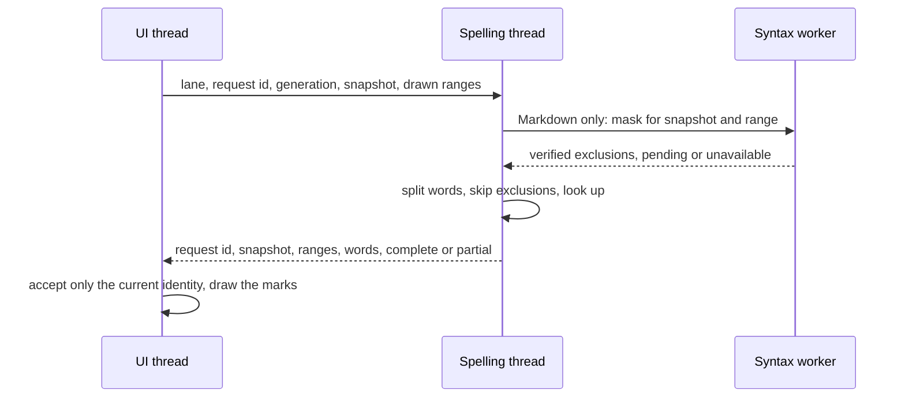

# Spelling 001

## Task

Mark misspelled English words in plain text and Markdown files, and offer
suggestions, without changing startup time or the feel of scrolling,
typing and navigating. Off by default.

This is the first iteration: English only, text and Markdown only. Code
files (comments, `camelCase` and `snake_case` splitting) come later.

Three engines can be chosen in the configuration: the built-in word list
(default), Hunspell dictionaries and the Windows Spell Checking API. Each
is allowed only if it meets the same performance criteria.

## Scope

### Included

- **Files:** Plain Text (no language) and Markdown. Other languages are not
  checked.
- **Markdown:** prose only. Skipped: code spans, fenced and indented code
  blocks, link destinations and autolinks, HTML, front matter. Exclusions
  come from verified syntax trees (see Markdown Exclusions); text whose
  structure is not verified is not checked. `--syntax none` makes the file
  plain text, which is checked as such.
- **Words:** runs of letters with inner apostrophes (`don't`); a trailing
  `'s` is dropped. Skipped: words with digits or `_`, all-capital words
  (acronyms), words longer than 64 bytes, URLs, e-mail addresses and paths
  (a token containing `://`, `@`, `/` or `\`), and words with non-ASCII
  letters that are not in the dictionary.
- **Case:** a word is correct if it, its lowercase form or (for a
  capitalized dictionary word) its capitalized form is in the dictionary.
- **Marks:** a wavy underline in a new blue theme color (`spelling`, a hint
  color, not the red of errors) under each misspelled word of the drawn
  rows; the text color is unchanged. Drawn by a new display-list item that
  fills a repeating pixel pattern under the marked width (DPI scaled), so
  its cost grows only with the marked width. With the caret on a
  misspelled word the status line shows `Spelling: recieve (Ctrl+.)`.
- **Engines (`spelling.engine`):**
  - `builtin` (default): US English from SCOWL (size 60, `en_US`,
    inflections included), a sorted word list embedded in the executable.
  - `hunspell`: the shipped US English Hunspell dictionary
    (`Dictionaries/en_US.aff` and `en_US.dic` beside the executable, from
    the SCOWL-based `en_US` release, license kept), read with the
    pure-Rust `spellbook` crate. `spelling.hunspell` (a base path relative
    to the executable) can point to another `.aff` / `.dic` pair.
  - `windows`: the Windows Spell Checking API (`ISpellChecker`) for
    `en-US`, when that language is installed.
  - An engine that cannot start (missing or invalid files, `en-US` not
    installed, COM failure) is reported once and `builtin` is used.
- **User dictionary:** `UserSettings/Spelling/en_US.txt`, one word per line,
  at most 64 KiB and 10,000 words, shared by all engines. Ignored words last
  for the session. Engines never write their own dictionaries.
- **Interaction:** the Spelling palette and keys (see Design).
- **Configuration:** `spelling.enabled` (default `false`),
  `spelling.engine` (`builtin`, `hunspell`, `windows`; default `builtin`),
  `spelling.hunspell` (default `Dictionaries/en_US`).
- **Command line:** `--spelling off|builtin|hunspell|windows` overrides
  both for the session (also used by the benchmarks).

### Excluded

- Other languages and a `spelling.language` key.
- The Windows API's own add and ignore lists.
- Code files: comments, strings, identifier splitting (later iteration).
- A right-click menu and a hover balloon (see Alternatives).
- Auto-correct while typing.
- A count of all misspellings in the file.

### Compatibility Constraints

- New configuration keys and command IDs only; existing ones unchanged.
- Mutable state only under `UserSettings`; no Registry writes. The Windows
  engine never calls `ISpellChecker::Add` or `Ignore` (they write the
  user's Windows dictionary).
- The import table of the executable is unchanged: COM is loaded at run
  time on the spelling thread (`cargo xtask check-imports`).
- Disabled: no thread, no dictionary access, no file I/O, no timers.

## Design

### Ownership

- **`rte_spell` (new core crate):** word splitting, the `Speller` trait
  (`check(word)`, `suggest(word, max)`), the built-in engine, the Hunspell
  engine (`spellbook`), the suggestion generator, user dictionary parsing.
  No threads, no Win32.
- **`rte_platform/src/spell.rs`:** the Windows engine: run-time loaded COM,
  minimal `ISpellCheckerFactory`, `ISpellChecker`, `IEnumSpellingError` and
  `IEnumString` vtables (the only new `unsafe`, kept there like the rest of
  the Win32 code).
- **`rte_app/src/spelling.rs`:** the UI handle (marks of the visible rows,
  requests, replies) and the spelling thread, which picks the engine.
  Created on first need, like `Syntax`.
- **Words:** `xtask spelling-words` builds the sorted list from a pinned
  SCOWL release into `crates/rte_spell/words/en_US.txt` (committed,
  license kept), as the syntax queries are generated today.

### Data Flow



#### Identity

A reply is accepted only when all of these still hold on the UI thread:

- **Text:** the request's `Snapshot` is the current one (`same_tree`, the
  tree identity), not only an equal `Rev` (undo then a different edit can
  repeat a `Rev`).
- **Generation:** the spelling generation is unchanged. It increases on
  Toggle Spelling, a language change, an engine fallback, Add to
  Dictionary, Ignore, and a new authoritative syntax result for Markdown.
- **Request:** the request id is the latest of its lane.

Marks carry their range and word. After an edit, marks the edit touches
are dropped and the others are shifted as provisional display; a reply
for the new text replaces them. Replace, Add to Dictionary and Ignore
revalidate on the UI thread that the range still holds the same word in
the current text and is still the palette's target; otherwise they change
nothing and show a notice. A late suggestion or navigation reply never
edits or moves the caret on its own.

#### Lanes

Three request lanes, each holding at most one pending request (a newer one
replaces it), served in priority order:

1. **Suggest:** the word of an open Spelling palette.
2. **Marks:** the drawn ranges of the visible rows.
3. **Navigate:** an `F8` / `Shift+F8` scan, run in slices.

A higher lane preempts navigation between slices; the scan keeps its
progress. The thread blocks on its channel when idle (no wake-ups).

#### Markdown Exclusions

The syntax worker owns the trees, so it answers exclusion requests:

- A request carries the spelling thread's snapshot and a byte range (at
  most 256 KiB). The worker answers `Verified(excluded ranges)` only when
  its host tree is the full-file parse of that same snapshot; the inline
  elements of the range are parsed on demand for the answer. While its
  text or full parse is behind, the request waits on the worker; a newer
  snapshot answers it `Stale`.
- Unavailable (no exclusions, no marks, one notice): the file is above
  `syntax.maxFileMiB`, highlighting is toggled off, or
  `syntax.injections: false`. Text with unknown structure is never
  treated as verified prose.
- A new authoritative syntax result (for example the full tree replacing
  a window) increases the spelling generation and resubmits the Marks
  lane, even without a text or view change.
- Navigation asks for the exclusions of each slice the same way, so it
  never checks offscreen code or links.

#### Bounds

- **Marks request:** the drawn byte ranges of the visible rows only (the
  horizontally scrolled part of a long line, not its undrawn prefix); at
  most 256 KiB and 16,384 words per request and 4,096 marks per reply.
  Beyond that the reply is `Partial` and the UI requests the rest; partial
  coverage is never reported as a complete, clean view.
- **Cache:** at most 65,536 words and 4 MiB; cleared when the generation
  changes.
- **Retained snapshots:** one pending request per lane plus the running
  one.
- **UI work:** proportional to the marks drawn and the marks shifted per
  edit (at most 4,096 each).

### Engines

Every engine runs only on the spelling thread and is created there on its
first request, after the first frame. The UI never calls an engine. Word
splitting, skipping, the user dictionary, ignored words and a bounded cache
of checked words sit in front of every engine, so all three see the same
words and apply the same user overrides; their dictionary verdicts can
differ (SCOWL, Hunspell rules, the installed Windows provider). Repeated
words cost one cache hit.

The `Speller` contract: `check(word)` and `suggest(word, max, deadline)`
return a result or an engine error. Deadlines are cooperative: they are
checked between engine calls, and a native call (`ISpellChecker::Check`,
`Suggest`) cannot be interrupted. Late results are rejected by their
request id. An engine error at run time disables that engine for the
session: one notice, `builtin` takes over, and the lanes are resubmitted.

- **`builtin`:** the word list is embedded (`include_str!`): its pages load
  only when read, and the executable grows by about 0.5 MiB. The thread
  builds an offset index (one pass, about 1 ms, about 0.2 MiB) and looks
  words up by binary search.
- **`hunspell`:** the thread reads `<base>.aff` and `<base>.dic` (at most
  16 MiB together) and builds a `spellbook` dictionary. Loading is expected
  in the tens of milliseconds and a few MiB, measured at implementation.
  Marks appear when it is ready.
- **`windows`:** the thread loads `ole32.dll` from System32 at run time
  (`LoadLibraryExW`), initializes COM (multithreaded), creates the
  `SpellCheckerFactory`, checks `IsSupported("en-US")` and creates the
  checker. Words are checked one by one (`Check`), behind the cache. Only
  `Check` and `Suggest` are called. COM is released and uninitialized when
  the thread ends.

### Suggestions

- `builtin`: edit distance 1 (deletion, transposition, replacement,
  insertion of `a-z` and `'`), then distance 2 within a 20 ms budget.
- `hunspell`: `spellbook`'s suggestions when the pinned version has them,
  otherwise the same generator over its `check`.
- `windows`: `ISpellChecker::Suggest`.
- At most 8, closest first, in the case of the word; computed on the thread
  when the palette asks.

### Interaction

The Command Palette is reused: no new popup type, keyboard first, mouse
works as today. Accepted by the user, with the three points below
(suggestions first, status line hint, Next/Previous instead of a whole-file
scan).

- **`Ctrl+.` (Spelling: Show Suggestions)** opens the palette in a Spelling
  mode for the misspelled word at the caret, or the only selection when it
  is exactly one misspelled word:
  - Suggestions first, the best one selected, so `Ctrl+.`, `Enter` fixes
    the word (one undo step). Then the commands: Add to Dictionary, Ignore,
    Next Misspelling, Previous Misspelling.
  - Elsewhere it lists only the commands.
- **`F8` / `Shift+F8` (Spelling: Next / Previous Misspelling)** select the
  next or previous misspelled word, wrapping, as VS Code's next problem.
  See Navigation.
- **Status line:** with the caret on a misspelled word it shows
  `Spelling: recieve (Ctrl+.)`.
- **View: Toggle Spelling** in the palette, for the session.

| Command                         | ID                           | Key        |
| ------------------------------- | ---------------------------- | ---------- |
| Spelling: Show Suggestions      | `royi.spellingSuggestions`   | `Ctrl+.`   |
| Spelling: Next Misspelling      | `royi.nextMisspelling`       | `F8`       |
| Spelling: Previous Misspelling  | `royi.previousMisspelling`   | `Shift+F8` |
| Spelling: Add to Dictionary     | `royi.addToDictionary`       | None       |
| Spelling: Ignore Word           | `royi.ignoreWord`            | None       |
| View: Toggle Spelling           | `royi.toggleSpelling`        | None       |

### Navigation

- A scan is a cursor on the thread: request id, snapshot, direction,
  origin (the caret), position, scanned bytes and whether it wrapped.
- It runs in slices of at most 256 KiB or 2 ms, each extended to a word
  boundary so no word is split; higher lanes run between slices.
- Outcomes: **Found** (range and word: the UI revalidates and selects it),
  **Pending** (after 200 ms the status line shows the progress),
  **Exhausted** (one full wrap without another misspelling: "No other
  misspellings"), **Cancelled** (an edit, Toggle Spelling or a language
  change: the status is cleared). Cancelled is never shown as "none".
- `F8` again while a scan runs continues it; the other direction replaces
  it. A misspelling at the caret is skipped once; when it is the only one,
  the scan wraps to it and reports "No other misspellings". An empty
  document is Exhausted at once.
- Markdown slices wait for verified exclusions; the scan stays Pending
  meanwhile.

### Threading

One spelling thread per session, started the first time spelling is on for
a plain text or Markdown file. It owns the engine, the user dictionary and
the cache, and reads the user dictionary when it starts. Editor, document
and view state stay on the UI thread. Changing the engine needs a restart
(the configuration is read once).

### Persistence

Add to Dictionary updates the UI's copy at once. The thread then runs one
transaction through a fakeable storage boundary like `favorites::Storage`:

1. Read the file (bounded) and validate it.
2. Merge: the union of the file's words, earlier additions and the new
   word. The list only grows in v1, so a union never loses a word.
3. Check the limits on the encoded result (64 KiB, 10,000 words); over
   them, the word stays for the session with a notice, and the file is
   unchanged.
4. Write a sibling temporary file and rename it over the file.
5. Re-read and verify that every merged word is there; if another writer
   replaced the file meanwhile, repeat from 1, at most three times, then
   report and keep the word for the session.

An unreadable or invalid file is never written; additions then last for
the session. Additions made before the first read are applied after it.
Add and Ignore increase the generation, clearing the cache and resubmitting
the Marks lane.

### Failure Behavior

- Thread start failure: spelling is off for the session, with a notice.
- An engine that fails to start (missing, too large or invalid Hunspell
  files; `en-US` not installed; a COM error) or fails at run time: one
  notice naming the reason, then `builtin`.
- Budgets are cooperative; a reply past its budget is `Partial` or
  `Pending`, never an empty "no misspellings" answer.

## Alternatives

- **Right-click menu:** no context menu exists; it needs a new popup type
  and is mouse only. Rejected for v1.
- **Hover balloon (VS Code):** needs hover tracking over the text and a
  clickable popup; mouse first. Rejected for v1. The status line hint gives
  the discoverability.
- **Commands first, suggestions below:** puts the likely action two keys
  away. Suggestions first make the common fix `Ctrl+.`, `Enter`.
- **Hunspell as the default:** good suggestions, but loading takes tens of
  ms and a few MiB on every first use; kept as an option.
- **Windows API as the default:** no files to ship, but results depend on
  the installed languages and Windows version; kept as an option.
- **The `windows` crate for COM:** a large dependency and static imports
  (`ole32.dll` loaded at every start). Rejected for a few hand-written
  vtables and run-time loading.
- **Batch checks with the Windows API (`Check` on a whole row):** fewer COM
  calls, but its word rules would differ from the other engines and bypass
  the cache. Rejected for v1; revisit if measurements need it.
- **`fst` crate:** zero-build lookup and Levenshtein search, at the cost of
  a dependency and a build step; the embedded sorted list needs neither.
- **Windows Spell Checking API through its own dictionary:** `Add` and
  `Ignore` write the user's Windows dictionary outside `UserSettings`;
  the shared user dictionary is used instead.
- **Checking the whole file:** cost grows with file size; the visible rows
  bound the work.
- **Sending the UI's syntax `View` to the spelling thread:** its positions
  follow edits but its structure can be older, and inline trees exist only
  around the view. Rejected for exclusions answered by the syntax worker
  from a verified full parse.
- **`Rev` as the reply identity:** an undo and a different edit can repeat
  a `Rev`. Rejected for the snapshot's tree identity plus generation and
  request ids.

## Runtime Effects

- **Startup:** none, enabled or not, for every engine. The import table is
  unchanged; no engine is touched before the first frame.
- **Disabled:** a flag check per frame; no thread, no I/O, no memory.
- **Enabled:**

  | Engine     | Start on the thread     | Memory                 | Per new word                   |
  | ---------- | ----------------------- | ---------------------- | ------------------------------ |
  | `builtin`  | About 1 ms (index)      | About 0.2 MiB          | Binary search, well below 1 µs |
  | `hunspell` | Tens of ms (to measure) | A few MiB (to measure) | Affix rules, a few µs          |
  | `windows`  | COM and facility load   | System DLLs, a few MiB | One COM call (to measure)      |

  Repeated words are cache hits for all engines. The UI cost is the same
  for all: a request per change of the visible rows and drawing the marks.
- **Executable:** about 0.5 MiB larger (the word list) plus `spellbook`.
- **Package:** the Hunspell files beside the executable (about 0.6 MiB,
  less in the ZIP). They are read only by the spelling thread with
  `spelling.engine: hunspell`, never at startup.
- **Cancellation:** one pending request per lane; scans stop on an edit,
  Toggle Spelling or a language change; replies of an old identity are
  dropped. Native engine calls finish before a cancellation is seen.

## Tests

### Unit

- **`rte_spell` front end (same for every engine):** word splitting
  (apostrophes, `'s`, digits, `_`, capitals, URLs, paths, non-ASCII), case
  rules, user dictionary and ignore overrides, cache bounds.
- **Engine verdicts (separately per engine):** built-in lookup and
  suggestions (distance 1 and 2, deadline, case); Hunspell with a small
  test `.aff` / `.dic` pair (affixes, case, suggestions, size limit,
  invalid files); a slow and an erroring fake engine (cooperative deadline,
  late results rejected, fallback).
- **Persistence (fake storage):** an external change between load and Add,
  overlapping writers, additions at the byte and word limits, duplicates,
  Add before the first read, write and rename failures; no successful Add
  loses a word or leaves an over-limit file.
- **Windows engine (native, `rte_platform`):** check and suggest for
  `en-US`, no `Add` or `Ignore` calls, COM objects released and
  uninitialized. When `en-US` is not installed the test is skipped with a
  printed reason; a skip does not admit the engine.

### Headless editor (`Ctx::headless`)

- Default off: no spelling thread, no dictionary or user dictionary I/O,
  no marks.
- Plain text gets marks after a wake; a code file gets none.
- **Identity:** branch A, undo, branch B with an equal `Rev`; two Marks
  requests answered in reverse order; caret moves and palette reopen
  before suggestions arrive; Add or Ignore while a lookup runs; Toggle
  Spelling or a language change before a reply. None restores old marks,
  moves the caret or edits the wrong word.
- **Markdown:** opening before the first syntax reply (no marks until
  verified); a large file whose window starts inside a fenced block;
  editing a fence or a backtick, then checking at once; a syntax-only
  update with the same text and view; `F8` meeting offscreen inline code
  and links; `syntax.injections: false`; a file above `syntax.maxFileMiB`.
  Excluded text is never marked at any point.
- **Navigation:** the first misspelling several slices away; a large
  correct file (Exhausted); reverse scans; a word across a slice boundary;
  a single misspelling at the caret; an empty file; viewport, navigation
  and suggestion requests interleaved while typing and scrolling. Each
  scan finds, reports Exhausted or reports why it was cancelled.
- **Bounds:** dense long rows, many distinct new words, a horizontally
  scrolled long line, saturated cache and lanes, toggling off during
  checks and suggestions; retained data and UI work stay within the
  declared limits, and partial coverage is never shown as complete.
- `Ctrl+.` lists suggestions first; `Enter` replaces the word in one undo
  step after revalidation.
- An engine that fails at start or at run time reports once and falls
  back to `builtin`.

### Package

The ZIP contains `Dictionaries/en_US.aff`, `en_US.dic` and their license
with pinned hashes; the default `spelling.hunspell` finds them in the
packaged layout.

### Performance

New v1 benchmark tests (v1 is still open), each run with
`--spelling builtin`, `hunspell` and `windows`:

| ID  | Test                                   | Fixture                    | Measure                                       |
| --- | -------------------------------------- | -------------------------- | --------------------------------------------- |
| P01 | Scroll and jump, prose                 | `spell.txt`, 1 MiB         | Key to presented complete marks, p95 / max    |
| P02 | Scroll and jump, Markdown              | `spell.md`, 1 MiB          | Same, with exclusions                         |
| P03 | Scroll a dense long line sideways      | `spell-dense.txt`          | Same, and missed refreshes                    |
| P04 | `F8` to a misspelling 4 MiB ahead      | `spell-far.txt`            | Key to selection; UI frame p95 while scanning |
| P05 | `Ctrl+.` on a misspelled word          | `spell.txt`                | Key to palette with suggestions               |
| P06 | First marks after start (cold)         | `spell.txt`                | First paint to first complete marks           |

- Fixtures: generated prose with about 2 % misspellings, new and repeated
  words; the Markdown one adds code spans, fences, links and HTML.
- Paced tests (P01-P03) use the 140 scroll keys of S01-S03; a key counts
  only when its presented frame shows complete marks for its identity.
  Keys never marked within 1 s are counted and reported, never dropped.
- Warm runs follow one warm-up; P06 uses 20 fresh processes.
- The pinned SCOWL and Hunspell dictionary releases, the `spellbook`
  version and the Windows build are recorded with the results.

### Commands

```powershell
cargo test -p rte_spell
cargo test -p rte_platform spell
cargo test -p rte_app spelling
cargo xtask check-imports
cargo xtask package
cargo xtask bench-perf --only L01,L02,L07,S01,S02
cargo xtask bench-perf --only P01,P02,P03,P04,P05,P06
```

## Implementation Steps

1. `xtask spelling-words` and the committed `en_US` list with its license.
2. `rte_spell`: words, `Speller`, built-in engine, suggestions, user
   dictionary parsing; unit tests.
3. `spelling.rs`: thread, lanes, identity and generation, bounds, marks of
   the drawn ranges; configuration keys, `--spelling` and the toggle; marks
   drawn in `rte_view`.
4. Markdown exclusions answered by the syntax worker from a verified full
   parse; resubmission on new syntax results.
5. Spelling palette mode, `Ctrl+.`, status hint, Add to Dictionary and
   Ignore with the persistence transaction.
6. `F8` / `Shift+F8` resumable scans.
7. Hunspell engine (`spellbook`, license recorded), the shipped `en_US`
   dictionary (pinned release and hashes, fetched or committed like the
   fonts, added by `xtask package`) and its fallback.
8. Windows engine in `rte_platform`; confirm the import table.
9. Benchmarks P01-P06 and the A/B runs; admission of each engine against
   the criteria, recorded per engine.
10. Documentation (README, shortcuts, configuration, command line),
    CHANGELOG.

Steps 7 and 8 are kept only if their measurements meet the acceptance
criteria; otherwise the engine is left out and the reason recorded. The
criteria are strict and are not relaxed to admit an engine (user decision).

## Acceptance Criteria

- **Spelling off:** nothing spelling-related runs (no thread, no I/O).
  Against the previous release, A/B with 20 interleaved launches each:
  first paint of L01, L02 and L07 within 1 ms (median) and peak private
  memory within 0.2 MiB; S01 and S02 without missed refreshes and their
  p95 within 1 ms.
- **Spelling on, for every admitted engine:** the same first-paint rule;
  S01, S02 and P01-P03 without missed refreshes and with no unmarked key;
  no new DLL in the import table.
- **Marks latency (warm, p95, P01-P03):** `builtin` within two refresh
  periods as reported by DWM (33.3 ms at 60 Hz); `hunspell` and `windows`
  within 50 ms. P04-P06 are reported; while P04 scans, the UI frame p95
  stays within one refresh period.
- An engine is admitted only by a measured pass on the reference machine;
  a skipped test is not a pass. Estimates in this plan are not results.
- Misspelled words in the visible rows of plain text and Markdown prose are
  marked; Markdown code, links and HTML are never marked, also while the
  syntax is pending.
- `Ctrl+.`, `Enter` fixes a word in one undo step; Add to Dictionary
  persists under `UserSettings`; `F8` / `Shift+F8` move between
  misspellings.
- Code files are never checked.
- The package ships the Hunspell `en_US` dictionary with its license.

## Reviewers

### 2026_10_30 - Claude Opus 5.5

- Role: Reviewer
- Activity: Design
- Agent: GitHub Copilot
- Model: Claude Opus 5.5
- Effort: High
- Context Window: 872K
- Outcome: Design drafted with the user: English only, plain text and
  Markdown, off by default, visible rows only on a dedicated thread.
  Interaction through the Command Palette (`Ctrl+.`, `F8`) recommended over
  a right-click menu or a balloon; awaiting the user's confirmation.

### 2026_10_30 - Claude Opus 5.5

- Role: Reviewer
- Activity: Review
- Agent: GitHub Copilot
- Model: Claude Opus 5.5
- Effort: High
- Context Window: 872K
- Outcome: User accepted the palette interaction, suggestions first, the
  status line hint and Next/Previous instead of a whole-file scan. Added
  selectable engines at the user's request: `builtin` (default),
  `hunspell` (`spellbook`, user-supplied files) and `windows`
  (`ISpellChecker`, run-time loaded COM, no `Add`/`Ignore`). All run on the
  spelling thread after the first frame behind one cache; each is kept only
  if it meets the acceptance criteria, with a fallback to `builtin`.

### 2026_10_30 - Claude Opus 5.5

- Role: Reviewer
- Activity: Review
- Agent: GitHub Copilot
- Model: Claude Opus 5.5
- Effort: High
- Context Window: 872K
- Outcome: User decisions: the Hunspell `en_US` dictionary is shipped in
  the package (`Dictionaries/`, license and pinned hashes; read only by the
  spelling thread), and the performance criteria stay strict: an engine
  that does not meet them is left out, not admitted with relaxed criteria.

## Sol Design Review

### 2026_10_30 - GPT-6.1 Sol

- Role: Reviewer
- Activity: Review
- Agent: GitHub Copilot
- Model: GPT-6.1 Sol
- Effort: High
- Context Window: 1M
- Outcome: Changes requested before implementation. Request identity and
  Markdown exclusion authority need explicit contracts; findings below
  describe the required design and regression coverage. Review only: no
  application implementation or dependency changes.

### SP001R1 [P1] A revision alone cannot authorize replies or replacements

The Data Flow rejects only old revisions. The current text engine's
[`Snapshot::rev`](../crates/rte_text/src/snapshot.rs#L50) increments along a
snapshot branch: undo followed by a different edit can produce the same
revision with different text. Scrolling, moving the caret, changing the
language/highlighting state, Add/Ignore and closing/reopening the palette
also do not necessarily change the document revision.

Define the reply identity before implementation: an actual snapshot identity
or monotonic editor text sequence, a spelling-service generation, and
request/purpose identities for viewport marks, navigation and suggestions.
Include dictionary/ignore state and syntax coverage generations wherever
they affect an answer. Retain the checked word and range, and revalidate
them on the UI thread before replacement or Add/Ignore; do not make a late
suggestion or navigation result authoritative just because its revision
matches. Mapped marks may be provisional display data, not replacement
authority; discard marks intersected by an edit rather than mapping a
changed word as if it were still misspelled.

Required checks: branch A -> undo -> branch B with equal `Rev`; two requests
of one purpose in the same snapshot answered in reverse order; caret/query
changes and palette reopen before suggestions arrive; Add/Ignore while a
lookup is in flight; and toggling spelling or changing language before a
reply. None may restore obsolete marks, move the caret or edit the wrong
word.

### SP001R2 [P1] The current syntax view is not a complete Markdown mask

The plan sends a clone of the current `View` and requests new work only for
text/viewport changes. The current
[`Syntax::view`](../crates/rte_app/src/syntax.rs#L466) can have edited positions
but older structure; [`final_view`](../crates/rte_app/src/syntax.rs#L454)
separately checks final coverage. Markdown inline trees are injected only
around the interest range, and large-file windows can lack preceding
context. A host block tree alone does not identify inline code spans or
link destinations. A later parse can change exclusions without any text
or viewport change, so the proposed scheduling may leave incorrect marks
unchanged. F8 scans beyond the viewport, where those injected trees may
not exist at all.

Specify a worker-safe exclusion API/data representation with snapshot,
syntax generation and verified coverage. On a new authoritative syntax
result, resubmit affected spelling work. Define behavior while syntax is
pending, absent because of `syntax.maxFileMiB`, or disabled by
`syntax.injections: false`; do not silently treat an unknown region as
verified prose. Keep the approved `--syntax none` plain-text behavior as
an explicit exception, not the fallback for every incomplete tree. Give
F8 its own coverage strategy, such as bounded worker-side Markdown parsing
of each scanned region, or pausing until exclusions for that region are
known without waiting on the UI thread.

Required checks: opening Markdown before the first syntax reply; scrolling
into a window starting inside a fenced block; editing a fence or backtick
then immediately checking; a syntax-only update with unchanged text/view;
F8 encountering offscreen inline code/links; injections off; and a file
above the syntax limit. Verify excluded text stays excluded rather than
merely eventually acquiring plausible colors.

### SP001R3 [P1] Budgeted navigation needs continuation and completion state

The Failure Behavior returns partial work after a budget, but F8 must find
the next misspelling anywhere in the snapshot and wrap correctly. If a
budget expires before a hit, an empty partial result is not proof that no
misspelling exists. Restarting each F8 from the unchanged caret can inspect
the same prefix indefinitely and never reach a later misspelling. One
undifferentiated latest-request slot can also let a viewport request discard
an explicit navigation or suggestion request.

Define separate request purposes and scheduling priorities, with a resumable
navigation cursor carrying direction, origin, scanned coverage and wrap
state. Distinguish found, partial/pending, exhausted and cancelled. Continue
bounded chunks until a hit, one complete wrap, or a superseding user intent;
do not equate cancellation with an exact empty result. Ensure interactive
suggestions and fresh viewport work can preempt scanning without losing its
valid progress. The existing
[`search` worker](../crates/rte_app/src/search.rs#L1) already demonstrates
purpose-specific generations and snapshot-tagged outcomes.

Required checks: the first misspelling beyond several work slices; a large
correct file; reverse scans; a word crossing a chunk boundary; wrap once
with single-hit and empty-file behavior defined; and interleaved viewport/navigation/
suggestion requests while typing or scrolling. Each retained navigation
must make progress or report explicitly why it was superseded.

### SP001R4 [P2] Per-row bounds do not bound the complete spelling pipeline

The 64 KiB row cap and eight-suggestion result cap do not bound work, queued
snapshots, candidate generation, returned marks or UI remapping/drawing.
For illustration, 50 rows of 64 KiB containing three-byte tokens allow
about 1.09 million candidate marks: 16-byte ranges alone occupy 16.67 MiB.
This is a cost model, not a measured runtime result. The current search
worker has an explicit `MAX_VIEW_MATCHES`; spelling needs its own declared
whole-request policy rather than borrowing only search's row-byte cap.

Specify total bytes/words per slice, mark-count/result-byte limits, cache
entries/bytes, queued snapshot bounds and bounded UI work. Prefer actual
drawn spans, including the current editor's long-line tail when horizontally
scrolled, over checking large undrawn prefixes. Define partial coverage and
how it completes; never present truncated work as a complete clean view.

The `Speller` contract also needs cancellation/deadline and partial/error
semantics across the whole suggestion pipeline, not just the distance-2
loop. Microsoft's documented
[`Check`](https://learn.microsoft.com/en-us/windows/win32/api/spellcheck/nf-spellcheck-ispellchecker-check)
and
[`Suggest`](https://learn.microsoft.com/en-us/windows/win32/api/spellcheck/nf-spellcheck-ispellchecker-suggest)
signatures expose no timeout or cancellation parameter. Checks around a
native call cannot interrupt that call. State this cooperative boundary,
define late-result rejection and runtime engine-error handling, and admit
an engine only after its complete check/suggest path meets the approved
gates. Do not claim a hard 20 ms bound merely because a timer is checked
after a synchronous engine call.

Required checks: dense long rows, many distinct unseen words, long-line
horizontal scrolling, saturated caches/queues, a slow/erroring fake engine,
and toggling off during checking or suggestions. Assert bounded retained
data and UI work as well as correct cancellation/partial-result handling.

### SP001R5 [P2] Atomic replacement alone does not preserve dictionary edits

Persistence currently describes appending to the worker's dictionary and
atomically replacing the file. A file changed since the startup read can
therefore be overwritten, losing words added externally or by another
independent editor process. Atomic replacement prevents torn files; it does
not merge changes or serialize read/modify/write transactions. The plan
also needs to say what happens when an addition itself would exceed the
64 KiB/10,000-word limits, not only when the initial file is too large.

Define a bounded re-read/validate/merge/write transaction and an explicit
file-level conflict policy, without session discovery or IPC. Reject or
retry conflicting writes rather than overwriting unknown newer content.
Enforce limits on the encoded result before replacing it, keep invalid or
unreadable files untouched, and report persistence failure while retaining
the approved session-only word. Apply additions arriving during the initial
load after that load, and invalidate cached results for Add/Ignore.
[`favorites::Storage`](../crates/rte_app/src/favorites.rs#L57) offers an
existing fakeable bounded-read/atomic-write boundary to reuse; its re-read
pattern is useful, but is not by itself a simultaneous-writer guarantee.

Required checks: an external change between load and Add; overlapping
writes; additions at each byte/word cap; duplicate words; Add before the
initial read replies; and write/rename failure. No successful Add may
silently delete existing valid words or leave an over-limit dictionary.

### SP001R6 [P2] The performance gate needs reproducible spelling metrics

The listed L02/L07 and S01/S02 fixtures exercise existing load/scroll paths;
they do not yet define a spelling request-to-presented-marks measurement.
The plan does not specify samples, baseline/noise tolerance, refresh-rate
interpretation of two frames, cold versus warm dictionaries/caches, or how
superseded and missing results count. Measuring only completed fast replies
can pass p95 while useful requests are repeatedly cancelled or never shown.

Define reference fixtures with new and repeated words, Markdown exclusions
and dense/long rows; baseline version/configuration; cold and warm runs;
sample counts; and numeric pass/fail rules. End latency at presentation of
marks matching the request identity and coverage, not worker completion.
Report cancelled/missing results and navigation/suggestion latency separately.
A skipped native Windows test is not evidence that the Windows engine met
its admission gate. Treat executable/index size and load-time estimates as
estimates until measured, and record the pinned dictionary artifacts and
engine versions used for the gate.

Add the exact focused unit, headless, package and benchmark commands to
Tests before implementation is accepted. Include failure/fallback paths,
default-off startup/I/O assertions and native COM/resource cleanup. Keep
the user's strict engine-admission decision; do not lower thresholds to
accommodate an engine.

### Clarification

The common front end can guarantee consistent tokenization, skipping and
user overrides, not identical dictionary verdicts from SCOWL, Hunspell and
the installed Windows provider. Clarify that wording in Engines and test
engine-specific verdicts separately from front-end conformance and fallback.

### Review Validation

- Reviewed the plan against current snapshot identity, syntax coverage,
  visible-range, search-request and preference-persistence abstractions.
  Verified the Windows `Check`/`Suggest` signatures against Microsoft Learn.
- Original plan/reviewer bytes are preserved; append validation checks
  finding IDs, metadata, local links/line anchors and whitespace. Application
  source fingerprints are compared before completing the review.
- The dense-row calculation used a controlled PowerShell arithmetic check;
  no spelling performance, memory or backend timing was measured.
- No application tests, full suites, benchmarks, dictionary installs or
  implementation changes were run for this documentation-only design review.

## Sol Review Response

### 2026_10_30 - Claude Opus 5.5

All findings accepted; the design sections above are revised.

- **SP001R1:** Identity (Data Flow): the snapshot's tree identity, a
  spelling generation and per-lane request ids; marks carry word and
  range; marks touched by an edit are dropped; Replace, Add and Ignore
  revalidate on the UI thread. Tests listed under Headless editor,
  Identity.
- **SP001R2:** Markdown Exclusions: the syntax worker answers for a
  snapshot and range only from a verified full parse, parsing inline
  elements on demand; pending text is not checked; unavailable above
  `syntax.maxFileMiB`, with highlighting toggled off or with injections
  off; new syntax results resubmit the Marks lane; navigation asks per
  slice. The UI `View` is no longer sent (Alternatives).
- **SP001R3:** Lanes (Suggest, Marks, Navigate) and Navigation: a
  resumable cursor in bounded slices, outcomes Found, Pending, Exhausted
  and Cancelled, defined behavior for `F8` repeats, a single hit and an
  empty file.
- **SP001R4:** Bounds (drawn ranges only, per-request byte, word and mark
  limits, `Partial` replies, cache and snapshot limits) and the `Speller`
  contract (cooperative deadlines, uninterruptible native calls, late
  results rejected, run-time engine errors fall back).
- **SP001R5:** Persistence: a bounded read, union merge, limits checked on
  the encoded result, temporary file and rename, re-read verification with
  at most three retries; failures keep the word for the session.
- **SP001R6:** Performance: P01-P06 with fixtures, cold and warm runs,
  presented-marks latency with unmarked keys counted, A/B rule for the
  disabled path, numeric thresholds, recorded artifact versions, exact
  commands; a skipped native test does not admit an engine. The strict
  criteria are unchanged.
- **Clarification:** Engines now states that the front end makes words and
  overrides consistent while verdicts may differ; front-end and engine
  verdict tests are separate.

Open with the user: the visual style of the mark (Scope, Marks). Resolved:
the user chose a wavy blue underline and the status line hint.

### Reviewers

#### 2026_10_30 - Claude Opus 5.5

- Role: Reviewer
- Activity: Review
- Agent: GitHub Copilot
- Model: Claude Opus 5.5
- Effort: High
- Context Window: 872K
- Outcome: Accepted SP001R1-R6 and the clarification; design revised in
  place (identity, lanes, verified Markdown exclusions from the syntax
  worker, resumable navigation, bounds, persistence transaction, P01-P06
  metrics). Ready for re-review once the mark style is chosen.

#### 2026_10_30 - Claude Opus 5.5

- Role: Reviewer
- Activity: Review
- Agent: GitHub Copilot
- Model: Claude Opus 5.5
- Effort: High
- Context Window: 872K
- Outcome: User chose the mark: a wavy underline in a blue `spelling`
  theme color (text color unchanged) plus the status line hint, drawn by a
  pattern display-list item. Ready for re-review.
