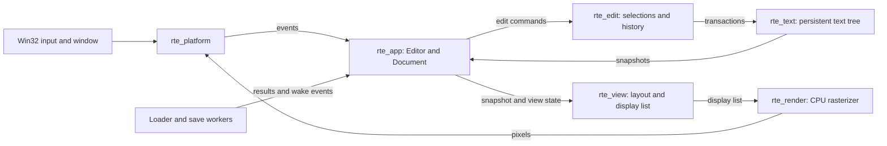

# Developer Guide

RoyiTextEditor is a Windows-first Rust application. Its core is split into
small crates so text storage, editing, layout, rendering, and operating-system
integration have clear owners.

## Architecture

The window thread owns the editor, document, selections, popups, and frame
construction. Background work returns results through channels and wakes the
window; it does not mutate UI state directly.

| Crate | Responsibility |
| --- | --- |
| `rte_text` | Persistent piece tree, immutable snapshots, line queries, transactions, position mapping, and UTF-8/UTF-16 conversion. |
| `rte_edit` | Byte-offset selections, caret motion, editing commands, clipboard data, and undo history. |
| `rte_view` | Integer-cell layout, hit-test geometry, and display lists for text and popups. |
| `rte_render` | CPU glyph rasterization, caches, clipping, and framebuffer drawing. |
| `rte_platform` | Raw Win32 window, input events, DIB presentation, clipboard, and file operations. |
| `rte_app` | Startup, command dispatch, document lifecycle, loading, saving, palette, and UI coordination. |
| `rte_assets` | Bundled default font and build-time font acquisition. |
| `xtask` | Startup and performance benchmarks, import checks, and release packaging. |

`rte_search` and `rte_syntax` appear in the architecture plan but do not exist
in the current workspace. Search, syntax parsing, multi-cursor workflows,
recovery journals, and external-change merging are not shipped features.

## Data Flow

The loader builds immutable text snapshots off the UI thread. Editing commands
produce transactions and updated snapshots; the application then rebuilds the
visible display list and rasterizes it into the window buffer. Saving writes a
temporary sibling file and uses the platform replacement path, with conflict
checks and backup handling.

Workers should receive owned or immutable data. Keep window and view state on
the UI thread, reject stale asynchronous results, and wake the window only
when there is new work to present. These boundaries are also described in the
[architecture plan](https://github.com/RoyiAvital/RoyiTextEditor/blob/main/Plan/Architecture.md).

## Build and Validation

The repository targets Windows x64 with the GNU Rust toolchain and
`x86-64-v3` CPU features. `windres` is required to embed the application
manifest and icon. Missing font assets are fetched from pinned releases and
SHA-256 verified by the `rte_assets` build script.

Run focused tests for the crate being changed. Do not run the whole workspace
suite or performance suite unless requested; see [AGENTS.md](https://github.com/RoyiAvital/RoyiTextEditor/blob/main/AGENTS.md).

| Task | Command |
| --- | --- |
| Run the editor | `cargo run --release -p rte_app -- <file>` |
| Test a crate | `cargo test -p <crate>` |
| Check formatting | `cargo fmt --all --check` |
| Run the documentation build | `./tools/Build-Docs.ps1` |
| Measure startup | `cargo xtask bench-startup` |
| Run the short performance report | `cargo xtask bench-perf --short` |
| Package a release ZIP | `cargo xtask package` |

The workspace and shipped behavior are documented in
[Plan/Architecture.md](https://github.com/RoyiAvital/RoyiTextEditor/blob/main/Plan/Architecture.md),
[DEVELOPMENT.md](https://github.com/RoyiAvital/RoyiTextEditor/blob/main/DEVELOPMENT.md),
and [AGENTS.md](https://github.com/RoyiAvital/RoyiTextEditor/blob/main/AGENTS.md).