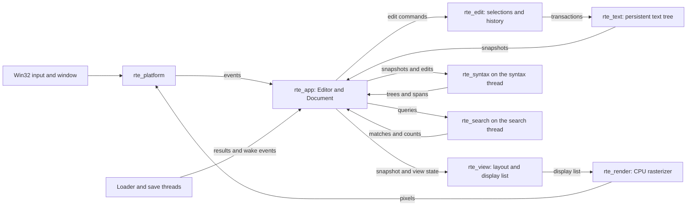
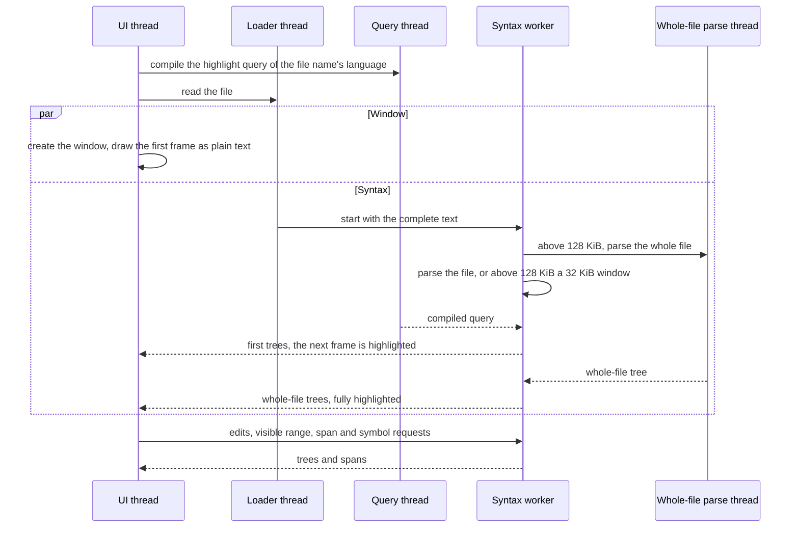

# Developer Guide

RoyiTextEditor is a Windows-first Rust application. Its core is split into
small crates so text storage, editing, layout, rendering, and operating-system
integration have clear owners.

## Architecture

The window thread owns the editor, document, selections, popups, and frame
construction. Background threads (loading, saving, search, syntax) receive
immutable snapshots, return results through channels and wake the window;
they do not mutate UI state directly.

| Crate          | Responsibility                                                                                                                                                                                                                                                         |
| -------------- | ---------------------------------------------------------------------------------------------------------------------------------------------------------------------------------------------------------------------------------------------------------------------- |
| `rte_text`     | Persistent piece tree, immutable snapshots, line queries, transactions, position mapping, and UTF-8/UTF-16 conversion.                                                                                                                                                 |
| `rte_edit`     | Byte-offset selections, caret motion, editing commands (including comment, auto-closing and indentation edits), clipboard data, and undo history.                                                                                                                      |
| `rte_search`   | Literal, Glob and regular-expression search over snapshots, and replacements.                                                                                                                                                                                          |
| `rte_syntax`   | Language registry and detection, built-in tree-sitter grammars with trimmed queries (`queries/`, regenerated by `cargo xtask syntax-queries`), parsing sessions, highlight spans, injections, brackets, syntax-node selection, symbols, and the tree-sitter allocator. |
| `rte_view`     | Integer-cell layout, hit-test geometry, and display lists for text and popups.                                                                                                                                                                                         |
| `rte_render`   | CPU glyph rasterization, caches, clipping, and framebuffer drawing.                                                                                                                                                                                                    |
| `rte_platform` | Raw Win32 window, input events, DIB presentation, clipboard, and file operations.                                                                                                                                                                                      |
| `rte_app`      | Startup, command dispatch, document lifecycle, loading, saving, palette, search and syntax threads, and UI coordination.                                                                                                                                               |
| `rte_assets`   | Bundled default font and build-time font acquisition.                                                                                                                                                                                                                  |
| `xtask`        | Startup and performance benchmarks, import checks, release packaging, and query generation.                                                                                                                                                                            |

Recovery journals and external-change merging are not shipped features.

## Data Flow

The loader builds immutable text snapshots off the UI thread. Editing commands
produce transactions and updated snapshots; the application then rebuilds the
visible display list and rasterizes it into the window buffer. Each edit is
also sent to the syntax thread, which re-parses incrementally. Saving writes a
temporary sibling file and uses the platform replacement path, with conflict
checks and backup handling.

Workers should receive owned or immutable data. Keep window and view state on
the UI thread, reject stale asynchronous results, and wake the window only
when there is new work to present. These boundaries are also described in the
[architecture plan](https://github.com/RoyiAvital/RoyiTextEditor/blob/main/Plan/Architecture.md).

## Syntax Threads

Highlighting starts while the window is still being created. The work runs
in parallel on short-lived threads: in the benchmarks, files of 10,000
lines of TypeScript, Python and C are fully highlighted 36, 43 and 70 ms
after the process starts.

- The loader starts the syntax worker as soon as the text is read. The
  editor adopts that worker when the language and text match; otherwise it
  starts its own.
- The highlight query compiles on its own thread while the text parses; the
  first view waits for it.
- Files above 128 KiB parse a 32 KiB window around the view first. The whole
  file parses at the same time on its own thread; edits made meanwhile are
  applied to its tree when it arrives, and it is adopted before any further
  window parse.
- The UI thread never waits for these threads. It draws the visible rows
  from the latest trees within 1 ms per frame and asks the worker for the
  rest. Trees it replaces go back to the worker to be freed.

### Memory Allocation

Tree-sitter allocates its parse trees through
[mimalloc](https://github.com/microsoft/mimalloc)
(`rte_syntax::install_allocator`, an `unsafe` function called first in
`main`, before any tree-sitter object exists; a failed allocation aborts the
process). Parsing is 6-16%
faster than with the Windows heap, and Go to Symbol about 25% faster. The
rest of the application keeps the Windows heap: mimalloc there gave no
measurable gain and doubled the memory of small files.

Fast rendering with a higher memory footprint is the project owner's
design choice: when the two conflict, speed wins, within explicit limits
such as `syntax.maxFileMiB`. The parallel
threads and mimalloc's per-thread pages add 2-3 MiB to the peak memory of
small and 10,000-line files, and editing an 8 MiB file while it is still
being parsed can peak 13-20 MiB higher, because the whole-file parse no
longer pauses for the edits. In return highlighting is complete sooner, and
8 MiB files peak about 24 MiB lower. Startup memory is unchanged (5.1 MiB
for an empty file), and `--syntax none` restores the memory footprint of
0.3.0 (a 64 KiB JSON file peaks at 5.7 MiB instead of 10.7 MiB). The
design and measurements are recorded in
[Done/SyntaxPerformance.md](https://github.com/RoyiAvital/RoyiTextEditor/blob/main/Done/SyntaxPerformance.md).

## Build and Validation

The repository targets Windows x64 with the GNU Rust toolchain and
`x86-64-v3` CPU features. `windres` is required to embed the application
manifest and icon. Missing font assets are fetched from pinned releases and
SHA-256 verified by the `rte_assets` build script.

Run focused tests for the crate being changed. Do not run the whole workspace
suite or performance suite unless requested; see [AGENTS.md](https://github.com/RoyiAvital/RoyiTextEditor/blob/main/AGENTS.md).

| Task                             | Command                                    |
| -------------------------------- | ------------------------------------------ |
| Run the editor                   | `cargo run --release -p rte_app -- <file>` |
| Test a crate                     | `cargo test -p <crate>`                    |
| Check formatting                 | `cargo fmt --all --check`                  |
| Run the documentation build      | `./tools/Build-Docs.ps1`                   |
| Measure startup                  | `cargo xtask bench-startup`                |
| Run the short performance report | `cargo xtask bench-perf --short`           |
| Run selected performance tests   | `cargo xtask bench-perf --only L01,F01`    |
| Package a release ZIP            | `cargo xtask package`                      |

The workspace and shipped behavior are documented in
[Plan/Architecture.md](https://github.com/RoyiAvital/RoyiTextEditor/blob/main/Plan/Architecture.md),
[DEVELOPMENT.md](https://github.com/RoyiAvital/RoyiTextEditor/blob/main/DEVELOPMENT.md),
and [AGENTS.md](https://github.com/RoyiAvital/RoyiTextEditor/blob/main/AGENTS.md).